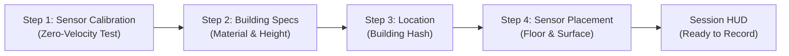
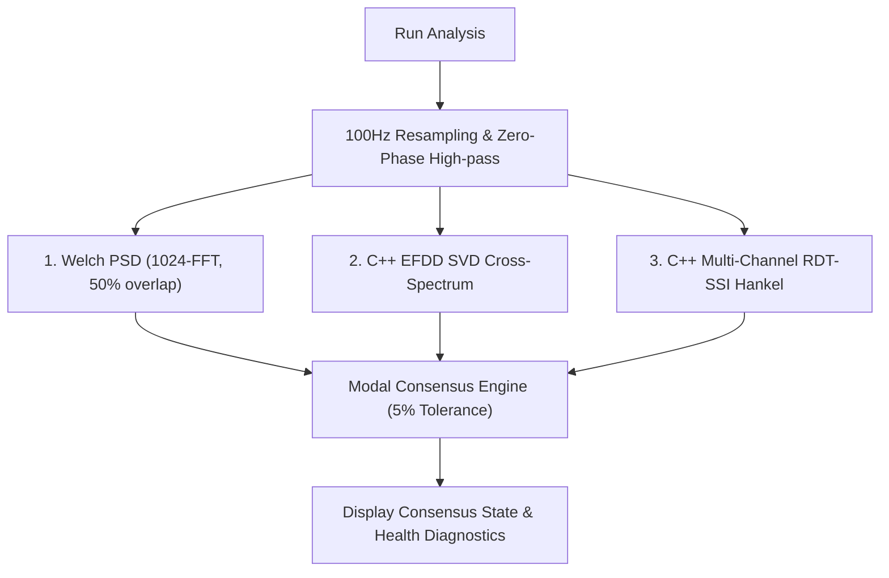

# PhoneSHM Application User Guide

## 1. Introduction & Overview

**PhoneSHM** is an open-source, sovereign, citizen-scale Android Structural Health Monitoring (SHM) platform. It allows building owners, civil engineers, researchers, and citizen scientists to monitor the structural integrity of buildings, bridges, and infrastructure using commodity Android smartphones.

This guide provides step-by-step instructions on setting up building profiles, recording ambient vibrations, executing multi-algorithm Operational Modal Analysis (OMA), and tracking longitudinal structural stiffness degradation.

---

## 2. System Requirements & Installation

### Requirements
- **Operating System**: Android 8.0 (API Level 26) or higher.
- **Hardware**: Tri-axial MEMS Accelerometer with support for $\ge 100\text{ Hz}$ sampling rate.
- **Permissions**:
  - `HIGH_SAMPLING_RATE_SENSORS`: Required on Android 12+ for 100Hz continuous sampling.
  - `FOREGROUND_SERVICE` & `WAKE_LOCK`: Ensures uninterrupted recording when screen turns off.
  - `ACCESS_FINE_LOCATION` (Optional): Used to generate localized crowdsourced building hashes.

### Installation
1. Download the latest release APK (`PhoneSHM-v1.2.0-research-grade.apk`) from [GitHub Releases](https://github.com/intellibits28/PhoneSHM/releases).
2. Tap the APK file to install (allow "Install from Unknown Sources" in Android Settings if prompted).
3. Open **PhoneSHM** from your app drawer.

---

## 3. Step-by-Step Initial Setup (Onboarding Wizard)

When launched for the first time, PhoneSHM opens a 4-step configuration wizard:



### Step 1: Device Sensor Capability Test
- Place the smartphone completely flat and motionless on a sturdy surface.
- Tap **"Start Calibration"**. The app records 3 seconds of zero-motion data to calculate:
  - Static accelerometer bias ($b_x, b_y, b_z$).
  - Estimated sensor noise floor in milli-g ($mg$).
  - Quality tier classification (`RESEARCH_GRADE`, `GOOD`, `FAIR`, `POOR`).
- Tap **"Next"** to continue.

### Step 2: Building Characteristics
Enter the structural parameters of the target building:
- **Building Display Name**: A friendly name (e.g. `City Hall Main Tower`).
- **Primary Material**: Select one of the supported archetypes:
  - `Reinforced Concrete (RC)`
  - `Moment-Resisting Steel Frame`
  - `Timber / Wood Frame`
  - `Masonry / Shear Wall`
- **Total Storeys (Floors)**: Height in number of floors (e.g. `8`).
- **Construction Year**: Year built (e.g. `2012`).

### Step 3: Location Fingerprinting
- The app detects GPS/Network coordinates and computes an immutable, privacy-preserving **`building_hash`** (SHA-256 fingerprint).
- Tap **"Next"** to proceed.

### Step 4: Measurement Location Configuration
Specify where in the building this phone will be placed:
- **Floor Level**: Floor number where measurements take place (e.g. Roof or Floor 8 produces the highest signal-to-noise ratio for fundamental modes).
- **Surface Type**: `Concrete Slab`, `Wooden Plank`, `Steel Beam`, or `Tiled Floor`.
- **Location Type**: `Center Span` (best for vertical floor modes), `Edge`, or `Column / Shear Wall` (best for global lateral translation).
- **Placement**: `Flat on Floor`, `Wedge in Corner`, or `Taped / Rigid Mount`.
- Tap **"Save & Finish"** to navigate to the Main Measurement HUD.

---

## 4. Main Measurement HUD & Recording Walkthrough

```text
+-------------------------------------------------------------+
| PhoneSHM Session HUD                   [Edit] [Locations] [Switch] |
| Building ID: b3e05a8f.. | Session: c92fa321..               |
+-------------------------------------------------------------+
|                                                             |
|   ● SENSOR READY                                            |
|   Target Sample Rate: 100 Hz                                |
|   Target Duration: 60 Seconds                               |
|                                                             |
|   Live RMS Vibration Level: [████████░░░░░░░] 0.042 m/s²    |
|                                                             |
|                 [ START RECORDING ]                         |
|                                                             |
+-------------------------------------------------------------+
```

### Managing Locations & Buildings
- **"Switch" Button**: Opens the Building Switcher dialog to select a different building profile or create a new one.
- **"Locations" Button**: Lists all measurement points configured for the current building. You can select an existing placement or tap **"Add New Location"** to add a new floor/location.
- **"Edit" Button**: Modify building specifications if no prior sessions have locked the baseline.

### Executing a Vibration Measurement
1. **Coupling**: Place the smartphone firmly on the floor or beam. Ensure no loose cables or vibrating objects are touching the device.
2. **Start**: Tap **"Start Recording"**.
3. **Automatic Pre-Calibration**: The app automatically executes a 3-second zero-velocity noise calibration before the timer begins (`isCalibrating = true`). Do not touch or move the device!
4. **Acquisition**: The app records 100Hz tri-axial acceleration. The live RMS vibration meter displays ambient excitation strength in real time.
5. **Finalization**:
   - Monotonic hardware timestamp verification is performed.
   - Sample jitter ($\sigma_{\Delta t}$) and clock drift (PPM) are computed.
   - CRC-32 checksum is generated over the binary file.
   - Data is finalized and mirrored to `/sdcard/Download/PhoneSHM/`.
   - The app presents an option to navigate directly to **Analysis**.

---

## 5. Operational Modal Analysis (OMA) & Interpretation

Opening the **Analysis Screen** triggers PhoneSHM's Tri-Engine OMA pipeline:



### Understanding Consensus States

| Status Badge | Meaning & Structural Significance | Recommended Action |
| :--- | :--- | :--- |
| <span style="color:green;font-weight:bold">AGREED</span> (100%) | All 3 methods (Welch, EFDD, SSI) converge within 5% tolerance. High confidence mode identification. | Reliable measurement; safe for baseline update. |
| <span style="color:orange;font-weight:bold">PARTIAL</span> (67%) | Two methods agree (e.g. Welch + EFDD), but the third diverged or had low excitation. | Valid mode candidate; check environmental noise. |
| <span style="color:red;font-weight:bold">DISAGREED</span> (33%) | The algorithms identified distinct frequencies. Likely caused by transient human walking or machinery. | Discard or re-measure with longer duration. |
| <span style="color:gray;font-weight:bold">INSUFFICIENT</span> (0%) | Ambient vibration level is below the sensor's noise floor. | Re-measure during windier periods or floor movement. |

### Physics Domain Classification
- **`GLOBAL_MODE`**: The frequency falls within the theoretical natural frequency bounds for the building's height and structural archetype.
- **`LOCAL_MODE`**: The frequency corresponds to higher-order floor diaphragm or beam vibration.
- **`SENSOR_ARTIFACT`**: Mains electricity hum ($50\text{Hz}/60\text{Hz}$) or thermal sensor drift.

---

## 6. Longitudinal Baseline Tracking & Structural Alerts

PhoneSHM automatically compares identified frequencies against the building's historical baseline:

### Calibration Phase (Sessions 1 to 10)
- The app establishes normal environmental variance over the first 10 sessions.
- HUD indicates: `CALIBRATING BASELINE (n/10)`.

### Operational Monitoring Phase (Session 11+)
- The established baseline $(\mu, \sigma)$ acts as the golden structural reference.
- **Shift Calculation**:
  $$\Delta f_0\% = \frac{f_{\text{current}} - \mu}{\mu} \times 100\%$$
- **Safety Warning**: If $|\Delta f_0\%| > 5.0\%$, the app flags a **Structural Anomaly Alert**.
- **Data Protection**: Anomalous sessions are flagged but excluded from healthy baseline statistics to prevent baseline corruption.

---

## 7. Data Interoperability & External Analysis

All recorded sessions are stored in compact binary format (`.bin`) with metadata sidecars (`.meta.json`):

### Access via Termux
You can access raw data directly on your phone using Termux:
```bash
# Navigate to PhoneSHM downloads
cd /data/data/com.termux/files/home/storage/downloads/phoneshm/

# List recorded sessions
ls -lh *.bin
```

### Access via PC / USB
Connect your phone via USB (File Transfer mode) and navigate to:
`This PC \ <Phone Name> \ Internal storage \ Download \ PhoneSHM\`

Refer to [docs/DATA_FORMATS.md](DATA_FORMATS.md) for full binary frame specifications and Python parsing scripts.
