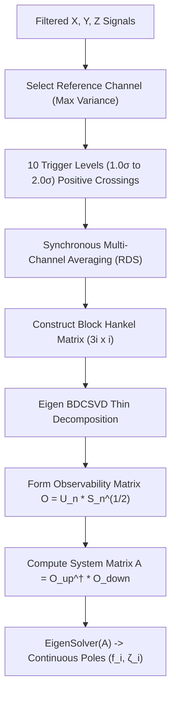

# Operational Modal Analysis (OMA) & DSP Specification

## 1. Mathematical & Engineering Foundations

Smartphone MEMS accelerometers inherently operate with variable sampling intervals, analog-to-digital converter quantization noise, thermal drift, and baseline DC gravity offsets ($1g \approx 9.80665\text{ m/s}^2$). 

**PhoneSHM** solves these physical constraints through a three-stage mathematical pipeline:
1. **Deterministic Preprocessing**: Monotonic time validation, zero-velocity static bias subtraction $[b_x, b_y, b_z]$, cubic/linear resampling to $100.0\text{ Hz}$ on 64-bit double precision timestamps, mean subtraction + Ordinary Least Squares (OLS) linear detrending, and zero-phase Butterworth filtering with 64-bit double-precision IIR state accumulators.
2. **Tri-Engine Modal Identification**:
   - **Method 1 (Frequency Domain)**: Welch's Method Power Spectral Density (PSD) with multi-axis spectral summing ($S_{\text{mag}} = S_{xx} + S_{yy} + S_{zz}$ in $(m/s^2)^2/\text{Hz}$), 8-window sliding persistence tracking across 300s continuous sessions, sub-bin parabolic interpolation, and Median + 3*MAD non-stationary segment gating.
   - **Method 2 (Spatial/Frequency Domain)**: Enhanced Frequency Domain Decomposition (EFDD) via Singular Value Decomposition (SVD) of the horizontal 2-axis ($X, Y$) sway spectral matrix sorted by $\sigma_1$, decoupled from vertical slab modes, tri-axial coherence ($3 \times 3$ CSD), Axis-Aligned Sway Gate, and single-node multi-floor Roving Mode Shape synthesis with Modal Assurance Criterion (MAC).
   - **Method 3 (Time Domain)**: Multi-Channel Random Decrement Technique with Data-Driven Stochastic Subspace Identification (RDT-SSI) tracking state-space model orders $n \in \{2..40\}$ and cluster stability.
3. **Tri-Engine Modal Consensus**: Autonomous clustering across candidates to eliminate spurious ambient noise and identify true structural natural frequencies ($f_0$).

---

## 2. Signal Preprocessing Pipeline

```mermaid
flowchart LR
    Raw["Raw MEMS Acceleration x, y, z @ variable fs"] --> BiasSub["Zero-Velocity Static Bias Subtraction [bx, by, bz]"]
    BiasSub --> Monotonic[Monotonic Timestamp Verification]
    Monotonic --> Resample["Uniform Resampling to 100.0 Hz (Double Grid)"]
    Resample --> MeanSub[Mean Subtraction]
    MeanSub --> Detrend[OLS Linear Trend Removal]
    Detrend --> FiltFilt["Zero-Phase High-pass Butterworth Filtfilt @ 0.5 Hz (Float64 States)"]
    FiltFilt --> TriEngine["Tri-Engine OMA Pipeline (Welch + EFDD + SSI)"]
```



### A. Zero-Velocity Bias Subtraction, Monotonic Verification, Fritsch-Carlson PCHIP Resampling & Gap-Mask Gating
Android sensor hardware timestamps (`SensorEvent.timestamp`) are delivered in nanoseconds since boot. 

1. **Zero-Velocity Static Accelerometer Bias Subtraction**:
   - The static offset vector $\mathbf{b} = [b_x, b_y, b_z]^T$ is measured during pre-session stationary calibration (`AndroidDeviceCapabilityEngine`).
   - PhoneSHM subtracts this bias directly from raw sensor samples during acquisition in `AndroidVibrationSensorEngine` and at the start of `resampleToUniformGrid`:
     $$\mathbf{a}_{\text{unbiased}, i} = \mathbf{a}_i - \mathbf{b}$$
2. **Monotonic Verification**:
   - Verifies strict monotonicity ($t_i > t_{i-1}$), sorting out-of-order samples and deduplicating identical timestamps.
3. **64-bit Target Grid**:
   - Target timestamps are computed in 64-bit `double` precision to prevent cumulative integer truncation drift:
     $$t_{\text{target}, k} = t_{\text{start}} + \text{round}\left(k \cdot \frac{10^9}{f_s}\right)$$
4. **Fritsch-Carlson Monotone Cubic Hermite (`PCHIP_CUBIC`) & Gap Bridging**:
   - For normal intervals ($\Delta t_i \le 50.0\text{ ms}$), monotone cubic Hermite interpolation preserves local extrema without overshoot (`gapMask[k] = 0`).
   - When a sensor dropout gap exceeds `gapThresholdMs` ($> 50.0\text{ ms}$), `PCHIP_CUBIC` automatically falls back to linear bridging across that interval to prevent cubic polynomial explosion and marks every bridged sample with `gapMask[k] = 1`.
   - Continuity quality is tracked via `maxGapMs`, `totalMissingTimeSec`, and `isContinuityPassed = (missingTimeRatio <= 0.05)`.
5. **Settling-Aligned Gap-Mask Window Rejection**:
   - When slicing signals after the high-pass filter settling window (`settlingN`), `gapMask` is sliced identically (`gapMask[settlingN .. settlingN + usableN]`).
   - Any FFT window containing one or more bridged dropout samples (`gapMask != 0`) is strictly excluded from both Welch PSD (`welchPsdSingleAxis`) and EFDD CSD (`calculateFdd`) accumulation alongside the Median + $3 \times \text{MAD}$ RMS gate.

### B. Gravity Separation & Linear Detrending
In ambient continuous monitoring of civil infrastructure, smartphone sensors remain stationary throughout the measurement. High-alpha Exponential Moving Average (EMA) filters introduce an effective high-pass corner frequency ($f_c \approx 1.68\text{ Hz}$ at $\alpha = 0.1, f_s = 100\text{ Hz}$), which severely attenuates fundamental structural modes ($0.2\text{ Hz} - 2.0\text{ Hz}$).

PhoneSHM applies **Sample Mean Subtraction** and **Ordinary Least Squares (OLS) Linear Detrending** for stationary ambient monitoring:
1. **Sample Mean Subtraction**:
   $$\mu_x = \frac{1}{N}\sum_{i=0}^{N-1} x_i, \quad x'_i = x_i - \mu_x$$
   Eliminates static $1g$ gravity components without altering signal frequency content.
2. **Ordinary Least Squares (OLS) Linear Detrending**:
   $$y_i = x'_i - (m \cdot i + c)$$
   Removes linear baseline ramps caused by thermal drift without introducing low-frequency attenuation.

### C. Zero-Phase High-Pass Filtering (`filtfilt`) & 64-bit State Precision
To eliminate ultra-low-frequency thermal drift and micro-seismic noise without introducing phase distortion, PhoneSHM applies a forward-backward zero-phase digital filter (`highPassFilterFiltfilt`) with a cut-off at $f_c = 0.5\text{ Hz}$.

Because the normalized cut-off frequency is extremely low ($\frac{f_c}{f_s} = 0.005$), the filter poles lie in close proximity to the unit circle ($z \approx 0.978 \pm j0.022$). Single-precision (`float32`) direct-form implementations suffer from severe coefficient quantization noise and limit cycles. PhoneSHM implements all biquad coefficients ($b_0, b_1, b_2, a_1, a_2$) and state delay registers ($z_1, z_2$) in **64-bit IEEE 754 `Double` (`double` in C++)** precision, guaranteeing unconditional numerical stability.

---

## 3. Method 1: Welch Power Spectral Density (PSD)

Welch's averaged modified periodogram method computes the power spectrum density for $X$, $Y$, and $Z$ axes. The total acceleration Magnitude PSD is computed as the direct sum of the individual axis power spectral densities:
$$S_{\text{mag}}(f_k) = S_{xx}(f_k) + S_{yy}(f_k) + S_{zz}(f_k)$$
in physical units of $(m/s^2)^2/\text{Hz}$. Computing Welch PSD directly on the time-domain Euclidean norm vector ($\sqrt{x^2+y^2+z^2}$) introduces non-linear square-root cross-modulation, generating artificial harmonic distortion peaks ($2f_0, 4f_0$). Spectral summing preserves linear superposition and accurately reflects total vibration kinetic energy across both Kotlin and native C++20 implementations.

### Parameters
- **Sampling Frequency ($f_s$)**: $100\text{ Hz}$
- **FFT Size ($N_{\text{fft}}$)**: $1024$ samples
- **Window Function**: Hanning window $w(n) = 0.5 \left(1 - \cos\left(\frac{2\pi n}{N-1}\right)\right)$
- **Window Overlap**: $50\%$ ($512$ samples overlap, $5.12\text{ s}$ hop)
- **Spectral Resolution ($\Delta f$)**: $\frac{f_s}{N_{\text{fft}}} = \frac{100}{1024} \approx 0.09766\text{ Hz}$
- **Standard Ambient Duration**: $300\text{ s}$ ($30,000$ samples @ $100\text{ Hz}$)

### Sliding-Window Persistence Tracking
To ensure that an identified frequency candidate represents a genuine continuous structural resonance rather than a transient disturbance:
1. After trimming the initial filter settling margin ($600$ samples), the $300$-second recording is divided into **8 overlapping 60-second sliding windows** ($6,000$ samples per window, $3,000$ samples / $30\text{ s}$ hop).
2. Welch PSD is computed on each window, and peak candidates are matched against the session candidate using an adaptive tolerance:
   $$\Delta f_{\text{tol}} = \max\left(0.05 \cdot f_0, 4 \cdot \Delta f\right)$$
3. The persistence ratio is evaluated as:
   $$\text{persistence} = \frac{\text{matchingWindows}}{\text{totalWindows}} \in [0.0, 1.0]$$
   Candidates with $\text{persistence} \ge 0.70$ are prioritized for modal consensus.

### Non-Stationary Artifact Rejection (Segment Gating)
Ambient vibration recordings in real-world buildings are prone to transient non-stationary shocks (pedestrian footsteps, door slams, accidental phone handling). To prevent broadband impulse energy from corrupting the Welch PSD average:
1. The Root Mean Square (RMS) energy is computed for each candidate segment $m$:
   $$\text{RMS}_m = \sqrt{\frac{1}{N_{\text{fft}}} \sum_{n=0}^{N_{\text{fft}}-1} x_m^2[n]}$$
2. Across all $M$ candidate segments, the median RMS ($\widetilde{\text{RMS}}$) and Median Absolute Deviation ($\text{MAD}$) are evaluated:
   $$\text{MAD} = \text{median}\left(\left| \text{RMS}_m - \widetilde{\text{RMS}} \right|\right)$$
3. A segment is admitted to the periodogram accumulation if and only if:
   $$\text{RMS}_m \le \widetilde{\text{RMS}} + 3 \times \max(\text{MAD}, 10^{-6})$$
4. If all segments are rejected (e.g. sustained high excitation), a graceful fallback admits all segments to ensure pipeline continuity.

### Preallocated Scratch Buffers (C++20)
In [`dsp_core.cpp`](file:///data/data/com.termux/files/home/play-ground/ronin_shm/core/dsp/src/main/cpp/dsp_core.cpp), segment vectors (`segment`, `real`, `imag`) are preallocated outside the segment loop:
```cpp
std::vector<double> segment(fftSize);
std::vector<double> real(fftSize);
std::vector<double> imag(fftSize);

while (offset + fftSize <= n) {
    // Zero-allocation inner loop
    std::copy_n(signal.data() + offset, fftSize, segment.data());
    detrendInPlace(segment);
    std::fill(imag.begin(), imag.end(), 0.0);
    for (int i = 0; i < fftSize; ++i) real[i] = segment[i] * window[i];
    backend.fft(real.data(), imag.data(), fftSize);
    // Accumulate PSD...
    offset += stepSize;
}
```

### Sub-Bin Parabolic Interpolation
Peak frequencies are refined beyond the discrete grid $\Delta f$ using logarithmic parabolic interpolation:
$$\Delta p = 0.5 \cdot \frac{\alpha - \gamma}{\alpha - 2\beta + \gamma}$$
$$f_{\text{refined}} = f_k + \Delta p \cdot \Delta f$$
where $\alpha = \ln(S_{k-1})$, $\beta = \ln(S_k)$, and $\gamma = \ln(S_{k+1})$.

### Gated Transient Time-Frequency Analysis (STFT & Daubechies `db4` WPT)
Rather than simply discarding high-energy non-stationary segments ($\text{RMS}_m > \widetilde{\text{RMS}} + 3 \times 1.4826 \cdot \text{MAD}$ and `hasGap == false`), PhoneSHM routes up to the top $K = 5$ gated transient segments into [`analyzeGatedTransients`](file:///data/data/com.termux/files/home/play-ground/ronin_shm/core/dsp/src/main/cpp/dsp_core.cpp) (`wavelet_packet_core.cpp`):
1. **Short-Time Fourier Transform (STFT)**: Computes a $256$-point Hanning STFT with $75\%$ overlap ($64$-sample hop, $129$ frequency bins) across each $512$-sample transient segment.
2. **Daubechies `db4` Wavelet Packet Transform (Depth $J = 4$)**: Directly decomposes the $100\text{ Hz}$ vibration segment (without audio downsampling) into $2^4 = 16$ uniform subbands ($\Delta f_{\text{band}} = 3.125\text{ Hz}$ across $0\text{–}50\text{ Hz}$) using normalized 8-tap Daubechies `db4` quadrature mirror filters.
3. **Shannon Wavelet Entropy & NaN Guard**: Computes normalized subband energies $p_j = E_j / E_{\text{total}}$ and Shannon entropy:
   $$S_{\text{wpt}} = -\sum_{j=1, \, p_j > 10^{-12}}^{16} p_j \ln(p_j)$$
   Guarding $p_j > 10^{-12}$ prevents $0 \cdot \ln(0) \to \text{NaN}$ on zero-energy bands. Segments with $S_{\text{wpt}} < 1.8$ and low-frequency concentration ($\sum_{j=0}^7 p_j \ge 0.55$) are flagged as `isStructuralShock = true`.
4. **Safe JNI Timestamp Reconstruction**: To avoid 64-bit integer bitcasting into IEEE 754 `float` registers (which risks signaling NaN bit corruption on ARMv8/x86), JNI packs only the 32-bit float `onsetSampleIndex` and reconstructs exact 64-bit nanosecond timestamps in Kotlin via `reconstructOnsetTimestampNs(sessionStartTimestampNs, onsetSampleIndex, sampleRateHz)`.

---

## 4. Method 2: Enhanced Frequency Domain Decomposition (EFDD), Tri-Axial Coherence & Roving Mode Shapes

Frequency Domain Decomposition (FDD) decouples multi-degree-of-freedom structural responses into single-degree-of-freedom (SDOF) systems via Singular Value Decomposition (SVD).

### Horizontal Sway Decoupling ($2 \times 2$ SVD) & Tri-Axial $3 \times 3$ Coherence
Civilian buildings predominantly vibrate in orthogonal horizontal translation modes (sway along structural principal axes). In smartphone deployments, vertical ($Z$-axis) vibrations are dominated by localized floor slab vibrations that can mask or contaminate weak horizontal sway modes.

To achieve orientation independence while rigorously rejecting vertical slab bounce, [`fdd_core.cpp`](file:///data/data/com.termux/files/home/play-ground/ronin_shm/core/dsp/src/main/cpp/fdd_core.cpp) computes both the full **$3 \times 3$ Hermitian Cross-Spectral Density (CSD) matrix** $\mathbf{G}_{3\times 3}(f_k)$ across $(X, Y, Z)$ and the **$2 \times 2$ horizontal sub-block SVD** on $\mathbf{G}_{xy}(f_k)$:

1. **$3 \times 3$ CSD Matrix & $2 \times 2$ Horizontal SVD**:
   - Candidate segments without gaps (`!hasGap`) that pass the Median + $3 \times \text{MAD}$ RMS gate are accumulated into $\mathbf{G}_{3\times 3}(f_k) \in \mathbb{C}^{3\times 3}$.
   - SVD is applied to the upper-left $2 \times 2$ horizontal block $\mathbf{G}_{xy}(f_k) = \mathbf{U}_k \mathbf{\Sigma}_k \mathbf{U}_k^H = \sigma_1(f_k)\mathbf{u}_{1,k}\mathbf{u}_{1,k}^H + \sigma_2(f_k)\mathbf{u}_{2,k}\mathbf{u}_{2,k}^H$.
   - Singular values are strictly sorted descending ($\sigma_1 \ge \sigma_2$), and modal candidate search is constrained to the structural frequency band $[0.2, 25.0]\text{ Hz}$ in $(m/s^2)^2/\text{Hz}$.
2. **Division-by-Zero Guarded Coherences & H/V Ratio**:
   - Magnitude-squared coherences and the Horizontal-to-Vertical spectral ratio are computed with a `1e-30` denominator floor and clamped to $[0.0, 1.0]$:
     $$\gamma_{ij}^2(f_k) = \text{clamp}\left(\frac{|G_{ij}(f_k)|^2}{\max(S_{ii}(f_k)\cdot S_{jj}(f_k), 10^{-30})}, 0.0, 1.0\right), \quad \text{H/V}(f_k) = \frac{\sigma_1(f_k)}{\max(S_{zz}(f_k), 10^{-30})}$$
3. **Axis-Aligned Sway Gate & Dominant Sway Azimuth**:
   - When a building sways purely along the phone's $X$ or $Y$ axis (1D sway), one horizontal channel carries minimal modal energy and $\gamma_{xy}^2(f_0)$ is naturally near zero. Therefore, PhoneSHM validates horizontal sway modes **without** requiring $\gamma_{xy}^2 \ge 0.60$:
     $$\text{isValidHorizontalSway} \iff \left(\frac{\sigma_1(f_0)}{S_{zz}(f_0)} > 3.0\right) \land \left(\gamma_{xz}^2(f_0) \le 0.35\right) \land \left(\gamma_{yz}^2(f_0) \le 0.35\right)$$
   - The dominant horizontal sway azimuth angle $\theta_{\text{sway}} \in [-180^\circ, 180^\circ]$ is extracted from the first singular vector $\mathbf{u}_1(f_0) = [u_x, u_y]^T$:
     $$\theta_{\text{sway}} = \text{atan2}(\text{Re}(u_y), \text{Re}(u_x)) \times \frac{180^\circ}{\pi}$$
4. **Modal Damping Estimation ($\zeta$)**:
   - The SDOF auto-spectral bell surrounding a resonant peak is extracted via Modal Assurance Criterion ($\text{MAC} \ge 0.85$) and transformed to the time-domain autocorrelation free decay via IDFT to compute logarithmic decrement damping $\zeta$.
5. **Single-Node Roving Mode Shape Synthesis with MAC ([`RovingModeShapeEngine.kt`](file:///data/data/com.termux/files/home/play-ground/ronin_shm/core/modal/src/main/kotlin/com/ronin/phoneshm/core/modal/RovingModeShapeEngine.kt))**:
   - Aggregates sequential single-phone measurements recorded across building floors ($L = 1, 2, \dots, \text{Roof}$) that match the reference $f_0$ within $5\%$ tolerance.
   - Normalizes each floor's peak singular value $\sigma_1^{(L)}(f_0)$ by its stationary broadband ambient RMS variance $\sigma_{\text{amb}, L}^2$ to compensate for non-simultaneous wind excitation differences:
     $$|\phi(L)| = \sqrt{\frac{\sigma_1^{(L)}(f_0)}{\max(\sigma_{\text{amb}, L}^2, 10^{-12})}}$$
   - Assigns phase sign via cross-spectral real part $\text{sgn}(\text{Re}(G_{xz}(f_0)))$ when available, or SVD azimuth cosine:
     $$\text{phaseSign}(L) = \begin{cases} \text{sgn}(\text{Re}(G_{xz}^{(L)} \cdot G_{xz}^{(\text{Roof})})), & \text{if } G_{xz} \text{ available} \\ \text{sgn}(\cos(\theta_L - \theta_{\text{Roof}})), & \text{otherwise} \end{cases}$$
   - Normalizes by the highest floor so $\phi(\text{Roof}) = 1.0$.
   - Computes inter-story drift ratio $\Delta\phi_L = |\phi(L) - \phi(L_{\text{prev}})| / \max(1, L - L_{\text{prev}})$.
   - Evaluates the **Modal Assurance Criterion (MAC)** against the theoretical first-mode linear shear profile $\phi_{\text{ideal}}(L) = L / L_{\text{Roof}}$:
     $$\text{MAC}(\boldsymbol{\phi}, \boldsymbol{\phi}_{\text{ideal}}) = \frac{\left(\boldsymbol{\phi}^T \boldsymbol{\phi}_{\text{ideal}}\right)^2}{\left(\boldsymbol{\phi}^T \boldsymbol{\phi}\right)\left(\boldsymbol{\phi}_{\text{ideal}}^T \boldsymbol{\phi}_{\text{ideal}}\right)} \in [0.0, 1.0]$$
     Values $\text{MAC} \ge 0.90$ confirm a canonical first-mode shear building behavior.

---

## 5. Method 3: Multi-Channel RDT-SSI (Time Domain)

The Random Decrement Technique (RDT) converts ambient random responses into free vibration decay signatures (RDS), followed by Stochastic Subspace Identification (SSI) to extract state-space modal parameters. PhoneSHM provides complete numerical equivalence between its native C++20 Eigen SVD engine and its JVM fallback implementation.



### Mathematical Steps
1. **Trigger Condition**: Compute the standard deviation $\sigma_{\text{ref}}$ of the reference axis. Define 10 trigger thresholds from $1.0\sigma$ to $2.0\sigma$. At each positive slope crossing:
   $$x_{\text{ref}}(t_k) = T_j, \quad \dot{x}_{\text{ref}}(t_k) > 0$$
   Extract sub-segments of length $\tau = 5.0\text{ s}$ across all 3 channels and compute the ensemble average to eliminate uncorrelated white noise forcing:
   $$\mathbf{D}(\tau) = \frac{1}{M} \sum_{k=1}^M \mathbf{y}(t_k + \tau)$$
2. **Block Hankel Matrix**: Build the block Hankel matrix $\mathbf{H} \in \mathbb{R}^{3i \times i}$ from the multi-channel RDS vectors.
3. **Observability Matrix**:
   $$\mathbf{H} = \mathbf{U} \mathbf{\Sigma} \mathbf{V}^T \implies \mathbf{O}_n = \mathbf{U}_n \mathbf{\Sigma}_n^{1/2}$$
4. **Transition Matrix & Modal Poles**:
   $$\mathbf{A} = \mathbf{O}_{\text{up}}^\dagger \mathbf{O}_{\text{down}}$$
   Solving the eigenvalue problem $\mathbf{A} \mathbf{\phi}_i = \lambda_i \mathbf{\phi}_i$:
   $$\mu_i = \frac{\ln(\lambda_i)}{\Delta t}, \quad f_i = \frac{|\text{Im}(\mu_i)|}{2\pi}, \quad \zeta_i = -\frac{\text{Re}(\mu_i)}{|\mu_i|}$$
   Poles are retained when $0.1\text{ Hz} \le f_i \le \frac{f_s}{2}$ and $0.5\% \le \zeta_i \le 15\%$.
5. **State-Space Model Order & Stability Clustering**:
   - System order is systematically swept across even orders $n \in \{2, 4, \dots, 40\}$.
   - Stable poles ($\Delta f / f \le 1.5\%$) across varying model orders are clustered together.
   - The representative state-space model order ($n$) is preserved in `pole.modelOrder`, while the cluster stability count is stored in `pole.stabilityCount` and displayed in the UI as `n=22 (20x)`.

---

## 6. Tri-Engine Modal Consensus Engine

To prevent false alarms caused by localized pedestrian movement, HVAC motor vibration, or transient sensor anomalies, the [`ModalConsensusEngine`](file:///data/data/com.termux/files/home/play-ground/ronin_shm/core/modal/src/main/kotlin/com/ronin/phoneshm/core/modal/ModalConsensusEngine.kt) combines results from Welch, EFDD, and SSI:

### Matching Criterion
Two frequencies $f_1$ and $f_2$ agree if their relative difference is within the $5\%$ structural tolerance:
$$\frac{|f_1 - f_2|}{\frac{f_1 + f_2}{2}} \le 0.05$$

### Consensus Status States & Inter-Engine Uncertainty

| Status | Conditions | Confidence Impact |
| :--- | :--- | :--- |
| **`AGREED`** | All 3 methods (Welch, EFDD, SSI) converge within 5% tolerance. | **100% Agreement Score**: Maximum confidence ($f_{\text{consensus}} = \text{mean}(f_{\text{cluster}})$). |
| **`PARTIAL`** | Exactly 2 methods converge within 5% tolerance (e.g. Welch + EFDD, or Welch + SSI). | **66.7% Agreement Score**: Moderate confidence ($f_{\text{consensus}} = \text{mean}(f_{\text{pair}})$). |
| **`DISAGREED`** | All 3 methods yield distinct frequencies exceeding 5% separation. | **33.3% Agreement Score**: Low confidence; flagged for inspection. |
| **`INSUFFICIENT`**| Ambient excitation is too low for any method to identify distinct peaks. | **0.0% Agreement Score**: Re-measurement recommended. |

For `AGREED` ($k=3$) and `PARTIAL` ($k=2$) states, [`ModalConsensusEngine`](file:///data/data/com.termux/files/home/play-ground/ronin_shm/core/modal/src/main/kotlin/com/ronin/phoneshm/core/modal/ModalConsensusEngine.kt) quantifies sample variance and relative uncertainty across the agreeing engines:
$$\sigma_{\text{consensus}}^2 = \frac{1}{k - 1} \sum_{i=1}^k \left(f_i - f_{\text{consensus}}\right)^2, \quad \text{uncertaintyRatioPct} = \frac{\sqrt{\sigma_{\text{consensus}}^2}}{f_{\text{consensus}}} \times 100\%$$
