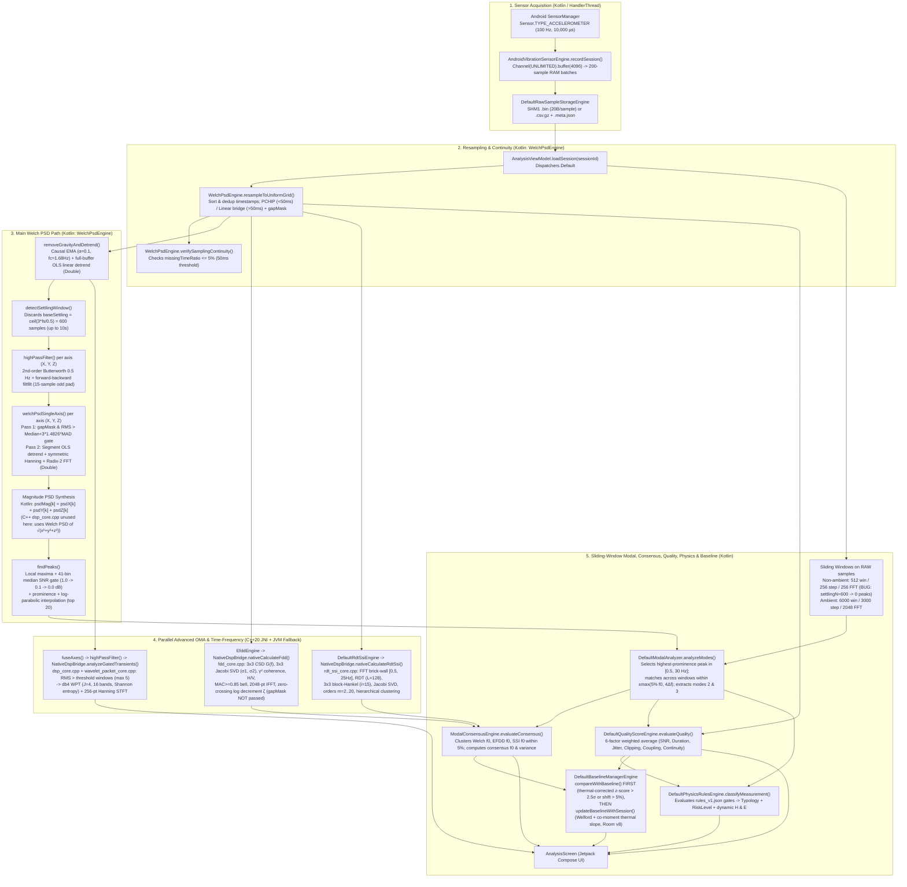

# PhoneSHM — Read-Only DSP Pipeline Forensic Audit

---

## 1. Executive Summary

The `PhoneSHM` codebase implements a **hybrid Kotlin + C++20 JNI** structural health monitoring (SHM) and operational modal analysis (OMA) pipeline on Android. Tracing the actual runtime execution path from [`MeasurementViewModel.kt`](file:///data/data/com.termux/files/home/play-ground/ronin_shm/feature/measurement/src/main/kotlin/com/ronin/phoneshm/feature/measurement/MeasurementViewModel.kt#L68-L132) through [`AnalysisViewModel.kt`](file:///data/data/com.termux/files/home/play-ground/ronin_shm/feature/analysis/src/main/kotlin/com/ronin/phoneshm/feature/analysis/AnalysisViewModel.kt#L211-L459) reveals that **the primary spectral pipeline and advanced OMA engines execute across split runtimes** and contain several significant divergences between UI claims, code comments, C++ native implementations, and the active Kotlin execution path:

1. **Split Execution Path (Kotlin vs. C++ JNI)**:
   - [`AnalysisViewModel.kt`](file:///data/data/com.termux/files/home/play-ground/ronin_shm/feature/analysis/src/main/kotlin/com/ronin/phoneshm/feature/analysis/AnalysisViewModel.kt#L85) instantiates `private val dspEngine: DspEngine = WelchPsdEngine()`. Consequently, **uniform-grid resampling, gravity removal, Butterworth `filtfilt` high-pass filtering, main Welch PSD, sliding-window persistence Welch PSD, impulse verification, and sampling continuity checks all execute in pure Kotlin** ([`WelchPsdEngine.kt`](file:///data/data/com.termux/files/home/play-ground/ronin_shm/core/dsp/src/main/kotlin/com/ronin/phoneshm/core/dsp/WelchPsdEngine.kt#L40-L1144)), **not** in [`dsp_core.cpp`](file:///data/data/com.termux/files/home/play-ground/ronin_shm/core/dsp/src/main/cpp/dsp_core.cpp#L1-L976).
   - Conversely, **EFDD** ([`fdd_core.cpp`](file:///data/data/com.termux/files/home/play-ground/ronin_shm/core/dsp/src/main/cpp/fdd_core.cpp#L14-L357)), **RDT-SSI** ([`rdt_ssi_core.cpp`](file:///data/data/com.termux/files/home/play-ground/ronin_shm/core/dsp/src/main/cpp/rdt_ssi_core.cpp#L20-L211)), and **Transient WPT/STFT** ([`dsp_core.cpp`](file:///data/data/com.termux/files/home/play-ground/ronin_shm/core/dsp/src/main/cpp/dsp_core.cpp#L791-L973) & [`wavelet_packet_core.cpp`](file:///data/data/com.termux/files/home/play-ground/ronin_shm/core/dsp/src/main/cpp/wavelet_packet_core.cpp)) execute via **C++20 JNI** ([`dsp_jni.cpp`](file:///data/data/com.termux/files/home/play-ground/ronin_shm/core/dsp/src/main/cpp/dsp_jni.cpp#L13-L329)), with pure-Kotlin fallbacks inside [`NativeDspBridge.kt`](file:///data/data/com.termux/files/home/play-ground/ronin_shm/core/dsp/src/main/kotlin/com/ronin/phoneshm/core/dsp/NativeDspBridge.kt#L19-L1057) if `libphoneshm_dsp.so` fails to load.
2. **Broken Non-Ambient Persistence Sliding Windows**:
   - In non-ambient mode (`targetDurationSeconds < 60`), [`AnalysisViewModel.kt`](file:///data/data/com.termux/files/home/play-ground/ronin_shm/feature/analysis/src/main/kotlin/com/ronin/phoneshm/feature/analysis/AnalysisViewModel.kt#L230-L304) slices the **raw, un-resampled** `samples` into 512-sample ($\approx 5.12\text{ s}$) windows and passes each window to `WelchPsdEngine.calculateMultiAxisWelchPsd`. Inside [`WelchPsdEngine.kt`](file:///data/data/com.termux/files/home/play-ground/ronin_shm/core/dsp/src/main/kotlin/com/ronin/phoneshm/core/dsp/WelchPsdEngine.kt#L526-L533), `detectSettlingWindow` enforces a minimum `baseSettling = ceil(3.0 * fs / 0.5) = 600` samples ($6.0\text{ s}$ at $100\text{ Hz}$). Because `usableN = 512 - 512 = 0 < fftSize (256)`, **every 512-sample sliding window returns `emptyResult` with zero peaks**, causing [`DefaultModalAnalyzer.kt`](file:///data/data/com.termux/files/home/play-ground/ronin_shm/core/modal/src/main/kotlin/com/ronin/phoneshm/core/modal/DefaultModalAnalyzer.kt#L75-L103) to compute `matchCount = 0` across a non-empty list of windows (`persistenceRatio = 0.0`, `frequencyStdDevHz = 0.0`, `stabilityScore = 0.5`), which subsequently fails all `minPersistence` gates in `rules_v1.json`.
3. **Sub-1.7 Hz Attenuation from EMA Gravity Filter**:
   - Both [`WelchPsdEngine.removeGravityAndDetrend`](file:///data/data/com.termux/files/home/play-ground/ronin_shm/core/dsp/src/main/kotlin/com/ronin/phoneshm/core/dsp/WelchPsdEngine.kt#L268-L321) and [`dsp_core.cpp:removeGravityAndDetrend`](file:///data/data/com.termux/files/home/play-ground/ronin_shm/core/dsp/src/main/cpp/dsp_core.cpp#L22-L79) subtract a causal 1st-order Exponential Moving Average (EMA) with $\alpha = 0.1$. At $f_s = 100\text{ Hz}$, this EMA has a $-3\text{ dB}$ cutoff of $f_c = \frac{-\ln(0.9) \cdot 100}{2\pi} \approx 1.68\text{ Hz}$, acting as a 1st-order high-pass filter that attenuates structural modes between $0.5\text{ Hz}$ and $1.68\text{ Hz}$ *before* the $0.5\text{ Hz}$ Butterworth `filtfilt` runs.
4. **UI vs. Implementation Discrepancies**:
   - [`AnalysisScreen.kt`](file:///data/data/com.termux/files/home/play-ground/ronin_shm/feature/analysis/src/main/kotlin/com/ronin/phoneshm/feature/analysis/AnalysisScreen.kt#L665) claims persistence matching uses `"max(1% f₀, 2Δf) across sequential 5s time windows"`, whereas [`DefaultModalAnalyzer.kt`](file:///data/data/com.termux/files/home/play-ground/ronin_shm/core/modal/src/main/kotlin/com/ronin/phoneshm/core/modal/DefaultModalAnalyzer.kt#L83) actually computes `max(0.05 * fundamentalFrequencyHz, deltaF * 4.0)` ($\max(5\% f_0, 4\Delta f)$), and ambient mode uses $60\text{ s}$ windows (`windowSize = 6000`).
   - [`AnalysisScreen.kt`](file:///data/data/com.termux/files/home/play-ground/ronin_shm/feature/analysis/src/main/kotlin/com/ronin/phoneshm/feature/analysis/AnalysisScreen.kt#L695) and [`AnalysisScreen.kt`](file:///data/data/com.termux/files/home/play-ground/ronin_shm/feature/analysis/src/main/kotlin/com/ronin/phoneshm/feature/analysis/AnalysisScreen.kt#L848) label Welch PSD and EFDD $\sigma_1$ values as `m²/s⁴`, whereas the code divides by $f_s \cdot \sum w[n]^2$, producing true Power Spectral Density in $(\text{m/s}^2)^2/\text{Hz} = \text{m}^2/\text{s}^3$.

---

## 2. Actual DSP Pipeline Flowchart

### Stage-by-Stage Execution Summary

| Stage | Class & Function | Input -> Output Types | Rate & Units | Location | Sync / Async |
| :--- | :--- | :--- | :--- | :--- | :--- |
| **Sensor API & Sampling** | [`AndroidVibrationSensorEngine.recordSession`](file:///data/data/com.termux/files/home/play-ground/ronin_shm/core/sensor/src/main/kotlin/com/ronin/phoneshm/core/sensor/AndroidVibrationSensorEngine.kt#L51-L261) | `SensorEvent` -> `Flow<RecordingProgress>` + `.bin`/`.csv.gz` | Target $100\text{ Hz}$ ($10{,}000\text{ }\mu\text{s}$), $\text{m/s}^2$, `timestamp` in $\text{ns}$ | Kotlin (`HandlerThread` + `Dispatchers.IO`) | Asynchronous (`callbackFlow` + `.buffer(4096)`) |
| **Raw Binary Storage** | [`DefaultRawSampleStorageEngine`](file:///data/data/com.termux/files/home/play-ground/ronin_shm/core/storage/src/main/kotlin/com/ronin/phoneshm/core/storage/DefaultRawSampleStorageEngine.kt#L13-L188) | `LongArray`, `FloatArray` $\times 3$ -> `RawSampleSessionData` | $\text{ns}$, $\text{m/s}^2$ ($20\text{ bytes/sample}$) | Kotlin (`Dispatchers.IO`) | Asynchronous (`suspend`) |
| **Uniform Resampling** | [`WelchPsdEngine.resampleToUniformGrid`](file:///data/data/com.termux/files/home/play-ground/ronin_shm/core/dsp/src/main/kotlin/com/ronin/phoneshm/core/dsp/WelchPsdEngine.kt#L46-L254) | `List<AccelerationSample>` -> `ResamplingOutput` | Uniform `sampleRateHz` ($\approx 100\text{ Hz}$), $\text{m/s}^2$ | Kotlin (`Dispatchers.Default`) | Synchronous inside coroutine |
| **Gravity & Detrend** | [`WelchPsdEngine.removeGravityAndDetrend`](file:///data/data/com.termux/files/home/play-ground/ronin_shm/core/dsp/src/main/kotlin/com/ronin/phoneshm/core/dsp/WelchPsdEngine.kt#L268-L321) | `List<AccelerationSample>` -> `GravityRemovalResult` | $\approx 100\text{ Hz}$, $\text{m/s}^2$ | Kotlin (`Dispatchers.Default`) | Synchronous inside coroutine |
| **Settling Window** | [`WelchPsdEngine.detectSettlingWindow`](file:///data/data/com.termux/files/home/play-ground/ronin_shm/core/dsp/src/main/kotlin/com/ronin/phoneshm/core/dsp/WelchPsdEngine.kt#L604-L664) | `GravityRemovalResult` -> `SettlingWindowResult` | Samples ($600$ to $1000$ samples at $100\text{ Hz}$) | Kotlin (`Dispatchers.Default`) | Synchronous inside coroutine |
| **High-Pass Filter** | [`WelchPsdEngine.highPassFilter`](file:///data/data/com.termux/files/home/play-ground/ronin_shm/core/dsp/src/main/kotlin/com/ronin/phoneshm/core/dsp/WelchPsdEngine.kt#L338-L394) | `FloatArray` -> `FloatArray` | $\approx 100\text{ Hz}$, $f_c = 0.5\text{ Hz}$, $\text{m/s}^2$ | Kotlin (`Dispatchers.Default`) | Synchronous inside coroutine |
| **Welch PSD & Peaks** | [`WelchPsdEngine.calculateMultiAxisWelchPsd`](file:///data/data/com.termux/files/home/play-ground/ronin_shm/core/dsp/src/main/kotlin/com/ronin/phoneshm/core/dsp/WelchPsdEngine.kt#L502-L586) | `List<AccelerationSample>` -> `MultiAxisSpectrumResult` | $\text{Hz}$, PSD in $(\text{m/s}^2)^2/\text{Hz}$ | Kotlin (`Dispatchers.Default`) | Synchronous inside coroutine |
| **EFDD + Coherence** | [`EfddEngine.calculateEfdd`](file:///data/data/com.termux/files/home/play-ground/ronin_shm/core/dsp/src/main/kotlin/com/ronin/phoneshm/core/dsp/EfddEngine.kt#L39-L87) -> [`calculateFdd`](file:///data/data/com.termux/files/home/play-ground/ronin_shm/core/dsp/src/main/cpp/fdd_core.cpp#L14-L357) | `List<AccelerationSample>` -> `EfddResult` | $\text{Hz}$, SV in $(\text{m/s}^2)^2/\text{Hz}$, $\gamma^2 \in [0,1]$ | C++20 JNI (`libphoneshm_dsp.so`) or Kotlin fallback | Synchronous JNI call on `Dispatchers.Default` |
| **Cov-SSI (RDT-SSI)** | [`DefaultRdtSsiEngine.calculateSsi`](file:///data/data/com.termux/files/home/play-ground/ronin_shm/core/dsp/src/main/kotlin/com/ronin/phoneshm/core/dsp/RdtSsiEngine.kt#L32-L90) -> [`calculateRdtSsi`](file:///data/data/com.termux/files/home/play-ground/ronin_shm/core/dsp/src/main/cpp/rdt_ssi_core.cpp#L20-L211) | `List<AccelerationSample>` -> `RdtSsiResult` | $\text{Hz}$, damping ratio $\zeta$ | C++20 JNI (`libphoneshm_dsp.so`) or Kotlin fallback | Synchronous JNI call on `Dispatchers.Default` |
| **Transient WPT/STFT** | [`NativeDspBridge.analyzeGatedTransients`](file:///data/data/com.termux/files/home/play-ground/ronin_shm/core/dsp/src/main/kotlin/com/ronin/phoneshm/core/dsp/NativeDspBridge.kt#L73-L108) -> [`analyzeGatedTransients`](file:///data/data/com.termux/files/home/play-ground/ronin_shm/core/dsp/src/main/cpp/dsp_core.cpp#L791-L973) | `FloatArray` (`filtMag`), `BooleanArray` (`gapMask`) -> `List<TransientEvent>` | $\approx 100\text{ Hz}$, $\text{m/s}^2$ (mislabeled `G` in struct fields) | C++20 JNI (`libphoneshm_dsp.so`) or Kotlin fallback | Synchronous JNI call on `Dispatchers.Default` |
| **Modal & Persistence** | [`DefaultModalAnalyzer.analyzeModes`](file:///data/data/com.termux/files/home/play-ground/ronin_shm/core/modal/src/main/kotlin/com/ronin/phoneshm/core/modal/DefaultModalAnalyzer.kt#L17-L162) | `MultiAxisSpectrumResult` + `List<MultiAxisSpectrumResult>` -> `ModalAnalysisResult` | $\text{Hz}$, dimensionless confidence $\in [0, 1]$ | Kotlin (`Dispatchers.Default`) | Synchronous inside coroutine |
| **Modal Consensus** | [`ModalConsensusEngine.evaluateConsensus`](file:///data/data/com.termux/files/home/play-ground/ronin_shm/core/modal/src/main/kotlin/com/ronin/phoneshm/core/modal/ModalConsensusEngine.kt#L19-L113) | Welch + EFDD + SSI -> `ConsensusModalResult` | $\text{Hz}$, variance in $\text{Hz}^2$, $\zeta$ | Kotlin (`Dispatchers.Default`) | Synchronous inside coroutine |
| **Quality Scoring** | [`DefaultQualityScoreEngine.evaluateQuality`](file:///data/data/com.termux/files/home/play-ground/ronin_shm/core/quality/src/main/kotlin/com/ronin/phoneshm/core/quality/DefaultQualityScoreEngine.kt#L14-L91) | `QualityEvaluationInput` -> `QualityEvaluationResult` | Composite score $\in [0.0, 1.0]$ | Kotlin (`Dispatchers.Default`) | Synchronous inside coroutine |
| **Physics & Typology** | [`DefaultPhysicsRulesEngine.classifyMeasurement`](file:///data/data/com.termux/files/home/play-ground/ronin_shm/core/physics/src/main/kotlin/com/ronin/phoneshm/core/physics/DefaultPhysicsRulesEngine.kt#L16-L138) | `ModalAnalysisResult`, `QualityEvaluationResult` -> `StructuralAssessment` | $\text{Hz}$, stories, height ($\text{m}$), $E_{\text{eff}}$ ($\text{GPa}$) | Kotlin (`Dispatchers.Default`) | Synchronous inside coroutine |
| **Baseline Tracking** | [`DefaultBaselineManagerEngine`](file:///data/data/com.termux/files/home/play-ground/ronin_shm/core/baseline/src/main/kotlin/com/ronin/phoneshm/core/baseline/DefaultBaselineManagerEngine.kt#L27-L514) | `buildingHash`, `f0Hz`, `temperatureCelsius` -> `BaselineComparisonResult` | $\text{Hz}$, $\text{Hz}/^\circ\text{C}$, `%` shift | Kotlin + Room SQLite (`Dispatchers.IO`) | Asynchronous (`suspend`) |

---

## 3. Sensor Acquisition Details

### 3.1 Android Sensor Type, Sampling Rate, and Registration
- **Sensor Type**: `Sensor.TYPE_ACCELEROMETER` (raw hardware accelerometer including gravity, **not** `TYPE_LINEAR_ACCELERATION`), requested via `sensorManager?.getDefaultSensor(Sensor.TYPE_ACCELEROMETER)` in [`AndroidVibrationSensorEngine.kt`](file:///data/data/com.termux/files/home/play-ground/ronin_shm/core/sensor/src/main/kotlin/com/ronin/phoneshm/core/sensor/AndroidVibrationSensorEngine.kt#L32-L35).
- **Target Rate**: Default `targetHz: Int = 100` in [`VibrationSensorEngine.kt`](file:///data/data/com.termux/files/home/play-ground/ronin_shm/core/sensor/src/main/kotlin/com/ronin/phoneshm/core/sensor/VibrationSensorEngine.kt#L68) and [`MeasurementViewModel.kt`](file:///data/data/com.termux/files/home/play-ground/ronin_shm/feature/measurement/src/main/kotlin/com/ronin/phoneshm/feature/measurement/MeasurementViewModel.kt#L92).
- **Registration Parameters**: In [`AndroidVibrationSensorEngine.kt`](file:///data/data/com.termux/files/home/play-ground/ronin_shm/core/sensor/src/main/kotlin/com/ronin/phoneshm/core/sensor/AndroidVibrationSensorEngine.kt#L65-L66):
  - `samplingPeriodUs = 1_000_000 / targetHz` ($10{,}000\text{ }\mu\text{s}$ for $100\text{ Hz}$).
  - `maxReportLatencyUs = 0` (disables hardware FIFO batching to request immediate delivery).
  - Registered on a dedicated background `HandlerThread("PhoneSHM-SensorThread")` ([`AndroidVibrationSensorEngine.kt`](file:///data/data/com.termux/files/home/play-ground/ronin_shm/core/sensor/src/main/kotlin/com/ronin/phoneshm/core/sensor/AndroidVibrationSensorEngine.kt#L41-L45)).
- **Ambient Temperature Sensor**: Concurrently registers `Sensor.TYPE_AMBIENT_TEMPERATURE` with `SensorManager.SENSOR_DELAY_NORMAL` on the same `sensorHandler` ([`AndroidVibrationSensorEngine.kt`](file:///data/data/com.termux/files/home/play-ground/ronin_shm/core/sensor/src/main/kotlin/com/ronin/phoneshm/core/sensor/AndroidVibrationSensorEngine.kt#L35-L36), [`L67-L69`](file:///data/data/com.termux/files/home/play-ground/ronin_shm/core/sensor/src/main/kotlin/com/ronin/phoneshm/core/sensor/AndroidVibrationSensorEngine.kt#L67-L69)) and records the arithmetic mean `tempSum / tempCount` into `SessionMetadata.ambientTemperatureCelsius` ([`L165`](file:///data/data/com.termux/files/home/play-ground/ronin_shm/core/sensor/src/main/kotlin/com/ronin/phoneshm/core/sensor/AndroidVibrationSensorEngine.kt#L165)).

### 3.2 Timestamp Handling, Buffering, and Disk I/O
- **Timestamps Recorded**: Inside `onSensorChanged` ([`AndroidVibrationSensorEngine.kt`](file:///data/data/com.termux/files/home/play-ground/ronin_shm/core/sensor/src/main/kotlin/com/ronin/phoneshm/core/sensor/AndroidVibrationSensorEngine.kt#L121-L132)):
  - `hwTs = event.timestamp` (hardware sensor monotonic clock in nanoseconds).
  - `sysTs = SystemClock.elapsedRealtimeNanos()` (system arrival monotonic clock in nanoseconds).
- **In-Memory Batching & Channel Buffering**:
  - Samples are accumulated in pre-allocated primitive arrays of size `batchSize = 200` (`batchTimestamps`, `batchX`, `batchY`, `batchZ`) on the sensor thread and flushed to Disk I/O every 200 samples ($\approx 2\text{ s}$ at $100\text{ Hz}$) via `ioScope.launch { storageEngine.appendSamplesBatch(...) }` ([`AndroidVibrationSensorEngine.kt`](file:///data/data/com.termux/files/home/play-ground/ronin_shm/core/sensor/src/main/kotlin/com/ronin/phoneshm/core/sensor/AndroidVibrationSensorEngine.kt#L98-L102), [`L134-L147`](file:///data/data/com.termux/files/home/play-ground/ronin_shm/core/sensor/src/main/kotlin/com/ronin/phoneshm/core/sensor/AndroidVibrationSensorEngine.kt#L134-L147)).
  - Simultaneously, all `hwTimestamps` and `sysTimestamps` for the entire session are kept in `ArrayList<Long>(expectedSamples)` in RAM ([`L92-L94`](file:///data/data/com.termux/files/home/play-ground/ronin_shm/core/sensor/src/main/kotlin/com/ronin/phoneshm/core/sensor/AndroidVibrationSensorEngine.kt#L92-L94), [`L129-L130`](file:///data/data/com.termux/files/home/play-ground/ronin_shm/core/sensor/src/main/kotlin/com/ronin/phoneshm/core/sensor/AndroidVibrationSensorEngine.kt#L129-L130)).
  - The outer `callbackFlow` applies `.buffer(4096)` and `.flowOn(Dispatchers.IO)` ([`L260-L261`](file:///data/data/com.termux/files/home/play-ground/ronin_shm/core/sensor/src/main/kotlin/com/ronin/phoneshm/core/sensor/AndroidVibrationSensorEngine.kt#L260-L261)), emitting `RecordingProgress` to the UI every 10 samples ($\approx 10\text{ Hz}$ UI update rate, [`L150-L162`](file:///data/data/com.termux/files/home/play-ground/ronin_shm/core/sensor/src/main/kotlin/com/ronin/phoneshm/core/sensor/AndroidVibrationSensorEngine.kt#L150-L162)).
- **Binary File Format (`SHM1`)**:
  - [`DefaultRawSampleStorageEngine.kt`](file:///data/data/com.termux/files/home/play-ground/ronin_shm/core/storage/src/main/kotlin/com/ronin/phoneshm/core/storage/DefaultRawSampleStorageEngine.kt#L30-L55) writes a 4-byte ASCII magic header `"SHM1"`, followed by little-endian 20-byte records per sample: `int64 timestampNs` ($8\text{ B}$) + `float32 x` ($4\text{ B}$) + `float32 y` ($4\text{ B}$) + `float32 z` ($4\text{ B}$).

### 3.3 Sampling Rate, Jitter, and Clock Drift Calculation
Computed post-recording in [`SensorMetricsCalculator.calculateMetrics`](file:///data/data/com.termux/files/home/play-ground/ronin_shm/core/sensor/src/main/kotlin/com/ronin/phoneshm/core/sensor/SensorMetricsCalculator.kt#L15-L59):
- **Actual Average Sample Rate ($\text{Hz}$)** ([`L25-L31`](file:///data/data/com.termux/files/home/play-ground/ronin_shm/core/sensor/src/main/kotlin/com/ronin/phoneshm/core/sensor/SensorMetricsCalculator.kt#L25-L31)):
  $$f_{s,\text{actual}} = \frac{N - 1}{(t_{\text{hw}}[N-1] - t_{\text{hw}}[0]) \times 10^{-9}}$$
- **Sample Jitter Standard Deviation ($\text{ms}$)** ([`L34-L47`](file:///data/data/com.termux/files/home/play-ground/ronin_shm/core/sensor/src/main/kotlin/com/ronin/phoneshm/core/sensor/SensorMetricsCalculator.kt#L34-L47)):
  $$\Delta t_i = \frac{t_{\text{hw}}[i+1] - t_{\text{hw}}[i]}{10^6}\text{ (ms)}, \quad \sigma_{\text{jitter}} = \sqrt{\frac{1}{N-1}\sum_{i=0}^{N-2} (\Delta t_i - \overline{\Delta t})^2}$$
- **Clock Drift ($\text{PPM}$)** ([`L50-L56`](file:///data/data/com.termux/files/home/play-ground/ronin_shm/core/sensor/src/main/kotlin/com/ronin/phoneshm/core/sensor/SensorMetricsCalculator.kt#L50-L56)):
  $$\text{Drift}_{\text{PPM}} = \frac{(t_{\text{hw}}[N-1] - t_{\text{hw}}[0]) - (t_{\text{sys}}[N-1] - t_{\text{sys}}[0])}{t_{\text{sys}}[N-1] - t_{\text{sys}}[0]} \times 10^6$$

### 3.4 Zero-Velocity Calibration & Unapplied Bias Bug
- Before recording, [`MeasurementViewModel.startRecording`](file:///data/data/com.termux/files/home/play-ground/ronin_shm/feature/measurement/src/main/kotlin/com/ronin/phoneshm/feature/measurement/MeasurementViewModel.kt#L73-L76) calls [`AndroidDeviceCapabilityEngine.runZeroVelocityCalibration(durationSec = 3)`](file:///data/data/com.termux/files/home/play-ground/ronin_shm/core/device/src/main/kotlin/com/ronin/phoneshm/core/device/AndroidDeviceCapabilityEngine.kt#L46-L119), which samples `TYPE_ACCELEROMETER` at `SENSOR_DELAY_FASTEST` for $3\text{ s}$ and computes:
  - `bias = [meanX, meanY, meanZ - 9.80665f]` ([`L99-L101`](file:///data/data/com.termux/files/home/play-ground/ronin_shm/core/device/src/main/kotlin/com/ronin/phoneshm/core/device/AndroidDeviceCapabilityEngine.kt#L99-L101)) — **assumes the phone is lying flat face-up ($+Z$ up)**.
  - `noiseFloorMg = (sqrt(mean(dx² + dy² + dz²)) / 9.80665f) * 1000f` ([`L104-L113`](file:///data/data/com.termux/files/home/play-ground/ronin_shm/core/device/src/main/kotlin/com/ronin/phoneshm/core/device/AndroidDeviceCapabilityEngine.kt#L104-L113)).
- **Forensic Finding**: Although `sessionAccelerometerBias` is passed into `recordSession` and serialized to `.meta.json` ([`AndroidVibrationSensorEngine.kt`](file:///data/data/com.termux/files/home/play-ground/ronin_shm/core/sensor/src/main/kotlin/com/ronin/phoneshm/core/sensor/AndroidVibrationSensorEngine.kt#L56), [`L240`](file:///data/data/com.termux/files/home/play-ground/ronin_shm/core/sensor/src/main/kotlin/com/ronin/phoneshm/core/sensor/AndroidVibrationSensorEngine.kt#L240)), **it is never subtracted from the recorded accelerometer samples anywhere in `AndroidVibrationSensorEngine` or `AnalysisViewModel`**.

---

## 4. Preprocessing and Filter Details

### 4.1 Timestamp Sorting, Deduplication, and Uniform Resampling (PCHIP & Linear Bridge)
Executed in [`WelchPsdEngine.resampleToUniformGrid`](file:///data/data/com.termux/files/home/play-ground/ronin_shm/core/dsp/src/main/kotlin/com/ronin/phoneshm/core/dsp/WelchPsdEngine.kt#L46-L254) (called at [`AnalysisViewModel.kt`](file:///data/data/com.termux/files/home/play-ground/ronin_shm/feature/analysis/src/main/kotlin/com/ronin/phoneshm/feature/analysis/AnalysisViewModel.kt#L214-L220) with `method = InterpolationMethod.PCHIP_CUBIC`, `gapThresholdMs = 50.0`, `maxAllowedMissingRatio = RemoteConfigManager.gapMissingTimeRatioThreshold` $= 0.05$):
1. **Sorting & Deduplication** ([`WelchPsdEngine.kt`](file:///data/data/com.termux/files/home/play-ground/ronin_shm/core/dsp/src/main/kotlin/com/ronin/phoneshm/core/dsp/WelchPsdEngine.kt#L64-L77)): Checks monotonicity and sorts by `timestampNs` if out of order; drops any sample where `s.timestampNs <= clean.last().timestampNs`. *(Note: [`AndroidVibrationSensorEngine.kt`](file:///data/data/com.termux/files/home/play-ground/ronin_shm/core/sensor/src/main/kotlin/com/ronin/phoneshm/core/sensor/AndroidVibrationSensorEngine.kt#L177-L181) throws `IllegalStateException("Non-monotonic hardware timestamp detected...")` after recording finishes if `hwTsArray[i] <= hwTsArray[i - 1]`, which aborts saving the session before `resampleToUniformGrid` can ever repair it).*
2. **Uniform Grid Construction** ([`L120-L132`](file:///data/data/com.termux/files/home/play-ground/ronin_shm/core/dsp/src/main/kotlin/com/ronin/phoneshm/core/dsp/WelchPsdEngine.kt#L120-L132)):
   - $\text{targetCount} = \lfloor \text{durationSec} \cdot f_s \rfloor + 1$, where $\Delta t_{\text{ns}} = 10^9 / f_s$.
   - Target timestamps: $t_k = t_{\text{start}} + \text{round}(k \cdot \Delta t_{\text{ns}})$.
3. **PCHIP Cubic Hermite vs. Linear Bridge & `gapMask`** ([`L135-L241`](file:///data/data/com.termux/files/home/play-ground/ronin_shm/core/dsp/src/main/kotlin/com/ronin/phoneshm/core/dsp/WelchPsdEngine.kt#L135-L241)):
   - Secant slopes $\delta_i = (y_{i+1} - y_i)/h_i$ and Fritsch–Carlson weighted harmonic mean derivatives $d_i$ are computed in `Double` precision:
     $$d_i = \frac{w_1 + w_2}{\frac{w_1}{\delta_{i-1}} + \frac{w_2}{\delta_i}}, \quad w_1 = 2h_i + h_{i-1}, \; w_2 = h_i + 2h_{i-1}$$
     when $\text{sgn}(\delta_{i-1}) = \text{sgn}(\delta_i)$, and $d_i = 0$ at local extrema.
   - For each grid point $t_k \in (t_i, t_{i+1})$ with interval $\Delta t_{\text{ms}} = (t_{i+1} - t_i)/10^6$:
     - **If $\Delta t_{\text{ms}} \le 50.0\text{ ms}$**: Evaluates the cubic Hermite basis functions $h_{00}(u), h_{10}(u), h_{01}(u), h_{11}(u)$ and sets `gapMask[k] = false` ([`L222-L238`](file:///data/data/com.termux/files/home/play-ground/ronin_shm/core/dsp/src/main/kotlin/com/ronin/phoneshm/core/dsp/WelchPsdEngine.kt#L222-L238)).
     - **If $\Delta t_{\text{ms}} > 50.0\text{ ms}$**: Falls back to a **linear bridge** $y(t_k) = y_i + u(y_{i+1} - y_i)$ to prevent cubic overshoot across missing data and sets **`gapMask[k] = true`** ([`L209-L220`](file:///data/data/com.termux/files/home/play-ground/ronin_shm/core/dsp/src/main/kotlin/com/ronin/phoneshm/core/dsp/WelchPsdEngine.kt#L209-L220)).

### 4.2 Gravity Removal and Linear Detrending
Executed in [`WelchPsdEngine.removeGravityAndDetrend`](file:///data/data/com.termux/files/home/play-ground/ronin_shm/core/dsp/src/main/kotlin/com/ronin/phoneshm/core/dsp/WelchPsdEngine.kt#L268-L321) (and identically in [`dsp_core.cpp`](file:///data/data/com.termux/files/home/play-ground/ronin_shm/core/dsp/src/main/cpp/dsp_core.cpp#L22-L79)):
1. **Causal 1st-Order EMA Gravity Tracker** ([`WelchPsdEngine.kt`](file:///data/data/com.termux/files/home/play-ground/ronin_shm/core/dsp/src/main/kotlin/com/ronin/phoneshm/core/dsp/WelchPsdEngine.kt#L276-L296)):
   - Initialized to first sample: $\mathbf{g}_0 = [x_0, y_0, z_0]^T$.
   - Updated per sample with hardcoded $\alpha = 0.1$:
     $$\mathbf{g}_n = 0.1 \cdot \mathbf{a}_n + 0.9 \cdot \mathbf{g}_{n-1}, \quad \mathbf{a}_{\text{gf},n} = \mathbf{a}_n - \mathbf{g}_n$$
   - Also computes the variance of $\|\mathbf{g}_n\|_2$ across the session (`gravityVectorVariance`, [`L292-L300`](file:///data/data/com.termux/files/home/play-ground/ronin_shm/core/dsp/src/main/kotlin/com/ronin/phoneshm/core/dsp/WelchPsdEngine.kt#L292-L300)).
   - **Critical Mathematical Side-Effect**: Subtracting an EMA with $\alpha = 0.1$ has transfer function $H(z) = \frac{0.9(1 - z^{-1})}{1 - 0.9z^{-1}}$, which is a **1st-order high-pass filter with $-3\text{ dB}$ cutoff at $f_c = \frac{-\ln(0.9) \cdot f_s}{2\pi} \approx 1.68\text{ Hz}$ at $f_s = 100\text{ Hz}$**. Any structural mode at $0.5\text{ Hz}$ is attenuated by $\sim 10.8\text{ dB}$ ($71\%$ amplitude loss) before reaching the Butterworth filter.
2. **Full-Buffer Ordinary Least Squares (OLS) Linear Detrend** ([`WelchPsdEngine.detrendInPlace`](file:///data/data/com.termux/files/home/play-ground/ronin_shm/core/dsp/src/main/kotlin/com/ronin/phoneshm/core/dsp/WelchPsdEngine.kt#L688-L716)):
   - Fits a straight line $y = m \cdot i + c$ in `Double` precision across all $N$ samples per axis and subtracts $(m \cdot i + c)$ in-place.

### 4.3 Compound Settling Window Detection
Executed in [`WelchPsdEngine.detectSettlingWindow`](file:///data/data/com.termux/files/home/play-ground/ronin_shm/core/dsp/src/main/kotlin/com/ronin/phoneshm/core/dsp/WelchPsdEngine.kt#L604-L664) inside `calculateMultiAxisWelchPsd`:
- `baseSettling = ceil(3.0 * sampleRateHz / hpfCutoffHz)` where `hpfCutoffHz = 0.5f`. At $100\text{ Hz}$, **`baseSettling = 600` samples ($6.0\text{ s}$)**.
- Scans a $1.0\text{ s}$ sliding window (`windowSamples = 100`) from `baseSettling` ($600$) up to `maxSettling = 10 * sampleRateHz` ($1000$ samples $= 10.0\text{ s}$) checking if the variance of $\|\mathbf{g}_n\|_2$ drops below `gravityVarianceThreshold = 0.01f` ($\text{m}^2/\text{s}^4$).
- Slices off the first `settlingN` samples from both the gravity-free samples and `gapMask` ([`WelchPsdEngine.kt`](file:///data/data/com.termux/files/home/play-ground/ronin_shm/core/dsp/src/main/kotlin/com/ronin/phoneshm/core/dsp/WelchPsdEngine.kt#L527-L539)).

### 4.4 High-Pass Filter (`highPassFilter` / `filtfilt`)
Executed in [`WelchPsdEngine.highPassFilter`](file:///data/data/com.termux/files/home/play-ground/ronin_shm/core/dsp/src/main/kotlin/com/ronin/phoneshm/core/dsp/WelchPsdEngine.kt#L338-L413) (and identically in [`dsp_core.cpp:highPassFilterFiltfilt`](file:///data/data/com.termux/files/home/play-ground/ronin_shm/core/dsp/src/main/cpp/dsp_core.cpp#L151-L205)):
- **Topology**: 2nd-order Butterworth IIR high-pass filter with cutoff $f_c = 0.5\text{ Hz}$, bilinear-transform pre-warped via $\omega_c = \tan(\pi f_c / f_s)$ ([`WelchPsdEngine.kt`](file:///data/data/com.termux/files/home/play-ground/ronin_shm/core/dsp/src/main/kotlin/com/ronin/phoneshm/core/dsp/WelchPsdEngine.kt#L345-L355)):
  $$k = 1 + \sqrt{2}\omega_c + \omega_c^2, \quad b_0 = \frac{1}{k}, \; b_1 = -\frac{2}{k}, \; b_2 = \frac{1}{k}, \quad a_1 = \frac{2(\omega_c^2 - 1)}{k}, \; a_2 = \frac{1 - \sqrt{2}\omega_c + \omega_c^2}{k}$$
- **Zero-Phase Forward-Backward (`filtfilt`)**:
  - Uses step-response steady-state initial conditions (`zi1`, `zi2`, [`L375-L377`](file:///data/data/com.termux/files/home/play-ground/ronin_shm/core/dsp/src/main/kotlin/com/ronin/phoneshm/core/dsp/WelchPsdEngine.kt#L375-L377)).
  - Applies odd reflection padding of `padlen = minOf(15, signal.size - 1)` samples at both ends ([`L358-L372`](file:///data/data/com.termux/files/home/play-ground/ronin_shm/core/dsp/src/main/kotlin/com/ronin/phoneshm/core/dsp/WelchPsdEngine.kt#L358-L372)).
  - Runs Direct Form II Transposed (`applyIir`, [`L396-L413`](file:///data/data/com.termux/files/home/play-ground/ronin_shm/core/dsp/src/main/kotlin/com/ronin/phoneshm/core/dsp/WelchPsdEngine.kt#L396-L413)) forward, reverses the array, runs `applyIir` backward, reverses again, and strips `padlen` from both ends (effective 4th-order zero-phase response).
  - **Ordering**: In `calculateMultiAxisWelchPsd` ([`WelchPsdEngine.kt`](file:///data/data/com.termux/files/home/play-ground/ronin_shm/core/dsp/src/main/kotlin/com/ronin/phoneshm/core/dsp/WelchPsdEngine.kt#L524-L547)), `removeGravityAndDetrend` and `detectSettlingWindow` (which discards $6.0\text{ s}$) run **before** `highPassFilter`, meaning any residual edge transient introduced by the 15-sample ($0.15\text{ s}$) reflection pad in `highPassFilter` is **not** discarded by `detectSettlingWindow`.

---

## 5. FFT / Welch PSD Mathematical Details

### 5.1 FFT Implementation & Precision
- **Kotlin Active Path** ([`WelchPsdEngine.fft`](file:///data/data/com.termux/files/home/play-ground/ronin_shm/core/dsp/src/main/kotlin/com/ronin/phoneshm/core/dsp/WelchPsdEngine.kt#L815-L868)): In-place iterative Radix-2 Cooley–Tukey FFT operating on `DoubleArray` (`real`, `imag`). Requires `fftSize` to be a power of 2 (`n and (n - 1) == 0`, [`L817`](file:///data/data/com.termux/files/home/play-ground/ronin_shm/core/dsp/src/main/kotlin/com/ronin/phoneshm/core/dsp/WelchPsdEngine.kt#L817)).
- **C++ Path** ([`fft_backend.cpp`](file:///data/data/com.termux/files/home/play-ground/ronin_shm/core/dsp/src/main/cpp/fft_backend.cpp) / [`fft_backend.h`](file:///data/data/com.termux/files/home/play-ground/ronin_shm/core/dsp/src/main/cpp/fft_backend.h#L13-L16)): `CooleyTukeyBackend::fft(double* real, double* imag, int n)` operating in `double` precision (used by EFDD, RDT-SSI, and STFT).

### 5.2 Window sizes, Overlap, and Frequency Resolution ($\Delta f$)
Configured dynamically in [`AnalysisViewModel.kt`](file:///data/data/com.termux/files/home/play-ground/ronin_shm/feature/analysis/src/main/kotlin/com/ronin/phoneshm/feature/analysis/AnalysisViewModel.kt#L226-L237):
- `isAmbientMode = sessionMeta?.measurementProfileId == "ambient_baseline_continuous" || (sessionMeta?.targetDurationSeconds ?: 0) >= 60` ([`L226-L227`](file:///data/data/com.termux/files/home/play-ground/ronin_shm/feature/analysis/src/main/kotlin/com/ronin/phoneshm/feature/analysis/AnalysisViewModel.kt#L226-L227)).
- **Main Welch PSD (`mainParams`)**:
  - **Ambient Mode ($\ge 60\text{ s}$)**: `mainFftSize = minOf(4096, Integer.highestOneBit(resampledSamples.size))` ($40.96\text{ s}$ window at $100\text{ Hz}$, $\Delta f = 100 / 4096 = \mathbf{0.0244\text{ Hz}}$), $50\%$ overlap (`stepSize = 2048`).
  - **Active / Short Mode ($< 60\text{ s}$)**: `mainFftSize = minOf(2048, Integer.highestOneBit(resampledSamples.size))` ($20.48\text{ s}$ window at $100\text{ Hz}$, $\Delta f = 100 / 2048 = \mathbf{0.0488\text{ Hz}}$), $50\%$ overlap (`stepSize = 1024`).
  - **Short-Recording Failure Mode**: If `targetDurationSeconds >= 60` (`isAmbientMode = true`), `mainFftSize = 4096`, and the user stops or records between $41\text{ s}$ and $46.9\text{ s}$ ($4100 \le N < 4696$ samples), `Integer.highestOneBit(N)` is `4096`, but after `detectSettlingWindow` removes `600` samples, `usableN = N - 600 < 4096`. [`WelchPsdEngine.calculateMultiAxisWelchPsd`](file:///data/data/com.termux/files/home/play-ground/ronin_shm/core/dsp/src/main/kotlin/com/ronin/phoneshm/core/dsp/WelchPsdEngine.kt#L530-L533) then aborts and returns `emptyResult` (all zeros)!

### 5.3 Two-Pass Segment Gating (Gap Mask + Robust MAD Outlier Rejection)
Inside [`WelchPsdEngine.welchPsdSingleAxis`](file:///data/data/com.termux/files/home/play-ground/ronin_shm/core/dsp/src/main/kotlin/com/ronin/phoneshm/core/dsp/WelchPsdEngine.kt#L718-L813) (and [`dsp_core.cpp`](file:///data/data/com.termux/files/home/play-ground/ronin_shm/core/dsp/src/main/cpp/dsp_core.cpp#L317-L475)):
1. **Pass 1** ([`WelchPsdEngine.kt`](file:///data/data/com.termux/files/home/play-ground/ronin_shm/core/dsp/src/main/kotlin/com/ronin/phoneshm/core/dsp/WelchPsdEngine.kt#L735-L765)): Computes RMS for every overlapping segment and checks if any sample in the segment has `gapMask[scanOffset + i] == true`.
2. **MAD Threshold** ([`L754-L765`](file:///data/data/com.termux/files/home/play-ground/ronin_shm/core/dsp/src/main/kotlin/com/ronin/phoneshm/core/dsp/WelchPsdEngine.kt#L754-L765)):
   $$\text{rmsThreshold} = \max\Big(\text{median}(\text{RMS}) + 3.0 \times 1.4826 \times \text{MAD}(\text{RMS}),\; 2.5 \times \text{median}(\text{RMS})\Big)$$
   *(Note: In [`WelchPsdEngine.kt`](file:///data/data/com.termux/files/home/play-ground/ronin_shm/core/dsp/src/main/kotlin/com/ronin/phoneshm/core/dsp/WelchPsdEngine.kt#L755), `medianRms` is computed over all segments including gap segments, whereas in [`fdd_core.cpp`](file:///data/data/com.termux/files/home/play-ground/ronin_shm/core/dsp/src/main/cpp/fdd_core.cpp#L101-L108) it is computed only over `!hasGap` segments).*
3. **Pass 2 Accumulation & Two-Tier Fallback** ([`L769-L796`](file:///data/data/com.termux/files/home/play-ground/ronin_shm/core/dsp/src/main/kotlin/com/ronin/phoneshm/core/dsp/WelchPsdEngine.kt#L769-L796)):
   - Accumulates only segments where `!hasGap && (segmentRms.size < 3 || currentRms <= rmsThreshold)`.
   - Each accepted segment undergoes per-segment OLS linear detrending (`detrendInPlace(segment)`), multiplication by a symmetric Hanning window $w[n] = 0.5\big(1 - \cos(\frac{2\pi n}{N_{\text{fft}} - 1})\big)$, and Radix-2 FFT.
   - If `segmentCount == 0`, Tier-1 fallback accumulates all `!hasGap` segments regardless of RMS; if still `0`, Tier-2 fallback accumulates all segments.

### 5.4 One-Sided PSD Normalization & Units Discrepancy
In [`WelchPsdEngine.kt`](file:///data/data/com.termux/files/home/play-ground/ronin_shm/core/dsp/src/main/kotlin/com/ronin/phoneshm/core/dsp/WelchPsdEngine.kt#L800-L809):
$$S_{xx}[k] = \begin{cases} \frac{\sum_{m=1}^{M} |X_m[k]|^2}{f_s \cdot M \cdot \sum_{n=0}^{N-1} w[n]^2}, & k = 0 \text{ or } k = \frac{N}{2} \\ \frac{2 \sum_{m=1}^{M} |X_m[k]|^2}{f_s \cdot M \cdot \sum_{n=0}^{N-1} w[n]^2}, & 1 \le k < \frac{N}{2} \end{cases}$$
- **Actual Mathematical Units**: Since $x[n]$ is in $\text{m/s}^2$ and the denominator multiplies by $f_s$ ($\text{Hz} = \text{s}^{-1}$), $S_{xx}[k]$ has true PSD units of **$(\text{m/s}^2)^2/\text{Hz} = \text{m}^2/\text{s}^3$**.
- **UI Labeling Error**: [`AnalysisScreen.kt`](file:///data/data/com.termux/files/home/play-ground/ronin_shm/feature/analysis/src/main/kotlin/com/ronin/phoneshm/feature/analysis/AnalysisScreen.kt#L695) (`"Power (m²/s⁴)"`) and [`L848`](file:///data/data/com.termux/files/home/play-ground/ronin_shm/feature/analysis/src/main/kotlin/com/ronin/phoneshm/feature/analysis/AnalysisScreen.kt#L848) (`"Peak SV₁ Magnitude ... m²/s⁴"`) mislabel the PSD and SVD magnitudes as `m²/s⁴`.

### 5.5 Magnitude Spectrum Construction: Kotlin vs. C++ Divergence
- **Kotlin Active Path** ([`WelchPsdEngine.kt`](file:///data/data/com.termux/files/home/play-ground/ronin_shm/core/dsp/src/main/kotlin/com/ronin/phoneshm/core/dsp/WelchPsdEngine.kt#L554) and [`NativeDspBridge.kt`](file:///data/data/com.termux/files/home/play-ground/ronin_shm/core/dsp/src/main/kotlin/com/ronin/phoneshm/core/dsp/NativeDspBridge.kt#L238)):
  $$\text{psdMag}[k] = \text{psdX}[k] + \text{psdY}[k] + \text{psdZ}[k]$$
  Sums the three single-axis PSDs in the frequency domain (trace of the $3 \times 3$ auto-spectral matrix), which avoids non-linear frequency doubling.
- **C++ Path** ([`dsp_core.cpp`](file:///data/data/com.termux/files/home/play-ground/ronin_shm/core/dsp/src/main/cpp/dsp_core.cpp#L546-L562)):
  Computes `rawMag[i] = std::sqrt(s.x * s.x + s.y * s.y + s.z * s.z)` in the time domain, runs `highPassFilterFiltfilt`, and computes `welchPsdSingleAxis(filtMag, ...)` (which suffers from $2f_0$ harmonic rectification). Because `AnalysisViewModel` uses `WelchPsdEngine` (Kotlin), the Kotlin frequency-domain sum is what drives the app's main PSD.

---

## 6. Peak Detection and Primary Frequency Selection

### 6.1 Spectral Peak Extraction (`findPeaks`)
Implemented in [`WelchPsdEngine.findPeaks`](file:///data/data/com.termux/files/home/play-ground/ronin_shm/core/dsp/src/main/kotlin/com/ronin/phoneshm/core/dsp/WelchPsdEngine.kt#L870-L959) (and [`dsp_core.cpp:findPeaks`](file:///data/data/com.termux/files/home/play-ground/ronin_shm/core/dsp/src/main/cpp/dsp_core.cpp#L232-L315)):
1. **Local Maximum Criterion**: Bin $k \in [1, N_{\text{bins}}-2]$ must satisfy $\text{psd}[k] > \text{psd}[k-1]$ and $\text{psd}[k] > \text{psd}[k+1]$ ([`L882`](file:///data/data/com.termux/files/home/play-ground/ronin_shm/core/dsp/src/main/kotlin/com/ronin/phoneshm/core/dsp/WelchPsdEngine.kt#L882)).
2. **Local Noise Floor & Progressive SNR Relaxation** ([`L875-L945`](file:///data/data/com.termux/files/home/play-ground/ronin_shm/core/dsp/src/main/kotlin/com/ronin/phoneshm/core/dsp/WelchPsdEngine.kt#L875-L945)):
   - Collects bins in $[k - 20, k + 20]$ excluding a guard band of $|j - k| \le 2$ (`localWindowHalf = 20`, `guardBand = 2`).
   - Computes `localMedian` of those bins and $\text{SNR}_{\text{dB}} = 10\log_{10}(\text{psd}[k]) - 10\log_{10}(\max(\text{localMedian}, 10^{-30}))$.
   - First runs with `minSnrDb = ambientSnrThresholdDb` (default `1.0f` dB from [`RemoteConfigManager.kt`](file:///data/data/com.termux/files/home/play-ground/ronin_shm/core/storage/src/main/kotlin/com/ronin/phoneshm/core/storage/RemoteConfigManager.kt#L17)).
   - **Auto-Relaxation**: If no peaks pass `1.0 dB`, it retries with `0.1 dB`, and if still empty, retries with `0.0 dB` ([`WelchPsdEngine.kt`](file:///data/data/com.termux/files/home/play-ground/ronin_shm/core/dsp/src/main/kotlin/com/ronin/phoneshm/core/dsp/WelchPsdEngine.kt#L940-L945)) — meaning **even pure white noise will always yield candidate peaks**.
3. **Prominence Calculation** ([`L898-L911`](file:///data/data/com.termux/files/home/play-ground/ronin_shm/core/dsp/src/main/kotlin/com/ronin/phoneshm/core/dsp/WelchPsdEngine.kt#L898-L911)):
   - Scans left and right from bin $k$ until the spectrum starts rising again (`psd[j] > psd[j+1]` on left, `psd[j] > psd[j-1]` on right) to find the immediate adjacent valley minima `leftMin` and `rightMin`.
   - Computes linear prominence ratio:
     $$\text{prominence} = \frac{\text{psd}[k]}{\max\big(\frac{\text{leftMin} + \text{rightMin}}{2},\; 10^{-30}\big)}$$
4. **Log-Parabolic Sub-Bin Interpolation** ([`L914-L931`](file:///data/data/com.termux/files/home/play-ground/ronin_shm/core/dsp/src/main/kotlin/com/ronin/phoneshm/core/dsp/WelchPsdEngine.kt#L914-L931)):
   - With $\alpha = \ln(\text{psd}[k-1])$, $\beta = \ln(\text{psd}[k])$, $\gamma = \ln(\text{psd}[k+1])$:
     $$p = \frac{0.5(\alpha - \gamma)}{\alpha - 2\beta + \gamma} \in [-1, 1], \quad f_{\text{interp}} = f[k] + p \cdot \Delta f, \quad P_{\text{interp}} = \exp\big(\beta - 0.25(\alpha - \gamma)p\big)$$
5. **Sorting & Truncation**: Sorts peaks by `prominence` descending and keeps the **top 20** (`take(20)`, [`L947`](file:///data/data/com.termux/files/home/play-ground/ronin_shm/core/dsp/src/main/kotlin/com/ronin/phoneshm/core/dsp/WelchPsdEngine.kt#L947)).

### 6.2 Fundamental ($f_0$) and Higher-Mode ($f_2, f_3$) Selection
Implemented in [`DefaultModalAnalyzer.analyzeModes`](file:///data/data/com.termux/files/home/play-ground/ronin_shm/core/modal/src/main/kotlin/com/ronin/phoneshm/core/modal/DefaultModalAnalyzer.kt#L17-L162):
- **Candidate Pool**: Uses `spectrum.psdMagnitude.peaks`. If empty, falls back to `psdX.peaks + psdY.peaks + psdZ.peaks` ([`L29-L33`](file:///data/data/com.termux/files/home/play-ground/ronin_shm/core/modal/src/main/kotlin/com/ronin/phoneshm/core/modal/DefaultModalAnalyzer.kt#L29-L33)).
- **Valid Structural Band**: Filters peaks to **`0.5 Hz .. 30.0 Hz`** (`MIN_STRUCTURAL_FREQ_HZ = 0.5f`, `MAX_STRUCTURAL_FREQ_HZ = 30.0f`, [`L11-L12`](file:///data/data/com.termux/files/home/play-ground/ronin_shm/core/modal/src/main/kotlin/com/ronin/phoneshm/core/modal/DefaultModalAnalyzer.kt#L11-L12), [`L46-L48`](file:///data/data/com.termux/files/home/play-ground/ronin_shm/core/modal/src/main/kotlin/com/ronin/phoneshm/core/modal/DefaultModalAnalyzer.kt#L46-L48)).
- **Primary Frequency ($f_0$)**: Selects the peak with the **maximum `prominence`** (`validPeaks.maxByOrNull { it.prominence }`, [`L63`](file:///data/data/com.termux/files/home/play-ground/ronin_shm/core/modal/src/main/kotlin/com/ronin/phoneshm/core/modal/DefaultModalAnalyzer.kt#L63)) — **not** the lowest-frequency peak.
- **Secondary & Tertiary Modes ($f_2, f_3$)** ([`L127-L140`](file:///data/data/com.termux/files/home/play-ground/ronin_shm/core/modal/src/main/kotlin/com/ronin/phoneshm/core/modal/DefaultModalAnalyzer.kt#L127-L140)):
  - Requires candidate peaks $p$ to have **`p.prominence >= 3.0f`** and frequency strictly above the previous mode by at least $\max(0.5\text{ Hz}, 0.15 \times f_{\text{prev}})$:
    - $f_2$: highest-prominence peak with $f > f_0 + \max(0.5, 0.15 f_0)$ and $\text{prominence} \ge 3.0$.
    - $f_3$: highest-prominence peak with $f > f_2 + \max(0.5, 0.15 f_2)$ and $\text{prominence} \ge 3.0$.
- **Directional Horizontal Modes ($f_{0,X}, f_{0,Y}$)** ([`L143-L147`](file:///data/data/com.termux/files/home/play-ground/ronin_shm/core/modal/src/main/kotlin/com/ronin/phoneshm/core/modal/DefaultModalAnalyzer.kt#L143-L147)):
  - Independently picks the highest-prominence peak in $[0.5, 30.0]\text{ Hz}$ from `spectrum.psdX.peaks` (`f0X`) and `spectrum.psdY.peaks` (`f0Y`).

---

## 7. Confidence and Quality Gate Formulas

### 7.1 Modal Confidence Score (`DefaultModalAnalyzer.kt`)
- **Multi-Window Case (`slidingWindowSpectra.isNotEmpty()`)** ([`DefaultModalAnalyzer.kt`](file:///data/data/com.termux/files/home/play-ground/ronin_shm/core/modal/src/main/kotlin/com/ronin/phoneshm/core/modal/DefaultModalAnalyzer.kt#L112-L120)):
  $$\text{prominenceScore} = \min\!\left(\frac{\text{bestPeak.prominence}}{10.0},\; 1.0\right)$$
  $$\text{stabilityScore} = \begin{cases} \max\!\left(0.0,\; 1.0 - \frac{\sigma_f}{\text{matchingToleranceHz}}\right), & \text{matchCount} > 1 \\ 0.5, & \text{matchCount} \le 1 \end{cases}$$
  $$\text{confidence} = \text{clamp}_{[0,1]}\!\Big(0.40 \cdot \text{prominenceScore} + 0.40 \cdot \text{persistenceRatio} + 0.20 \cdot \text{stabilityScore}\Big)$$
- **Single-Window Fallback (`slidingWindowSpectra.isEmpty()`)** ([`L105-L109`](file:///data/data/com.termux/files/home/play-ground/ronin_shm/core/modal/src/main/kotlin/com/ronin/phoneshm/core/modal/DefaultModalAnalyzer.kt#L105-L109)):
  $$\text{confidence} = 0.5 + 0.3 \times \min\!\left(\frac{\text{bestPeak.prominence}}{10.0},\; 1.0\right) \in [0.5, 0.8]$$

### 7.2 Six-Factor Composite Quality Score (`DefaultQualityScoreEngine.kt`)
Computed in [`DefaultQualityScoreEngine.evaluateQuality`](file:///data/data/com.termux/files/home/play-ground/ronin_shm/core/quality/src/main/kotlin/com/ronin/phoneshm/core/quality/DefaultQualityScoreEngine.kt#L14-L91):
1. **SNR Score (weight $0.25$)** ([`L18-L26`](file:///data/data/com.termux/files/home/play-ground/ronin_shm/core/quality/src/main/kotlin/com/ronin/phoneshm/core/quality/DefaultQualityScoreEngine.kt#L18-L26)):
   - Note: `AnalysisViewModel.kt` ([`L336`](file:///data/data/com.termux/files/home/play-ground/ronin_shm/feature/analysis/src/main/kotlin/com/ronin/phoneshm/feature/analysis/AnalysisViewModel.kt#L336)) passes `topPeakProminence = primaryMode?.prominence ?: 0.0` (the **linear prominence ratio**, not dB SNR!):
     $$\text{snrScore} = \begin{cases} 1.0, & \text{prominence} \ge 10.0 \\ \frac{\text{prominence} - 1.5}{8.5}, & 1.5 < \text{prominence} < 10.0 \\ 0.0, & \text{prominence} \le 1.5 \end{cases}$$
2. **Duration Score (weight $0.20$)** ([`L29-L36`](file:///data/data/com.termux/files/home/play-ground/ronin_shm/core/quality/src/main/kotlin/com/ronin/phoneshm/core/quality/DefaultQualityScoreEngine.kt#L29-L36)):
   $$\text{durationScore} = \begin{cases} 1.0, & T \ge 30.0\text{ s} \\ 0.5 + 0.5\frac{T - 10.0}{20.0}, & 10.0 \le T < 30.0\text{ s} \\ 0.5\frac{T}{10.0}, & T < 10.0\text{ s} \end{cases}$$
3. **Jitter Score (weight $0.15$)** ([`L39-L46`](file:///data/data/com.termux/files/home/play-ground/ronin_shm/core/quality/src/main/kotlin/com/ronin/phoneshm/core/quality/DefaultQualityScoreEngine.kt#L39-L46)):
   $$\text{jitterScore} = \begin{cases} 1.0, & \sigma_{\text{jitter}} \le 1.0\text{ ms} \\ 1.0 - \frac{\sigma_{\text{jitter}} - 1.0}{9.0}, & 1.0 < \sigma_{\text{jitter}} < 10.0\text{ ms} \\ 0.0, & \sigma_{\text{jitter}} \ge 10.0\text{ ms} \end{cases}$$
4. **Clipping Score (weight $0.15$)** ([`L49-L55`](file:///data/data/com.termux/files/home/play-ground/ronin_shm/core/quality/src/main/kotlin/com/ronin/phoneshm/core/quality/DefaultQualityScoreEngine.kt#L49-L55)):
   - In [`AnalysisViewModel.kt`](file:///data/data/com.termux/files/home/play-ground/ronin_shm/feature/analysis/src/main/kotlin/com/ronin/phoneshm/feature/analysis/AnalysisViewModel.kt#L322-L328), `clippedSamples` counts raw samples where $|x| > 35.0$ or $|y| > 35.0$ or $|z| > 35.0\text{ m/s}^2$:
     $$\text{clippingScore} = \begin{cases} 1.0, & r_{\text{clip}} = 0 \\ \max(0.0, 1.0 - r_{\text{clip}} \times 100.0), & 0 < r_{\text{clip}} \le 0.01 \\ 0.0, & r_{\text{clip}} > 0.01 \end{cases}$$
5. **Coupling Score (weight $0.15$)** ([`L58-L65`](file:///data/data/com.termux/files/home/play-ground/ronin_shm/core/quality/src/main/kotlin/com/ronin/phoneshm/core/quality/DefaultQualityScoreEngine.kt#L58-L65)):
   $$\text{couplingScore} = \begin{cases} 1.0, & \sigma_g^2 \le 0.005 \\ 1.0 - \frac{\sigma_g^2 - 0.005}{0.095}, & 0.005 < \sigma_g^2 < 0.1 \\ 0.0, & \sigma_g^2 \ge 0.1 \end{cases}$$
6. **Continuity Score (weight $0.10$)** ([`L68-L74`](file:///data/data/com.termux/files/home/play-ground/ronin_shm/core/quality/src/main/kotlin/com/ronin/phoneshm/core/quality/DefaultQualityScoreEngine.kt#L68-L74)):
   $$\text{continuityScore} = \begin{cases} 1.0, & r_{\text{missing}} \le 0.0 \\ \max(0.0, 1.0 - \frac{r_{\text{missing}}}{0.05}), & 0 < r_{\text{missing}} \le 0.05 \\ 0.0, & r_{\text{missing}} > 0.05 \end{cases}$$
7. **Composite Score & Gate**:
   $$\text{compositeScore} = 0.25\cdot S_{\text{snr}} + 0.20\cdot S_{\text{dur}} + 0.15\cdot S_{\text{jit}} + 0.15\cdot S_{\text{clip}} + 0.15\cdot S_{\text{coup}} + 0.10\cdot S_{\text{cont}}$$
   `isAcceptableForBaseline = compositeScore >= 0.65` ([`L81`](file:///data/data/com.termux/files/home/play-ground/ronin_shm/core/quality/src/main/kotlin/com/ronin/phoneshm/core/quality/DefaultQualityScoreEngine.kt#L81)).

### 7.3 Additional Quality Gates in `AnalysisViewModel.kt`
- **Minimum RMS Energy Gate (`isSignalTooWeak`)** ([`AnalysisViewModel.kt`](file:///data/data/com.termux/files/home/play-ground/ronin_shm/feature/analysis/src/main/kotlin/com/ronin/phoneshm/feature/analysis/AnalysisViewModel.kt#L244-L256)):
  $$\text{dynamicRmsMg} = \frac{\sqrt{\frac{1}{N}\sum (x_{\text{gf}}^2 + y_{\text{gf}}^2 + z_{\text{gf}}^2)}}{9.80665} \times 1000, \quad \text{minRequiredRmsMg} = \max(\text{noiseFloorMg} \times \text{minRmsMultiplier},\; 0.05)$$
  where `minRmsMultiplier = 0.1` ([`RemoteConfigManager.kt`](file:///data/data/com.termux/files/home/play-ground/ronin_shm/core/storage/src/main/kotlin/com/ronin/phoneshm/core/storage/RemoteConfigManager.kt#L20)).
- **Impulse Quality Gate (`verifyImpulseQuality`)** ([`WelchPsdEngine.kt`](file:///data/data/com.termux/files/home/play-ground/ronin_shm/core/dsp/src/main/kotlin/com/ronin/phoneshm/core/dsp/WelchPsdEngine.kt#L1012-L1089)):
  - Runs only when `measurementProfileId == "heel_drop_floor_check"` ([`AnalysisViewModel.kt`](file:///data/data/com.termux/files/home/play-ground/ronin_shm/feature/analysis/src/main/kotlin/com/ronin/phoneshm/feature/analysis/AnalysisViewModel.kt#L308-L316)).
  - Checks `peakToRmsRatio >= 5.0` and `structuralEnergyRatio` (ratio of PSD energy in $[0.5, 15.0]\text{ Hz}$ to total PSD energy in $[0.5, f_s/2]$) `>= 0.15`.
- **Sampling Continuity Gate (`verifySamplingContinuity`)** ([`WelchPsdEngine.kt`](file:///data/data/com.termux/files/home/play-ground/ronin_shm/core/dsp/src/main/kotlin/com/ronin/phoneshm/core/dsp/WelchPsdEngine.kt#L1101-L1143)):
  - Sums all inter-sample intervals $\Delta t > 50.0\text{ ms}$; passes if `missingTimeRatio <= 0.05` ($5\%$).

---

## 8. Persistence Tracking Algorithm

### 8.1 Sliding-Window Generation (`AnalysisViewModel.kt`)
In [`AnalysisViewModel.kt`](file:///data/data/com.termux/files/home/play-ground/ronin_shm/feature/analysis/src/main/kotlin/com/ronin/phoneshm/feature/analysis/AnalysisViewModel.kt#L229-L237) and [`L291-L304`](file:///data/data/com.termux/files/home/play-ground/ronin_shm/feature/analysis/src/main/kotlin/com/ronin/phoneshm/feature/analysis/AnalysisViewModel.kt#L291-L304):
- **Window Parameters**:
  - **Non-Ambient Mode**: `windowSize = 512` samples ($5.12\text{ s}$), `stepSize = 256` samples ($2.56\text{ s}$, $50\%$ overlap), `slidingFftSize = 256` ($\Delta f = 0.3906\text{ Hz}$).
  - **Ambient Mode**: `windowSize = 6000` samples ($60.0\text{ s}$), `stepSize = 3000` samples ($30.0\text{ s}$, $50\%$ overlap), `slidingFftSize = 2048` ($\Delta f = 0.0488\text{ Hz}$).
- **Critical Implementation Bugs Found**:
  1. **Raw Samples Used Instead of Resampled Samples**: Line [`292`](file:///data/data/com.termux/files/home/play-ground/ronin_shm/feature/analysis/src/main/kotlin/com/ronin/phoneshm/feature/analysis/AnalysisViewModel.kt#L292) slices `samples` (the raw jittery samples) instead of `resampledSamples`, and does not pass `gapMask`.
  2. **Settling Window Wipes Out All 512-Sample Windows**: Each window calls `dspEngine.calculateMultiAxisWelchPsd(winSamples, sampleRateHz, slidingParams, ...)`. Inside [`WelchPsdEngine.calculateMultiAxisWelchPsd`](file:///data/data/com.termux/files/home/play-ground/ronin_shm/core/dsp/src/main/kotlin/com/ronin/phoneshm/core/dsp/WelchPsdEngine.kt#L526-L533), `detectSettlingWindow` discards `baseSettling = 600` samples. For `winSamples.size == 512`, `settlingN = min(600, 512) = 512`, leaving `usableN = 0 < 256` (`slidingFftSize`). Consequently, **`calculateMultiAxisWelchPsd` returns `emptyResult` (0 peaks) for every sliding window in non-ambient mode**. Because `slidingWindowSpectra` is a non-empty list of `emptyResult` objects, [`DefaultModalAnalyzer.kt`](file:///data/data/com.termux/files/home/play-ground/ronin_shm/core/modal/src/main/kotlin/com/ronin/phoneshm/core/modal/DefaultModalAnalyzer.kt#L75-L103) runs the multi-window branch, finds `matchCount = 0` across all windows, and sets **`persistenceRatio = 0.0`**, **`frequencyStdDevHz = 0.0`**, and **`stabilityScore = 0.5`**!

### 8.2 Adaptive Matching Tolerance & Persistence Formula
In [`DefaultModalAnalyzer.kt`](file:///data/data/com.termux/files/home/play-ground/ronin_shm/core/modal/src/main/kotlin/com/ronin/phoneshm/core/modal/DefaultModalAnalyzer.kt#L75-L103):
- **Actual Code Formula** ([`L83`](file:///data/data/com.termux/files/home/play-ground/ronin_shm/core/modal/src/main/kotlin/com/ronin/phoneshm/core/modal/DefaultModalAnalyzer.kt#L83)):
  $$\text{matchingToleranceHz} = \max(0.05 \times f_0,\; 4.0 \times \Delta f_{\text{main}})$$
  *(Contradicts [`AnalysisScreen.kt:665`](file:///data/data/com.termux/files/home/play-ground/ronin_shm/feature/analysis/src/main/kotlin/com/ronin/phoneshm/feature/analysis/AnalysisScreen.kt#L665), which claims $\max(1\% f_0, 2\Delta f)$).*
- For each window spectrum in `slidingWindowSpectra`, it searches `winSpectrum.psdMagnitude.peaks` (or `X+Y+Z` peaks) for the peak closest to $f_0$ satisfying $|f_{\text{peak}} - f_0| \le \text{matchingToleranceHz}$.
- Computes:
  $$\text{persistenceRatio} = \frac{\text{matchCount}}{N_{\text{windows}}}, \quad \sigma_f = \sqrt{\frac{1}{\text{matchCount}}\sum (f_i - \bar{f})^2}$$

---

## 9. EFDD / RDT-SSI / Wavelet & Roving Implementation Status

### 9.1 EFDD & Tri-Axial Coherence (`fdd_core.cpp` & `EfddEngine.kt`)
- **Status**: **Fully implemented in C++20** ([`fdd_core.cpp`](file:///data/data/com.termux/files/home/play-ground/ronin_shm/core/dsp/src/main/cpp/fdd_core.cpp#L14-L357)) and **Kotlin JVM fallback** ([`NativeDspBridge.kt`](file:///data/data/com.termux/files/home/play-ground/ronin_shm/core/dsp/src/main/kotlin/com/ronin/phoneshm/core/dsp/NativeDspBridge.kt#L350-L645)).
- **Mathematical Pipeline**:
  1. Runs `removeGravityAndDetrend`, `detectSettlingWindow`, and `highPassFilterFiltfilt` ($0.5\text{ Hz}$) on $X, Y, Z$.
  2. Segments signal with Hanning window and MAD outlier gating. *(Note: [`AnalysisViewModel.kt`](file:///data/data/com.termux/files/home/play-ground/ronin_shm/feature/analysis/src/main/kotlin/com/ronin/phoneshm/feature/analysis/AnalysisViewModel.kt#L262) calls `NativeDspBridge.nativeCalculateFdd` (7-arg overload), which invokes `nativeCalculateFddRaw` in [`dsp_jni.cpp`](file:///data/data/com.termux/files/home/play-ground/ronin_shm/core/dsp/src/main/cpp/dsp_jni.cpp#L13-L47) **without** passing `gapMask`, whereas `EfddEngine.calculateEfdd` passes `gapMask` via `nativeCalculateFddWithGapMask`!).*
  3. Forms the Hermitian $3 \times 3$ Cross-Spectral Density (CSD) matrix $\mathbf{G}(f_k)$ and computes $\gamma_{xy}^2, \gamma_{xz}^2, \gamma_{yz}^2 \in [0, 1]$ with a `1e-30` denominator guard ([`fdd_core.cpp`](file:///data/data/com.termux/files/home/play-ground/ronin_shm/core/dsp/src/main/cpp/fdd_core.cpp#L168-L185)).
  4. Computes $\mathbf{M} = \text{Re}(\mathbf{G}^H \mathbf{G})$ and diagonalizes it via $3 \times 3$ cyclic Jacobi eigenvalue rotation ([`L190-L246`](file:///data/data/com.termux/files/home/play-ground/ronin_shm/core/dsp/src/main/cpp/fdd_core.cpp#L190-L246)) to extract $\sigma_1(f_k) = \sqrt{\lambda_1}$, $\sigma_2(f_k) = \sqrt{\lambda_2}$, mode shape vector $\boldsymbol{\phi}_1(f_k)$, and $\text{H/V}(f_k) = \sigma_1(f_k) / \max(G_{zz}(f_k), 10^{-30})$.
  5. **SDOF Bell & Damping ($\zeta$)**: Isolates bins around peak $\sigma_1(f_{\text{peak}})$ where $\text{MAC}(\boldsymbol{\phi}_{\text{peak}}, \boldsymbol{\phi}_k) \ge 0.85$ ([`L274-L295`](file:///data/data/com.termux/files/home/play-ground/ronin_shm/core/dsp/src/main/cpp/fdd_core.cpp#L274-L295)), computes a 2048-point inverse FFT (`ifftLen = 2048`) to obtain the normalized autocorrelation $R(\tau)$, extracts zero-crossing extrema (`maxExtrema = 12`, stopping below $15\%$ amplitude), fits an OLS line to $\ln|r_k|$ vs. $k$, and computes logarithmic decrement damping ([`L297-L348`](file:///data/data/com.termux/files/home/play-ground/ronin_shm/core/dsp/src/main/cpp/fdd_core.cpp#L297-L348)):
     $$\delta = -2 \cdot \text{slope}, \quad \zeta = \frac{\delta}{\sqrt{4\pi^2 + \delta^2}}$$

### 9.2 Cov-SSI / RDT-SSI (`rdt_ssi_core.cpp` & `RdtSsiEngine.kt`)
- **Status**: **Fully implemented in C++20** ([`rdt_ssi_core.cpp`](file:///data/data/com.termux/files/home/play-ground/ronin_shm/core/dsp/src/main/cpp/rdt_ssi_core.cpp#L20-L211)) and **Kotlin JVM fallback** ([`NativeDspBridge.kt`](file:///data/data/com.termux/files/home/play-ground/ronin_shm/core/dsp/src/main/kotlin/com/ronin/phoneshm/core/dsp/NativeDspBridge.kt#L651-L869)).
- **Mathematical Pipeline**:
  1. Subtracts channel means and applies an **FFT brick-wall bandpass filter** zeroing all bins outside $[0.5\text{ Hz}, 25.0\text{ Hz}]$ ([`rdt_ssi_core.cpp`](file:///data/data/com.termux/files/home/play-ground/ronin_shm/core/dsp/src/main/cpp/rdt_ssi_core.cpp#L35-L70)).
  2. **Random Decrement Technique (RDT)**: Computes threshold $a_0 = \sqrt{2}\sigma_{\text{dom}}$ on the highest-variance axis and averages $L = 128$ lag segments at upward threshold crossings to form the $3 \times 3$ correlation matrices $\mathbf{R}_k$ ([`L72-L108`](file:///data/data/com.termux/files/home/play-ground/ronin_shm/core/dsp/src/main/cpp/rdt_ssi_core.cpp#L72-L108)).
  3. **Block-Hankel SVD & State Matrix**: Builds a $45 \times 45$ ($3i \times 3i$, $i = 15$) block-Toeplitz/Hankel matrix $\mathbf{H}_0$ and shifted $\mathbf{H}_1$, computes SVD via Jacobi rotations, and loops over model orders $m \in \{2, 4, \dots, 20\}$ to solve $\mathbf{A}_m = \mathbf{S}_m^{-1/2} \mathbf{U}_m^T \mathbf{H}_1 \mathbf{V}_m \mathbf{S}_m^{-1/2}$ ([`L110-L157`](file:///data/data/com.termux/files/home/play-ground/ronin_shm/core/dsp/src/main/cpp/rdt_ssi_core.cpp#L110-L157)).
  4. **QR Eigenvalues & Continuous-Time Poles**: Runs 60 iterations of Francis double-shift QR algorithm on $\mathbf{A}_m$, converts discrete eigenvalues $\lambda_d$ via $\mu = \ln(\lambda_d) \cdot f_s$, and extracts $f_n = |\mu|/(2\pi)$ and $\zeta_n = -\text{Re}(\mu)/|\mu|$, keeping poles with $f_n \in [0.5, 25.0]\text{ Hz}$ and $\zeta_n \in (0.0005, 0.20)$ ([`L159-L207`](file:///data/data/com.termux/files/home/play-ground/ronin_shm/core/dsp/src/main/cpp/rdt_ssi_core.cpp#L159-L207)).
  5. **Stability Clustering (`DefaultRdtSsiEngine.kt`)**: Groups poles across orders where $\frac{|f - \bar{f}|}{\bar{f}} \le 0.02$ ($2\%$) and $\frac{|\zeta - \bar{\zeta}|}{\bar{\zeta}} \le 0.10$ ($10\%$), requiring at least `minClusterSize = 4` distinct model orders ([`RdtSsiEngine.kt`](file:///data/data/com.termux/files/home/play-ground/ronin_shm/core/dsp/src/main/kotlin/com/ronin/phoneshm/core/dsp/RdtSsiEngine.kt#L51-L86)). *(Note: Line [`83`](file:///data/data/com.termux/files/home/play-ground/ronin_shm/core/dsp/src/main/kotlin/com/ronin/phoneshm/core/dsp/RdtSsiEngine.kt#L83) overwrites `RdtSsiPole.modelOrder` with `distinctOrders` count).*

### 9.3 Daubechies `db4` Wavelet Packet Transform (WPT) & STFT (`wavelet_packet_core.cpp` & `dsp_core.cpp`)
- **Status**: **Fully implemented in C++20** ([`wavelet_packet_core.cpp`](file:///data/data/com.termux/files/home/play-ground/ronin_shm/core/dsp/src/main/cpp/wavelet_packet_core.cpp) & [`dsp_core.cpp`](file:///data/data/com.termux/files/home/play-ground/ronin_shm/core/dsp/src/main/cpp/dsp_core.cpp#L791-L973)) and **Kotlin JVM fallback** ([`NativeDspBridge.kt`](file:///data/data/com.termux/files/home/play-ground/ronin_shm/core/dsp/src/main/kotlin/com/ronin/phoneshm/core/dsp/NativeDspBridge.kt#L875-L1055)).
- Isolates up to 5 non-overlapping high-RMS segments ($\text{RMS} > \text{rmsThreshold}$ without gaps), runs a 4-level ($J = 4$, 16 subbands across $0\text{--}50\text{ Hz}$) Daubechies `db4` wavelet packet decomposition, computes normalized subband energies $p_j$, Shannon wavelet entropy $S_{\text{wpt}} = -\sum_{j=1}^{16} p_j \ln(p_j)$, and a 256-point Hanning STFT (`hop = 64`).

### 9.4 Roving Mode Shape Engine (`RovingModeShapeEngine.kt`)
- **Status**: **Implemented in Kotlin (`core/modal`) with unit tests, but NOT wired into any ViewModel or UI screen**.
- [`RovingModeShapeEngine.estimateVerticalModeShape`](file:///data/data/com.termux/files/home/play-ground/ronin_shm/core/modal/src/main/kotlin/com/ronin/phoneshm/core/modal/RovingModeShapeEngine.kt#L46-L120) normalizes single-node multi-floor amplitudes against reference $S_{\text{ref}}(f_0)$ with a `1e-12` guard, applies $\text{sgn}(\text{Re}(G_{xz}(f_0)))$ phase orientation, and computes the Modal Assurance Criterion (`computeMac`, [`L126-L163`](file:///data/data/com.termux/files/home/play-ground/ronin_shm/core/modal/src/main/kotlin/com/ronin/phoneshm/core/modal/RovingModeShapeEngine.kt#L126-L163)). However, no UI or ViewModel calls `RovingModeShapeEngine`.

---

## 10. Baseline Storage and Typology Logic

### 10.1 Physics Rules Engine & Structural Typology (`DefaultPhysicsRulesEngine.kt` & `rules_v1.json`)
Executed in [`DefaultPhysicsRulesEngine.classifyMeasurement`](file:///data/data/com.termux/files/home/play-ground/ronin_shm/core/physics/src/main/kotlin/com/ronin/phoneshm/core/physics/DefaultPhysicsRulesEngine.kt#L16-L138) using [`rules_v1.json`](file:///data/data/com.termux/files/home/play-ground/ronin_shm/core/physics/src/main/resources/rules_v1.json#L1-L71) (or fallback defaults in [`PhysicsRulesConfig.kt`](file:///data/data/com.termux/files/home/play-ground/ronin_shm/core/physics/src/main/kotlin/com/ronin/phoneshm/core/physics/PhysicsRulesConfig.kt#L156-L267)):
1. **Quality & Confidence Pre-Gates** ([`DefaultPhysicsRulesEngine.kt`](file:///data/data/com.termux/files/home/play-ground/ronin_shm/core/physics/src/main/kotlin/com/ronin/phoneshm/core/physics/DefaultPhysicsRulesEngine.kt#L28-L59)):
   - If `primaryMode == null || f0 <= 0.0` -> `StructuralTypology.UNKNOWN`, `RiskLevel.INSUFFICIENT_DATA`.
   - If `qualityResult.compositeScore < 0.40` (`minCompositeQualityScore`) -> `StructuralTypology.SENSOR_ARTIFACT`, `RiskLevel.LOW_CONFIDENCE`.
   - If `primaryMode.confidence < 0.35` (`minModalConfidence`) -> `StructuralTypology.UNIDENTIFIED_RESONANCE`, `RiskLevel.LOW_CONFIDENCE`.
2. **Frequency-Band Typology Matching** ([`rules_v1.json`](file:///data/data/com.termux/files/home/play-ground/ronin_shm/core/physics/src/main/resources/rules_v1.json#L14-L57)):
   - `HIGH_RISE_BUILDING`: $0.5 \le f_0 < 2.0\text{ Hz}$ (min confidence $0.55$, min persistence $0.50$) -> `RiskLevel.NORMAL_BASELINE_CANDIDATE`, estimated stories $\text{round}(10 / f_0)$ clamped to $[6, 50]$.
   - `LOW_TO_MID_RISE_BUILDING`: $2.0 \le f_0 < 8.0\text{ Hz}$ (min confidence $0.50$, min persistence $0.40$) -> `RiskLevel.NORMAL_BASELINE_CANDIDATE`, estimated stories $\text{round}(10 / f_0)$ clamped to $[1, 5]$.
   - `FLOOR_SLAB_OR_LOCAL_ELEMENT`: $8.0 \le f_0 < 15.0\text{ Hz}$ (min confidence $0.45$, min persistence $0.35$) -> `RiskLevel.INFORMATIONAL`.
   - `MECHANICAL_OR_EQUIPMENT`: $15.0 \le f_0 \le 30.0\text{ Hz}$ (min confidence $0.40$, min persistence $0.30$) -> `RiskLevel.INFORMATIONAL`.
   - **Why Non-Ambient Recordings Fail Typology Matching**: Because the 512-sample sliding window bug (Section 8.1) forces `persistenceRatio = 0.0` for all non-ambient recordings, **every typology rule's `minPersistence` check ($\ge 0.30\text{--}0.50$) fails**, causing [`DefaultPhysicsRulesEngine.kt`](file:///data/data/com.termux/files/home/play-ground/ronin_shm/core/physics/src/main/kotlin/com/ronin/phoneshm/core/physics/DefaultPhysicsRulesEngine.kt#L68-L77) to fall back to `StructuralTypology.UNIDENTIFIED_RESONANCE` (`RiskLevel.LOW_CONFIDENCE`)!
3. **Empirical Height & Effective Stiffness ($E_{\text{eff}}$)** ([`DefaultPhysicsRulesEngine.kt`](file:///data/data/com.termux/files/home/play-ground/ronin_shm/core/physics/src/main/kotlin/com/ronin/phoneshm/core/physics/DefaultPhysicsRulesEngine.kt#L92-L120)):
   - Only computed when `f0 in 0.5..10.0`:
     $$T = \frac{1}{f_0}, \quad H_{\text{RC}} = (T / 0.07)^{4/3}, \quad H_{\text{steel}} = (T / 0.085)^{4/3}, \quad H_{\text{avg}} = \frac{H_{\text{RC}} + H_{\text{steel}}}{2}$$
     $$E_{\text{eff}} = \text{clamp}_{[5, 50]}\!\left(25.0 \times \left(\frac{f_0}{10.0 / N_{\text{stories}}}\right)^2\right)\text{ GPa}$$

### 10.2 Baseline Tracking, Welford Co-Moments, and Thermal Drift (`DefaultBaselineManagerEngine.kt`)
Implemented in [`DefaultBaselineManagerEngine.kt`](file:///data/data/com.termux/files/home/play-ground/ronin_shm/core/baseline/src/main/kotlin/com/ronin/phoneshm/core/baseline/DefaultBaselineManagerEngine.kt#L27-L514) backed by Room SQLite v8 (`baseline_profiles` and `baseline_history`):
1. **Execution Order in `AnalysisViewModel.kt`** ([`L382-L429`](file:///data/data/com.termux/files/home/play-ground/ronin_shm/feature/analysis/src/main/kotlin/com/ronin/phoneshm/feature/analysis/AnalysisViewModel.kt#L382-L429)):
   - Calls `compareWithBaseline(...)` **first**, and then calls `updateBaselineWithSession(...)` **second** (using `consensus.consensusF0Hz` and `consensus.consensusVariance`).
2. **Quality Gate**: Both methods require `confidence >= 0.50` (`MIN_QUALITY_CONFIDENCE_THRESHOLD`, [`BaselineManagerEngine.kt`](file:///data/data/com.termux/files/home/play-ground/ronin_shm/core/baseline/src/main/kotlin/com/ronin/phoneshm/core/baseline/BaselineManagerEngine.kt#L70)) and `qualityScorePct >= 50` ([`DefaultBaselineManagerEngine.kt`](file:///data/data/com.termux/files/home/play-ground/ronin_shm/core/baseline/src/main/kotlin/com/ronin/phoneshm/core/baseline/DefaultBaselineManagerEngine.kt#L172)).
3. **Thermal Drift Correction**:
   - Once at least 10 temperature-tagged normal sessions (`tempSampleCount >= 10`) have been collected with $\text{Var}(T) = \frac{M_{2,T}}{n_T} > 4.0\text{ }^\circ\text{C}^2$ ($\text{std}(T) > 2.0^\circ\text{C}$), the linear regression slope $k_T = \frac{C_{T,f_0}}{M_{2,T}}$ ($\text{Hz}/^\circ\text{C}$) is activated ([`L313-L321`](file:///data/data/com.termux/files/home/play-ground/ronin_shm/core/baseline/src/main/kotlin/com/ronin/phoneshm/core/baseline/DefaultBaselineManagerEngine.kt#L313-L321)) and adjusts the measured frequency to $T_{\text{ref}} = 25.0^\circ\text{C}$:
     $$f_{0,\text{corr}} = f_0 - k_T \cdot (T - 25.0)$$
4. **Anomaly & Confirmed Anomaly Detection** ([`L114-L133`](file:///data/data/com.termux/files/home/play-ground/ronin_shm/core/baseline/src/main/kotlin/com/ronin/phoneshm/core/baseline/DefaultBaselineManagerEngine.kt#L114-L133), [`L222-L249`](file:///data/data/com.termux/files/home/play-ground/ronin_shm/core/baseline/src/main/kotlin/com/ronin/phoneshm/core/baseline/DefaultBaselineManagerEngine.kt#L222-L249)):
   - Calibration phase requires $N < 5$ sessions (`MIN_CALIBRATION_SAMPLES = 5`).
   - For $N \ge 5$, an anomaly is flagged (`isAnomaly = true`) if:
     $$\text{percentageShift} = \frac{f_{0,\text{corr}} - \mu_{f_0}}{\mu_{f_0}} \times 100, \quad z = \frac{|f_{0,\text{corr}} - \mu_{f_0}|}{\sigma_{f_0}}$$
     $$\text{isAnomaly} = \begin{cases} z > 2.5 \lor |\text{percentageShift}| > 5.0\%, & \sigma_{f_0} > 10^{-4} \\ |\text{percentageShift}| > 5.0\%, & \sigma_{f_0} \le 10^{-4} \end{cases}$$
   - **Self-Poisoning Guard**: When `isAnomaly == true`, `updateBaselineWithSession` increments `consecutiveAnomalyCount` and **does not** update Welford $\mu_{f_0}$, $M_2$, or thermal co-moments ([`L245-L273`](file:///data/data/com.termux/files/home/play-ground/ronin_shm/core/baseline/src/main/kotlin/com/ronin/phoneshm/core/baseline/DefaultBaselineManagerEngine.kt#L245-L273)).
   - `isConfirmedAnomaly = (consecutiveAnomalyCount >= 2)` (`REQUIRED_CONSECUTIVE_ANOMALIES = 2`, [`L31`](file:///data/data/com.termux/files/home/play-ground/ronin_shm/core/baseline/src/main/kotlin/com/ronin/phoneshm/core/baseline/DefaultBaselineManagerEngine.kt#L31)). Any normal session hard-resets `consecutiveAnomalyCount = 0`.

---

## 11. Verified Features vs Partial Features vs Missing Features

| Category | Feature / Component | Forensic Verification Details |
| :--- | :--- | :--- |
| **Verified & Active** | Hardware Accelerometer + Temp Capture | `Sensor.TYPE_ACCELEROMETER` ($100\text{ Hz}$) + `TYPE_AMBIENT_TEMPERATURE` to `SHM1` binary format ([`AndroidVibrationSensorEngine.kt`](file:///data/data/com.termux/files/home/play-ground/ronin_shm/core/sensor/src/main/kotlin/com/ronin/phoneshm/core/sensor/AndroidVibrationSensorEngine.kt#L51-L261)). |
| **Verified & Active** | PCHIP Resampling + Gap Mask (>50 ms) | Fritsch–Carlson PCHIP for $\le 50\text{ ms}$, linear bridge + `gapMask = true` for $> 50\text{ ms}$ ([`WelchPsdEngine.kt`](file:///data/data/com.termux/files/home/play-ground/ronin_shm/core/dsp/src/main/kotlin/com/ronin/phoneshm/core/dsp/WelchPsdEngine.kt#L46-L254)). |
| **Verified & Active** | Main Welch PSD + MAD & Gap Gating | 2-pass segment gating (`!hasGap` and $\text{RMS} \le \text{Median} + 3 \times 1.4826 \times \text{MAD}$), OLS detrend, Hanning window, `Double` FFT ([`WelchPsdEngine.kt`](file:///data/data/com.termux/files/home/play-ground/ronin_shm/core/dsp/src/main/kotlin/com/ronin/phoneshm/core/dsp/WelchPsdEngine.kt#L718-L813)). |
| **Verified & Active** | C++20 EFDD + Tri-Axial Coherence + H/V | $3 \times 3$ CSD, Jacobi SVD, $\gamma_{xy}^2, \gamma_{xz}^2, \gamma_{yz}^2$, $\sigma_1/S_{zz}$ H/V ratio, MAC $\ge 0.85$ bell, 2048-pt IFFT log-decrement $\zeta$ ([`fdd_core.cpp`](file:///data/data/com.termux/files/home/play-ground/ronin_shm/core/dsp/src/main/cpp/fdd_core.cpp#L14-L357)). |
| **Verified & Active** | C++20 RDT-SSI (Cov-SSI) | 128-lag RDT, $45 \times 45$ block-Hankel SVD, Francis QR poles ($m=2\dots 20$), hierarchical clustering ([`rdt_ssi_core.cpp`](file:///data/data/com.termux/files/home/play-ground/ronin_shm/core/dsp/src/main/cpp/rdt_ssi_core.cpp#L20-L211)). |
| **Verified & Active** | C++20 Transient `db4` WPT + STFT | Daubechies `db4` ($J=4$, 16 subbands), Shannon entropy $S_{\text{wpt}}$, 256-pt STFT packed over single JNI `FloatArray` ([`dsp_core.cpp`](file:///data/data/com.termux/files/home/play-ground/ronin_shm/core/dsp/src/main/cpp/dsp_core.cpp#L791-L973), [`dsp_jni.cpp`](file:///data/data/com.termux/files/home/play-ground/ronin_shm/core/dsp/src/main/cpp/dsp_jni.cpp#L196-L329)). |
| **Verified & Active** | Multi-Engine Consensus & Room v8 Baseline | Welch/EFDD/SSI 5% clustering, Welford online variance + co-moment thermal drift slope $k_T$, anomaly-first gating ([`ModalConsensusEngine.kt`](file:///data/data/com.termux/files/home/play-ground/ronin_shm/core/modal/src/main/kotlin/com/ronin/phoneshm/core/modal/ModalConsensusEngine.kt#L19-L113), [`DefaultBaselineManagerEngine.kt`](file:///data/data/com.termux/files/home/play-ground/ronin_shm/core/baseline/src/main/kotlin/com/ronin/phoneshm/core/baseline/DefaultBaselineManagerEngine.kt#L27-L514)). |
| **Partial / Broken** | Sliding-Window Persistence Tracking | **Broken for non-ambient sessions ($<60\text{ s}$)**: 512-sample windows are completely consumed by `baseSettling = 600` inside `calculateMultiAxisWelchPsd`, returning 0 peaks and `persistenceRatio = 0.0` ([`AnalysisViewModel.kt`](file:///data/data/com.termux/files/home/play-ground/ronin_shm/feature/analysis/src/main/kotlin/com/ronin/phoneshm/feature/analysis/AnalysisViewModel.kt#L230-L304), [`WelchPsdEngine.kt`](file:///data/data/com.termux/files/home/play-ground/ronin_shm/core/dsp/src/main/kotlin/com/ronin/phoneshm/core/dsp/WelchPsdEngine.kt#L526-L533)). |
| **Partial / Unwired** | Zero-Velocity Accelerometer Bias | Calibration runs for $3\text{ s}$ and stores `accelerometerBias` in `.meta.json`, but **never subtracts the bias** from recorded samples ([`AndroidVibrationSensorEngine.kt`](file:///data/data/com.termux/files/home/play-ground/ronin_shm/core/sensor/src/main/kotlin/com/ronin/phoneshm/core/sensor/AndroidVibrationSensorEngine.kt#L121-L147)). |
| **Partial / Unwired** | C++ Main Welch PSD (`dsp_core.cpp`) | `calculateMultiAxisWelchPsd` in [`dsp_core.cpp`](file:///data/data/com.termux/files/home/play-ground/ronin_shm/core/dsp/src/main/cpp/dsp_core.cpp#L506-L584) is exposed via JNI, but [`AnalysisViewModel.kt`](file:///data/data/com.termux/files/home/play-ground/ronin_shm/feature/analysis/src/main/kotlin/com/ronin/phoneshm/feature/analysis/AnalysisViewModel.kt#L85) uses Kotlin `WelchPsdEngine()` instead. |
| **Partial / Unwired** | Gap Mask in `AnalysisViewModel` EFDD Call | `AnalysisViewModel.kt` ([`L262`](file:///data/data/com.termux/files/home/play-ground/ronin_shm/feature/analysis/src/main/kotlin/com/ronin/phoneshm/feature/analysis/AnalysisViewModel.kt#L262)) calls the 7-argument `NativeDspBridge.nativeCalculateFdd` without passing `resamplingOutput.gapMask`. |
| **Implemented, No UI** | Roving Mode Shape Engine | [`RovingModeShapeEngine.kt`](file:///data/data/com.termux/files/home/play-ground/ronin_shm/core/modal/src/main/kotlin/com/ronin/phoneshm/core/modal/RovingModeShapeEngine.kt#L46-L164) is implemented and unit-tested in `core/modal`, but not called from any ViewModel or Compose screen. |

---

## 12. Critical Technical Risks

1. **[CRITICAL] Non-Ambient Sliding-Window Persistence Always Evaluates to `0.0` (`AnalysisViewModel.kt:230-304`, `WelchPsdEngine.kt:526-533`)**:
   - In non-ambient sessions, each sliding window has `512` samples, while `calculateMultiAxisWelchPsd` subtracts `baseSettling = 600` samples before running the FFT. Every window yields `usableN = 0 < 256` and returns an empty peak list. `DefaultModalAnalyzer` then computes `matchCount = 0` across a non-empty list of windows, setting `persistenceRatio = 0.0`, reducing modal confidence by $0.40$, and causing all `rules_v1.json` structural typology checks (`minPersistence >= 0.30..0.50`) to fail into `UNIDENTIFIED_RESONANCE`!
2. **[HIGH] EMA Gravity Tracker Attenuates Fundamental Modes Below $1.68\text{ Hz}$ (`WelchPsdEngine.kt:283-289`, `dsp_core.cpp:47-53`)**:
   - Using `emaAlpha = 0.1f` at $100\text{ Hz}$ creates a 1st-order high-pass filter with cutoff $f_c \approx 1.68\text{ Hz}$. High-rise buildings ($0.5\text{--}1.68\text{ Hz}$) lose up to $71\%$ of their vibration amplitude before reaching the $0.5\text{ Hz}$ Butterworth filter.
3. **[HIGH] Post-Recording Crash on Duplicate Sensor Timestamps (`AndroidVibrationSensorEngine.kt:177-181`)**:
   - If the Android sensor HAL emits even a single pair of identical or non-monotonic timestamps (`hwTsArray[i] <= hwTsArray[i - 1]`), `AndroidVibrationSensorEngine` throws an unhandled `IllegalStateException` *after* the user finishes recording, discarding the session instead of allowing `resampleToUniformGrid` ([`WelchPsdEngine.kt:64-77`](file:///data/data/com.termux/files/home/play-ground/ronin_shm/core/dsp/src/main/kotlin/com/ronin/phoneshm/core/dsp/WelchPsdEngine.kt#L64-L77)) to sort and deduplicate the timestamps.
4. **[MEDIUM] Ambient Sessions of $41\text{--}46.9\text{ s}$ Produce Empty Main Spectra (`AnalysisViewModel.kt:228`, `WelchPsdEngine.kt:530-533`)**:
   - When `isAmbientMode == true` and $4096 \le N < 4696$, `mainFftSize = 4096`, but after subtracting `settlingN = 600`, `usableN < 4096`, causing `calculateMultiAxisWelchPsd` to return `emptyResult`.
5. **[MEDIUM] Kotlin vs. C++ Magnitude PSD Definition Mismatch (`WelchPsdEngine.kt:554` vs. `dsp_core.cpp:546-562`)**:
   - Kotlin computes `psdMag[k] = psdX[k] + psdY[k] + psdZ[k]` (linear frequency-domain sum), whereas C++ `dsp_core.cpp` computes the Welch PSD of $\sqrt{x^2+y^2+z^2}$ (non-linear time-domain norm that introduces $2f_0$ harmonics).
6. **[LOW] UI Formula & Unit Misrepresentations (`AnalysisScreen.kt:665, 695, 848, 926`)**:
   - Persistence UI text states `max(1% f₀, 2Δf)` and `5s` windows instead of `max(5% f₀, 4Δf)` and `5.12s`/`60s` windows; PSD/SVD units are displayed as `m²/s⁴` instead of `(m/s²)²/Hz` (`m²/s³`); SSI table column `"Order"` displays the cluster size (`distinctOrders`) rather than the state-space model order.

---

## 13. Source File Index

### Compact Index of Primary Pipeline Files and Functions

- **[`AndroidVibrationSensorEngine.kt`](file:///data/data/com.termux/files/home/play-ground/ronin_shm/core/sensor/src/main/kotlin/com/ronin/phoneshm/core/sensor/AndroidVibrationSensorEngine.kt)**
  - `recordSession(...)` (`L51–261`): Configures `TYPE_ACCELEROMETER` ($100\text{ Hz}$) and `TYPE_AMBIENT_TEMPERATURE`, batches samples to disk, and writes `.meta.json`.
- **[`SensorMetricsCalculator.kt`](file:///data/data/com.termux/files/home/play-ground/ronin_shm/core/sensor/src/main/kotlin/com/ronin/phoneshm/core/sensor/SensorMetricsCalculator.kt)**
  - `calculateMetrics(...)` (`L15–59`): Computes actual sample rate ($\text{Hz}$), interval jitter standard deviation ($\text{ms}$), and clock drift ($\text{PPM}$).
- **[`AndroidDeviceCapabilityEngine.kt`](file:///data/data/com.termux/files/home/play-ground/ronin_shm/core/device/src/main/kotlin/com/ronin/phoneshm/core/device/AndroidDeviceCapabilityEngine.kt)**
  - `runZeroVelocityCalibration(...)` (`L46–119`): Computes 3-second static bias and noise floor in $\text{mg}$.
- **[`DefaultRawSampleStorageEngine.kt`](file:///data/data/com.termux/files/home/play-ground/ronin_shm/core/storage/src/main/kotlin/com/ronin/phoneshm/core/storage/DefaultRawSampleStorageEngine.kt)**
  - `appendSamplesBatch(...)` (`L36–63`), `readSamplesFromFile(...)` (`L124–188`): Reads/writes `SHM1` 20-byte little-endian binary records and `.csv.gz`.
- **[`WelchPsdEngine.kt`](file:///data/data/com.termux/files/home/play-ground/ronin_shm/core/dsp/src/main/kotlin/com/ronin/phoneshm/core/dsp/WelchPsdEngine.kt)** *(Active Kotlin DSP Engine)*
  - `resampleToUniformGrid(...)` (`L46–254`): PCHIP / linear-bridge uniform resampling and `gapMask` generation.
  - `removeGravityAndDetrend(...)` (`L268–321`): Causal EMA ($\alpha = 0.1$) + OLS linear detrend.
  - `highPassFilter(...)` (`L338–394`): 2nd-order Butterworth $0.5\text{ Hz}$ forward-backward `filtfilt`.
  - `calculateMultiAxisWelchPsd(...)` (`L502–586`): Orchestrates gravity removal, settling window, HPF, per-axis Welch PSD, $S_x+S_y+S_z$ magnitude PSD, and peak finding.
  - `detectSettlingWindow(...)` (`L604–664`): Discards $6.0\text{--}10.0\text{ s}$ settling period.
  - `welchPsdSingleAxis(...)` (`L718–813`): 2-pass `gapMask` + MAD outlier segment gating, Hanning window, Radix-2 `Double` FFT (`L815–868`).
  - `findPeaks(...)` (`L870–959`): Local median SNR gate ($1.0 \to 0.1 \to 0.0\text{ dB}$), prominence, log-parabolic interpolation.
- **[`dsp_core.cpp`](file:///data/data/com.termux/files/home/play-ground/ronin_shm/core/dsp/src/main/cpp/dsp_core.cpp)** & **[`wavelet_packet_core.cpp`](file:///data/data/com.termux/files/home/play-ground/ronin_shm/core/dsp/src/main/cpp/wavelet_packet_core.cpp)**
  - `analyzeGatedTransients(...)` (`dsp_core.cpp:L791–973`): Extracts high-RMS transient windows, runs Daubechies `db4` WPT ($J=4$) + Shannon entropy and 256-pt STFT.
- **[`fdd_core.cpp`](file:///data/data/com.termux/files/home/play-ground/ronin_shm/core/dsp/src/main/cpp/fdd_core.cpp)** & **[`EfddEngine.kt`](file:///data/data/com.termux/files/home/play-ground/ronin_shm/core/dsp/src/main/kotlin/com/ronin/phoneshm/core/dsp/EfddEngine.kt)**
  - `calculateFdd(...)` (`fdd_core.cpp:L14–357`): $3 \times 3$ CSD matrix, Jacobi SVD ($\sigma_1, \sigma_2$), $\gamma^2$ coherence, H/V ratio, MAC $\ge 0.85$ SDOF bell, 2048-pt IFFT log-decrement damping.
- **[`rdt_ssi_core.cpp`](file:///data/data/com.termux/files/home/play-ground/ronin_shm/core/dsp/src/main/cpp/rdt_ssi_core.cpp)** & **[`RdtSsiEngine.kt`](file:///data/data/com.termux/files/home/play-ground/ronin_shm/core/dsp/src/main/kotlin/com/ronin/phoneshm/core/dsp/RdtSsiEngine.kt)**
  - `calculateRdtSsi(...)` (`rdt_ssi_core.cpp:L20–211`) & `DefaultRdtSsiEngine.calculateSsi(...)` (`RdtSsiEngine.kt:L32–90`): RDT correlation, $45 \times 45$ block-Hankel SVD, QR state-space poles, and cross-order stability clustering.
- **[`DefaultModalAnalyzer.kt`](file:///data/data/com.termux/files/home/play-ground/ronin_shm/core/modal/src/main/kotlin/com/ronin/phoneshm/core/modal/DefaultModalAnalyzer.kt)**
  - `analyzeModes(...)` (`L17–162`): Selects $f_0, f_2, f_3, f_{0,X}, f_{0,Y}$, evaluates sliding-window persistence (`max(5% f0, 4Δf)`), and computes modal confidence.
- **[`ModalConsensusEngine.kt`](file:///data/data/com.termux/files/home/play-ground/ronin_shm/core/modal/src/main/kotlin/com/ronin/phoneshm/core/modal/ModalConsensusEngine.kt)**
  - `evaluateConsensus(...)` (`L19–113`): Evaluates 5% agreement across Welch, EFDD, and Cov-SSI and computes inter-engine variance.
- **[`DefaultQualityScoreEngine.kt`](file:///data/data/com.termux/files/home/play-ground/ronin_shm/core/quality/src/main/kotlin/com/ronin/phoneshm/core/quality/DefaultQualityScoreEngine.kt)**
  - `evaluateQuality(...)` (`L14–91`): Computes 6-factor weighted quality score and `compositeScore >= 0.65` baseline gate.
- **[`DefaultPhysicsRulesEngine.kt`](file:///data/data/com.termux/files/home/play-ground/ronin_shm/core/physics/src/main/kotlin/com/ronin/phoneshm/core/physics/DefaultPhysicsRulesEngine.kt)** & **[`rules_v1.json`](file:///data/data/com.termux/files/home/play-ground/ronin_shm/core/physics/src/main/resources/rules_v1.json)**
  - `classifyMeasurement(...)` (`L16–138`): Evaluates typology gates, risk levels, empirical building height, and effective stiffness $E_{\text{eff}}$.
- **[`DefaultBaselineManagerEngine.kt`](file:///data/data/com.termux/files/home/play-ground/ronin_shm/core/baseline/src/main/kotlin/com/ronin/phoneshm/core/baseline/DefaultBaselineManagerEngine.kt)**
  - `compareWithBaseline(...)` (`L65–162`), `updateBaselineWithSession(...)` (`L164–362`): Thermal-corrected anomaly evaluation ($z > 2.5\sigma$ or $>5\%$ shift) and Welford + co-moment Room v8 persistence.
- **[`AnalysisViewModel.kt`](file:///data/data/com.termux/files/home/play-ground/ronin_shm/feature/analysis/src/main/kotlin/com/ronin/phoneshm/feature/analysis/AnalysisViewModel.kt)** & **[`AnalysisScreen.kt`](file:///data/data/com.termux/files/home/play-ground/ronin_shm/feature/analysis/src/main/kotlin/com/ronin/phoneshm/feature/analysis/AnalysisScreen.kt)**
  - `loadSession(...)` (`AnalysisViewModel.kt:L196–459`): End-to-end post-session pipeline coordinator feeding `AnalysisScreen` (`L137–990`).
