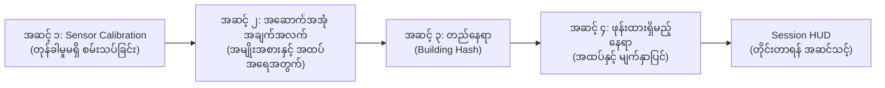
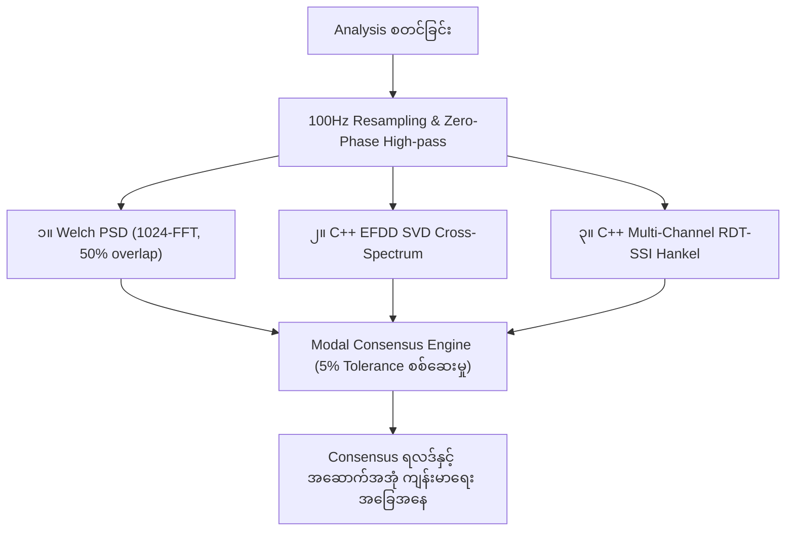

# PhoneSHM အသုံးပြုသူ လမ်းညွှန်လက်စွဲ (Application User Guide)

## ၁။ မိတ်ဆက်နှင့် ရည်ရွယ်ချက်

**PhoneSHM** သည် သာမန် Android စမတ်ဖုန်းများတွင် ပါရှိသော MEMS accelerometer တုန်ခါမှုတိုင်းတာရေး အာရုံခံကိရိယာများကို အသုံးပြု၍ အဆောက်အအုံများ၊ တံတားများနှင့် အခြေခံအဆောက်အအုံများ၏ တည်ဆောက်ပုံဆိုင်ရာ ကြံ့ခိုင်မှု (Structural Health) နှင့် သဘာဝတုန်ခါမှုနှုန်း (Fundamental Natural Frequency, $f_0$) တို့ကို တိကျစွာ တိုင်းတာစစ်ဆေးနိုင်သော Open-source အက်ပ်ဖြစ်ပါသည်။

ဤလမ်းညွှန်သည် အဆောက်အအုံ Profile ပြင်ဆင်ပုံ၊ တုန်ခါမှုဒေတာ ရယူပုံ၊ Tri-Engine Modal Analysis စနစ်ဖြင့် စစ်ဆေးပုံနှင့် အဆောက်အအုံ၏ ရေရှည်ကြံ့ခိုင်မှုအခြေအနေ (Baseline Monitoring) စောင့်ကြည့်ပုံတို့ကို အဆင့်ဆင့် ရှင်းပြထားပါသည်။

---

## ၂။ လိုအပ်ချက်များနှင့် ထည့်သွင်းခြင်း (Installation)

### အနိမ့်ဆုံး စနစ်လိုအပ်ချက်များ
- **Operating System**: Android 8.0 (API Level 26) သို့မဟုတ် အထက်။
- **Hardware**: Tri-axial MEMS Accelerometer ($\ge 100\text{ Hz}$ တိုင်းတာနိုင်ရမည်)။
- **ခွင့်ပြုချက်များ (Permissions)**:
  - `HIGH_SAMPLING_RATE_SENSORS`: Android 12+ တွင် $100\text{ Hz}$ မပြတ်တောက်ဘဲ တိုင်းတာနိုင်ရန်။
  - `FOREGROUND_SERVICE` & `WAKE_LOCK`: မျက်နှာပြင်မှိတ်ထားချိန်တွင်လည်း recording မရပ်တန့်စေရန်။
  - `ACCESS_FINE_LOCATION` (စိတ်ကြိုက်): အဆောက်အအုံ တည်နေရာ Hash ဖန်တီးရန်။

### ထည့်သွင်းပုံ (Installation)
1. [GitHub Releases](https://github.com/intellibits28/PhoneSHM/releases) မှ နောက်ဆုံးထွက်ရှိသော APK (`PhoneSHM-v1.2.0-research-grade.apk`) ကို ဒေါင်းလုဒ်ရယူပါ။
2. APK ဖိုင်ကို နှိပ်၍ ထည့်သွင်းပါ (လိုအပ်ပါက Android Settings တွင် "Install from Unknown Sources" ကို ဖွင့်ပေးပါ)။
3. ထည့်သွင်းပြီးပါက **PhoneSHM** ကို ဖွင့်ပါ။

---

## ၃။ အစပြုပြင်ဆင်ခြင်း အဆင့်ဆင့် (Onboarding Wizard)

အက်ပ်ကို ပထမဆုံးအကြိမ် ဖွင့်လှစ်သည့်အခါ အောက်ပါ အဆင့် ၄ ဆင့်ပါဝင်သော Wizard ပေါ်လာမည်ဖြစ်သည်-



### အဆင့် ၁: အာရုံခံကိရိယာ အရည်အသွေး စစ်ဆေးခြင်း (Sensor Calibration)
- ဖုန်းကို လှုပ်ရှားမှုမရှိသော ပြန့်ပြူးသည့် မျက်နှာပြင်တစ်ခုပေါ်တွင် ငြိမ်သက်စွာ ထားပါ။
- **"Start Calibration"** ကို နှိပ်ပါ။ အက်ပ်သည် ၃ စက္ကန့်ကြာ ငြိမ်သက်နေသော ဒေတာကို စစ်ဆေးကာ-
  - Accelerometer Bias တန်ဖိုးများ ($b_x, b_y, b_z$)၊
  - Sensor Noise Floor တန်ဖိုး (milli-g, $mg$)၊
  - ဖုန်း၏ အာရုံခံ အရည်အသွေးအဆင့် (`RESEARCH_GRADE`, `GOOD`, `FAIR`, `POOR`) တို့ကို တွက်ချက်ပေးမည်ဖြစ်သည်။
- **"Next"** ကို နှိပ်၍ ဆက်သွားပါ။

### အဆင့် ၂: အဆောက်အအုံဆိုင်ရာ အချက်အလက်များ သတ်မှတ်ခြင်း
- **Building Display Name**: မှတ်မိလွယ်သော အမည် (ဥပမာ- `ရုံးချုပ် အဆောက်အအုံ`)။
- **Primary Material**: အဆောက်အအုံ ဆောက်လုပ်ထားသော အဓိကပစ္စည်း-
  - `Reinforced Concrete (RC)` (သံကူကွန်ကရစ်)
  - `Moment-Resisting Steel Frame` (သံမဏိဘောင်)
  - `Timber / Wood Frame` (သစ်သားထည်)
  - `Masonry / Shear Wall` (အုတ်ရိုး / Shear Wall)
- **Total Storeys (Floors)**: အဆောက်အအုံ အထပ်အရေအတွက် (ဥပမာ- `8`)။
- **Construction Year**: ဆောက်လုပ်ခဲ့သည့် ခုနှစ် (ဥပမာ- `2015`)။

### အဆင့် ၃: တည်နေရာ အတည်ပြုခြင်း (Building Hash)
- အက်ပ်သည် GPS/Network တည်နေရာကို ရယူပြီး privacy ကို ထိန်းသိမ်းထားသော သီးသန့် **`building_hash`** (SHA-256 fingerprint) ကို ဖန်တီးပေးမည်ဖြစ်သည်။
- **"Next"** ကို နှိပ်ပါ။

### အဆင့် ၄: ဖုန်းထားရှိမည့် နေရာကို သတ်မှတ်ခြင်း
- **Floor Level**: ဖုန်းထားရှိပြီး တိုင်းတာမည့် အထပ် (ဥပမာ- အမြင့်ဆုံးအထပ် သို့မဟုတ် ခေါင်မိုးထပ်သည် အဆောက်အအုံ ယိမ်းခါမှု $f_0$ ကို အကောင်းဆုံး ဖမ်းယူနိုင်ပါသည်)။
- **Surface Type**: `Concrete Slab`, `Wooden Plank`, `Steel Beam`, သို့မဟုတ် `Tiled Floor`။
- **Location Type**: `Center Span` (ကြမ်းခင်းတုန်ခါမှုအတွက် ကောင်းမွန်), `Edge` (အစွန်း), `Column / Shear Wall` (အဆောက်အအုံ တစ်ခုလုံးယိမ်းခါမှုအတွက် အကောင်းဆုံး)။
- **Placement**: `Flat on Floor` (ကြမ်းပြင်ပေါ် အပြားလိုက်ထားရှိခြင်း)။
- **"Save & Finish"** ကို နှိပ်၍ ပင်မ HUD မျက်နှာပြင်သို့ သွားပါ။

---

## ၄။ တုန်ခါမှု တိုင်းတာခြင်း လုပ်ငန်းစဉ် (Measurement HUD)

```text
+-------------------------------------------------------------+
| PhoneSHM Session HUD                   [Edit] [Locations] [Switch] |
| Building ID: b3e05a8f.. | Session: c92fa321..               |
+-------------------------------------------------------------+
|                                                             |
|   ● SENSOR READY                                            |
|   Target Sample Rate: 100 Hz                                |
|   Target Duration: 60 Seconds                               |
|                                                             |
|   Live RMS Vibration Level: [████████░░░░░░░] 0.042 m/s²    |
|                                                             |
|                 [ START RECORDING ]                         |
|                                                             |
+-------------------------------------------------------------+
```

### အဆောက်အအုံနှင့် နေရာများ ပြောင်းလဲခြင်း
- **"Switch" ခလုတ်**: အခြားအဆောက်အအုံ profile သို့ ပြောင်းလဲခြင်း သို့မဟုတ် အဆောက်အအုံအသစ် ထည့်သွင်းခြင်း။
- **"Locations" ခလုတ်**: အဆောက်အအုံတစ်ခုတည်းတွင် အထပ်အမျိုးမျိုး/နေရာအမျိုးမျိုး တိုင်းတာနိုင်ရန် တည်နေရာရွေးချယ်ခြင်း သို့မဟုတ် **"Add New Location"** ဖြင့် နေရာအသစ် ထပ်ထည့်ခြင်း။
- **"Edit" ခလုတ်**: အဆောက်အအုံ အချက်အလက်များကို ပြန်လည်ပြင်ဆင်ခြင်း။

### တိုင်းတာမှု ပြုလုပ်ပုံ အဆင့်ဆင့်
1. **ဖုန်းကို အသေအချာ ထားရှိခြင်း**: ဖုန်းကို သတ်မှတ်ထားသော ကြမ်းပြင် သို့မဟုတ် တိုင်ခြေတွင် ငြိမ်သက်စွာ ချထားပါ။ တိုင်းတာနေစဉ် ဖုန်းကို လုံးဝ မကိုင်ပါနှင့်၊ ဖုန်းဘေးတွင် လမ်းမလျှောက်ပါနှင့်။
2. **စတင်ခြင်း**: **"Start Recording"** ကို နှိပ်ပါ။
3. **အလိုအလျောက် Sensor Calibration**: တိုင်းတာချိန် မစတင်မီ ၃ စက္ကန့်ကြာ noise calibration ကို အလိုအလျောက် ဦးစွာ ပြုလုပ်ပါမည် (`isCalibrating = true`)။
4. **ဒေတာ ရယူခြင်း**: အက်ပ်သည် $100\text{ Hz}$ အမြန်နှုန်းဖြင့် X, Y, Z တုန်ခါမှုများကို စတင်ဖမ်းယူပါမည်။ Live RMS meter တွင် လက်ရှိတုန်ခါမှုပြင်းအားကို တိုက်ရိုက် ကြည့်ရှုနိုင်ပါသည်။
5. **ပြီးဆုံးခြင်း**:
   - Hardware timestamp များ မှန်ကန်မှုကို စစ်ဆေးခြင်း။
   - Clock Jitter ($\sigma_{\Delta t}$) နှင့် Clock Drift (PPM) တွက်ချက်ခြင်း။
   - ဖိုင်အတွက် 4-byte CRC-32 Checksum ထုတ်ယူခြင်း။
   - Binary ဖိုင် (`.bin`) နှင့် Metadata (`.meta.json`) အဖြစ် သိမ်းဆည်းပြီး `/sdcard/Download/PhoneSHM/` သို့ အလိုအလျောက် ကူးယူပေးခြင်း။
   - စစ်ဆေးပြီးပါက **"Navigate to Analysis"** ဖြင့် ရလဒ်ဆန်းစစ်ချက် မျက်နှာပြင်သို့ သွားနိုင်ပါသည်။

---

## ၅။ ရလဒ်များ ဆန်းစစ်ခြင်း (Operational Modal Analysis)

**Analysis Screen** တွင် PhoneSHM ၏ Tri-Engine Modal Analysis စနစ်က အောက်ပါအတိုင်း တွက်ချက်ပြသပေးပါသည်-



### Consensus အဆင့်များကို နားလည်ခြင်း

| Status Badge | အဓိပ္ပာယ်နှင့် သဘောသဘာဝ | လုပ်ဆောင်ရန် အကြံပြုချက် |
| :--- | :--- | :--- |
| <span style="color:green;font-weight:bold">AGREED</span> (100%) | Method ၃ ခုစလုံး (Welch, EFDD, SSI) တူညီသော frequency (5% tolerance အတွင်း) ထွက်ရှိသည်။ | တိကျမှု အမြင့်ဆုံးဖြစ်သည်။ Baseline သို့ အတည်ပြုထည့်သွင်းနိုင်သည်။ |
| <span style="color:orange;font-weight:bold">PARTIAL</span> (67%) | Method ၂ ခု ကိုက်ညီသော်လည်း တတိယတစ်ခု ကွဲလွဲနေသည်။ | သဘာဝတုန်ခါမှု mode ဖြစ်နိုင်ခြေရှိသည်။ ပတ်ဝန်းကျင်ဆူညံမှုကို စစ်ဆေးပါ။ |
| <span style="color:red;font-weight:bold">DISAGREED</span> (33%) | Method များ အားလုံး frequency ကွဲလွဲနေသည်။ လူလျှောက်ခြင်း သို့မဟုတ် စက်သံများကြောင့် ဖြစ်နိုင်သည်။ | အချိန်ပိုကြာကြာ ထား၍ နောက်တစ်ကြိမ် ပြန်လည်တိုင်းတာပါ။ |
| <span style="color:gray;font-weight:bold">INSUFFICIENT</span> (0%) | ပတ်ဝန်းကျင် တုန်ခါမှုအားနည်းလွန်းသဖြင့် peak မရှာဖွေနိုင်ပါ။ | လေတိုက်ချိန် သို့မဟုတ် လူလှုပ်ရှားမှုရှိချိန်တွင် ပြန်လည်တိုင်းတာပါ။ |

### Physics Domain သတ်မှတ်ချက်များ
- **`GLOBAL_MODE`**: အဆောက်အအုံ အမြင့်နှင့် အမျိုးအစားအရ ထွက်ရှိသင့်သော သဘာဝတုန်ခါမှု ဘောင်အတွင်း ကျရောက်သည်။
- **`LOCAL_MODE`**: ကြမ်းခင်း သို့မဟုတ် အခန်းကန့်များ၏ သီးခြားတုန်ခါမှု ဖြစ်သည်။
- **`SENSOR_ARTIFACT`**: လျှပ်စစ်ဓာတ်အားလှိုင်းသံ ($50\text{Hz}/60\text{Hz}$) သို့မဟုတ် အာရုံခံကိရိယာ အပူကြောင့် ဖြစ်ပေါ်သော noise ဖြစ်သည်။

---

## ၆။ ရေရှည်ကြံ့ခိုင်မှု စောင့်ကြည့်စစ်ဆေးခြင်း (Longitudinal Baseline)

အဆောက်အအုံ ပျက်စီးယိုယွင်းလာပါက (ငလျင်ဒဏ်ကြောင့် အက်ကွဲခြင်း၊ အောက်ခြေကျွံခြင်း) တောင့်တင်းမှု (Stiffness) လျော့ကျသွားပြီး $f_0$ တုန်ခါမှုနှုန်း လျော့ကျသွားမည်ဖြစ်သည်-

### Calibration ကာလ (ပထမဆုံး တိုင်းတာမှု ၁၀ ကြိမ်)
- ပတ်ဝန်းကျင် အပူချိန်နှင့် သဘာဝအတက်အကျကို လေ့လာသည့် ကာလဖြစ်ပါသည်။
- HUD တွင် `CALIBRATING BASELINE (n/10)` ဟု ပြသမည်ဖြစ်သည်။

### စောင့်ကြည့်စစ်ဆေးမှု ကာလ (တိုင်းတာမှု ၁၁ ကြိမ်နှင့် အထက်)
- ပထမ ၁၀ ကြိမ်မှ ရရှိသော ပျမ်းမျှ $(\mu, \sigma)$ သည် အဆောက်အအုံ၏ မူလကျန်းမာရေးစံ (Golden Baseline) ဖြစ်လာသည်။
- **Shift တွက်ချက်မှု**:
  $$\Delta f_0\% = \frac{f_{\text{current}} - \mu}{\mu} \times 100\%$$
- **သတိပေးချက်**: မူလ baseline ထက် $|\Delta f_0\%| > 5.0\%$ ကျဆင်းသွားပါက အက်ပ်မှ **Structural Anomaly Alert** (ပုံမှန်မဟုတ်သော တုန်ခါမှုသတိပေးချက်) ကို ထုတ်ပြန်ပေးပါသည်။
- **ဒေတာလုံခြုံမှု**: Anomaly ဖြစ်သော တိုင်းတာမှုများကို Baseline သန့်ရှင်းစေရန်အတွက် မူလ $(\mu, \sigma)$ ထဲသို့ ရောနှောမထည့်သွင်းဘဲ သီးခြားမှတ်တမ်းတင်ပါသည်။

---

## ၇။ ဒေတာ ထုတ်ယူခြင်းနှင့် ပြင်ပ သုတေသန ပြုလုပ်ခြင်း

တိုင်းတာထားသော ဒေတာအားလုံးကို Compact binary (`.bin`) နှင့် Metadata sidecar (`.meta.json`) အဖြစ် သိမ်းဆည်းထားပါသည်-

### Termux ဖြင့် တိုက်ရိုက် ကြည့်ရှုခြင်း
```bash
cd /data/data/com.termux/files/home/storage/downloads/phoneshm/
ls -lh *.bin
```

### ကွန်ပျူတာ (PC) မှ ရယူခြင်း
ဖုန်းကို USB ကြိုးဖြင့် ချိတ်ဆက်ပြီး:
`This PC \ <Phone Name> \ Internal storage \ Download \ PhoneSHM\` သို့ သွားရောက်ရယူနိုင်ပါသည်။

အသေးစိတ် binary frame specifications များကို [docs/DATA_FORMATS.md](file:///data/data/com.termux/files/home/play-ground/ronin_shm/docs/DATA_FORMATS.md) တွင် ကြည့်ရှုနိုင်ပါသည်။
