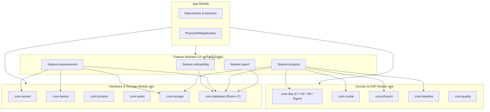
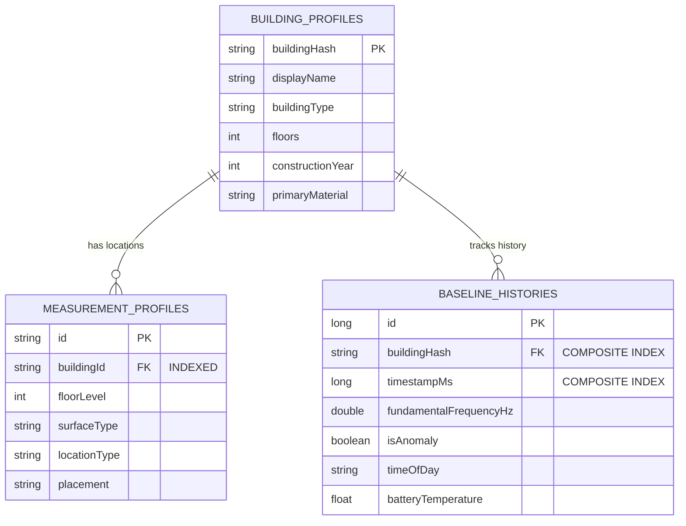

# PhoneSHM စနစ်ဖွဲ့စည်းပုံဆိုင်ရာ ဗိသုကာလက်စွဲ (System Architecture)

## ၁။ စနစ်ခြုံငုံသုံးသပ်ချက်

**PhoneSHM** သည် သာမန် Android စမတ်ဖုန်းများ၏ MEMS accelerometer များကို အသုံးပြု၍ အဆောက်အအုံများနှင့် တံတားများ၏ ကြံ့ခိုင်မှုကို တိုင်းတာစစ်ဆေးနိုင်သည့် သုတေသနအဆင့်မီ Android Platform တစ်ခုဖြစ်ပါသည်။

အောက်ပါ အဓိကနည်းပညာရပ်များကို ပေါင်းစပ်တည်ဆောက်ထားပါသည်-
- Hardware-accurate Clock Jitter နှင့် Drift များကို တွက်ချက်ထိန်းညှိခြင်း။
- C++20 (Eigen 3.4 SVD) ဖြင့် Welch PSD, EFDD နှင့် RDT-SSI စသည့် အဆင့်မြင့် Digital Signal Processing များ ပြုလုပ်ခြင်း။
- နိုင်ငံတကာ အဆောက်အအုံတည်ဆောက်ရေးစံနှုန်းများ (Eurocode 8, ASCE 7) ဖြင့် သဘာဝတုန်ခါမှု တိကျမှန်ကန်မှုကို စစ်ဆေးအတည်ပြုခြင်း။
- ပတ်ဝန်းကျင် အပူချိန်နှင့် နေ့/ည အချိန်ကာလများကို ထည့်သွင်းစဉ်းစားသော Online Welford Baseline စနစ်ဖြင့် အဆောက်အအုံ ယိုယွင်းမှု (Structural Anomaly) ကို စောင့်ကြည့်ခြင်း။

---

## ၂။ Module ၁၄ ခုပါဝင်သော Clean Architecture ဖွဲ့စည်းပုံ

Codebase ကို လွတ်လပ်စွာ ထိန်းသိမ်းနိုင်စေရန်အတွက် သီးခြား Gradle Module ၁၄ ခုဖြင့် ဖွဲ့စည်းထားပါသည်-

### Module တစ်ခုချင်းစီ၏ တာဝန်များ

| Module | တာဝန်နှင့် လုပ်ဆောင်ချက်များ |
| :--- | :--- |
| `:app` | Application စတင်ဖွင့်လှစ်ခြင်း၊ Compose Navigation Host နှင့် Back-stack စီမံခန့်ခွဲခြင်း။ |
| `:feature:onboarding` | ၄ ဆင့်ပါ Building Profile Wizard နှင့် တည်နေရာစီမံခန့်ခွဲမှု UI။ |
| `:feature:measurement` | $100\text{ Hz}$ တိုက်ရိုက်တုန်ခါမှု တိုင်းတာခြင်း HUD၊ Live RMS Level နှင့် သီးခြား Sensor Calibration။ |
| `:feature:analysis` | Tri-Engine Modal Execution (Welch + EFDD + RDT-SSI)၊ Consensus ရလဒ်နှင့် Baseline Anomaly စစ်ဆေးမှု UI။ |
| `:feature:report` | ပြည်သူလူထုသုံး အနှစ်ချုပ်နှင့် အင်ဂျင်နီယာသုံး အသေးစိတ် Spectrum/SVD အစီရင်ခံစာ။ |
| `:core:dsp` | C++20 / JNI / Eigen 3.4 SVD Math Engine၊ Welch PSD၊ EFDD နှင့် Multi-Channel RDT-SSI။ |
| `:core:modal` | Peak extraction၊ Parabolic interpolation၊ Adaptive persistence နှင့် Modal Consensus Engine။ |
| `:core:physics` | Eurocode / ASCE အဆောက်အအုံ အမြင့်နှင့် ကြိမ်နှုန်းဆိုင်ရာ ညီမျှခြင်းများ ($T = C_t H^{3/4}$)။ |
| `:core:baseline` | Welford Online Algorithm ($\mu, \sigma$)၊ ၁၀ ကြိမ်မြောက် Baseline တည်ဆောက်မှုနှင့် $\pm 5\%$ Anomaly စစ်ဆေးမှု။ |
| `:core:quality` | အချက် ၄ ချက်ပါ တိုင်းတာမှုအရည်အသွေး (Sensor, Noise, Coupling, Peak prominence) ပေါင်းစပ်တွက်ချက်မှု။ |
| `:core:sensor` | Hardware sensor မှ တုန်ခါမှုဒေတာဖမ်းယူခြင်း၊ Monotonic timestamp စစ်ဆေးခြင်းနှင့် Clock drift PPM တွက်ချက်ခြင်း။ |
| `:core:device` | ၃ စက္ကန့် Static calibration၊ Noise floor (mg) တွက်ချက်ခြင်းနှင့် Quality tier သတ်မှတ်ခြင်း။ |
| `:core:storage` | Compact Binary format (`.bin`) သို့ 20-byte sample frames များ စဉ်ဆက်မပြတ် ရေးသားသိမ်းဆည်းခြင်း။ |
| `:core:database` | Room Database (Version 7)၊ B-tree indices များ နှင့် ဒေတာမဆုံးရှုံးစေသော `MIGRATION_6_7`။ |
| `:core:location` | Privacy-preserving GPS resolver နှင့် အဆောက်အအုံဆိုင်ရာ immutable SHA-256 `building_hash`။ |
| `:core:audio` | အသံဖိုင်အစိမ်း မသိမ်းဆည်းဘဲ တုန်ခါချိန်ပတ်ဝန်းကျင် အသံအခြေအနေကို RAM Buffer ထဲတွင်သာ စစ်ဆေးခြင်း။ |

---

## ၃။ Threading Model နှင့် စွမ်းဆောင်ရည် စီမံခန့်ခွဲမှု

UI ထစ်ငေါ့ခြင်းနှင့် ANR (App Not Responding) crash ဖြစ်ခြင်းများကို ကာကွယ်ရန် Coroutine Dispatchers များကို တိကျစွာ ခွဲဝေထားပါသည်-

1. **`Dispatchers.Main`**:
   - Jetpack Compose UI ရေးဆွဲခြင်း၊ Animation များနှင့် User interaction များကိုသာ လုပ်ဆောင်သည်။
   - Screen rotation ပြုလုပ်ချိန်တွင် UI state မပျောက်ပျက်စေရန် `rememberSaveable` ကို သုံးသည်။
   - စနစ်၏ Back button အတွက် `BackHandler` ဖြင့် စီမံသည်။

2. **`Dispatchers.Default`**:
   - တွက်ချက်မှုပြင်းထန်သော CPU လုပ်ငန်းစဉ်များအတွက် သီးခြား Thread Pool ဖြစ်သည်-
     - Uniform Resampling (100Hz) နှင့် EMA gravity removal။
     - C++ JNI bridge native execution (Welch FFT, SVD decompositions, Hankel matrix)။
     - Modal Consensus multi-candidate clustering။

3. **`Dispatchers.IO`**:
   - Disk နှင့် Network လုပ်ငန်းစဉ်များအတွက် သီးခြား Thread Pool ဖြစ်သည်-
     - Binary `.bin` ဖိုင် ရေးသားခြင်းနှင့် Sidecar `.meta.json` ထုတ်ယူခြင်း။
     - Room Database SQLite queries များနှင့် Scoped Storage သို့ ဒေတာကူးယူခြင်း။

---

## ၄။ ဒေတာဘေ့စ် ဖွဲ့စည်းပုံ (Room Database Version 7)

- **Version 7 အဆင့်မြှင့်တင်မှု**: `MeasurementProfileEntity(buildingId)` ပေါ်တွင် B-tree index နှင့် `BaselineHistoryEntity(buildingHash, timestampMs)` ပေါ်တွင် composite index ထည့်သွင်းထားပြီး ဒေတာများ မပျက်စီးစေဘဲ `MIGRATION_6_7` ဖြင့် အောင်မြင်စွာ ရွှေ့ပြောင်းနိုင်ပါသည်။
