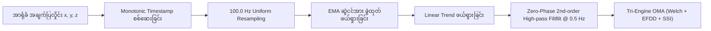

# Operational Modal Analysis (OMA) နှင့် DSP သတ်မှတ်ချက်များ (မြန်မာဘာသာ)

## ၁။ သင်္ချာနှင့် အင်ဂျင်နီယာဆိုင်ရာ အခြေခံသဘောတရား

စမတ်ဖုန်းများတွင် ပါရှိသော MEMS accelerometer များသည် analog-to-digital အကူးအပြောင်းတွင် ကွဲလွဲချက်များ၊ အပူချိန်ကြောင့် တန်ဖိုးရွေ့လျားမှုများ (thermal drift) နှင့် ကမ္ဘာ့ဆွဲငင်အား DC gravity offset ($1g \approx 9.80665\text{ m/s}^2$) တို့ အမြဲတစေ ပါရှိနေပါသည်။

**PhoneSHM** သည် အဆိုပါ ချို့ယွင်းချက်များကို အောက်ပါ အဆင့် ၃ ဆင့်ဖြင့် တိကျစွာ ပြင်ဆင်တွက်ချက်ပါသည်-
1. **Deterministic Preprocessing**: Hardware timestamp မှန်ကန်မှု စစ်ဆေးခြင်း၊ Uniform $100.0\text{ Hz}$ resampling ပြုလုပ်ခြင်း၊ EMA gravity ဖယ်ရှားခြင်းနှင့် Zero-phase Butterworth filtering။
2. **Tri-Engine Modal Identification**:
   - **Method 1 (Frequency Domain)**: Welch PSD နှင့် Sub-bin parabolic interpolation။
   - **Method 2 (Spatial/Frequency Domain)**: Enhanced Frequency Domain Decomposition (EFDD - C++ Eigen SVD)။
   - **Method 3 (Time Domain)**: Multi-Channel Random Decrement Technique နှင့် Stochastic Subspace Identification (RDT-SSI)။
3. **Tri-Engine Modal Consensus**: အယ်လဂိုရီသမ် ၃ ခုမှ ရရှိသော အကြိမ်နှုန်းများကို 5% tolerance ဖြင့် စစ်ဆေးပြီး အဆောက်အအုံ၏ စစ်မှန်သော သဘာဝတုန်ခါမှုနှုန်း ($f_0$) ကို အတည်ပြုခြင်း။

---

## ၂။ အချက်ပြလှိုင်း ပြင်ဆင်သန့်စင်ခြင်း (Signal Preprocessing)

### က။ Resampling နှင့် Monotonicity စစ်ဆေးခြင်း
Android OS သည် sensor events များကို အချိန်အခိုက်အတန့် မညီမညာ ပေးပို့လေ့ရှိသည်။ ထို့ကြောင့် Hardware timestamp များ တသမတ်တည်း တိုးတက်မှုရှိမရှိ စစ်ဆေးပြီး လှိုင်းများကို $100\text{ Hz}$ ($\Delta t = 10\text{ ms}$) သို့ linear/cubic interpolation ဖြင့် တစ်ပြေးညီ ပြန်လည်ချိန်ညှိပါသည်။

### ခ။ ကမ္ဘာ့ဆွဲငင်အား ဖယ်ရှားခြင်း (Gravity Removal)
ဖုန်း၏ အနေအထားကြောင့် ပါဝင်နေသော Static Gravity vector ကို Exponential Moving Average (EMA) ဖြင့် တွက်ချက်ဖယ်ရှားပါသည်:
$$\mathbf{g}_i = \alpha \mathbf{a}_i + (1 - \alpha) \mathbf{g}_{i-1}, \quad (\alpha = 0.05)$$
$$\mathbf{a}_{\text{free}, i} = \mathbf{a}_i - \mathbf{g}_i$$
ထို့နောက် အပူချိန်ကြောင့် လှိုင်းတန်ဖိုး တဖြည်းဖြည်း မြင့်တက်/ကျဆင်းသွားခြင်းကို Ordinary Least Squares Linear Detrending ဖြင့် ဖြောင့်တန်းစေပါသည်။

### ဂ။ Zero-Phase High-Pass Filter (`filtfilt`)
အလွန်နိမ့်သော အပူချိန်လှိုင်းများနှင့် မိုက်ခရိုတုန်ခါမှုများကို အဆင့်မလွဲချော်စေဘဲ (Zero-phase distortion) ရှင်းလင်းရန် $0.5\text{ Hz}$ cut-off ရှိသော forward-backward Butterworth filter ကို အသုံးပြုထားပါသည်။

---

## ၃။ Method 1: Welch Power Spectral Density (PSD)

Welch ၏ Averaged Modified Periodogram နည်းပညာဖြင့် X, Y, Z နှင့် ပေါင်းစပ် Acceleration Magnitude အပေါ်တွင် Power Spectrum ကို တွက်ချက်ပါသည်-

### သတ်မှတ်ချက်များ
- **Sampling Frequency ($f_s$)**: $100\text{ Hz}$
- **FFT Size ($N_{\text{fft}}$)**: $1024$ samples
- **Window Function**: Hanning window
- **Window Overlap**: $50\%$ ($512$ samples overlap)
- **Spectral Resolution ($\Delta f$)**: $\frac{100}{1024} \approx 0.09766\text{ Hz}$

### Memory Optimization (C++20)
[`dsp_core.cpp`](file:///data/data/com.termux/files/home/play-ground/ronin_shm/core/dsp/src/main/cpp/dsp_core.cpp) တွင် segment အကြိမ်ရာပေါင်းများစွာအတွက် vector allocate/free ပြုလုပ်ခြင်းကို ရှောင်ရှားပြီး loop ပြင်ပတွင် `segment`, `real`, `imag` vector များကို တစ်ကြိမ်တည်း preallocate လုပ်ကာ အသုံးပြုထားပါသည်။

### Parabolic Sub-Bin Interpolation
Discrete frequency grid $\Delta f$ ထက် ပိုမိုတိကျသော peak frequency ရရှိစေရန် logarithmic parabolic interpolation ဖြင့် ဒသမကိန်း တိကျစွာ ရှာဖွေပေးပါသည်။

---

## ၄။ Method 2: Enhanced Frequency Domain Decomposition (EFDD)

Frequency Domain Decomposition (FDD) သည် multi-degree-of-freedom တုန်ခါမှုလှိုင်းများကို Singular Value Decomposition (SVD) အသုံးပြု၍ single-degree-of-freedom (SDOF) စနစ်များအဖြစ် ခွဲထုတ်ပေးပါသည်။

1. **Cross-Spectral Density Matrix**: Frequency bin တစ်ခုစီတွင် $3 \times 3$ Power Spectral Density matrix $\mathbf{G}_{yy}(f_k)$ ကို တည်ဆောက်သည်။
2. **Singular Value Decomposition (SVD)**:
   $$\mathbf{G}_{yy}(f_k) = \mathbf{U}_k \mathbf{\Sigma}_k \mathbf{U}_k^H = \sum_{j=1}^3 s_{j, k} \mathbf{u}_{j, k} \mathbf{u}_{j, k}^H$$
3. **First Singular Value ($s_1$) Line Spectrum**: အဆောက်အအုံ၏ အဓိက mode များသည် ပထမ singular value $s_1(f)$ တွင် အထင်ရှားဆုံး peak များအဖြစ် ပေါ်ပေါက်လာသည်။
4. **Damping Ratio ($\zeta$) တွက်ချက်ခြင်း**: Modal Assurance Criterion (MAC $\ge 0.80$) ရှိသော peak ပတ်ဝန်းကျင် SDOF bell ကို Inverse Discrete Fourier Transform (IDFT) ပြုလုပ်ပြီး auto-correlation decay envelope မှ logarithmic decrement နည်းဖြင့် damping ratio ($\zeta$) ကို ထုတ်ယူပေးသည်။

---

## ၅။ Method 3: Multi-Channel RDT-SSI (Time Domain)

Random Decrement Technique (RDT) ဖြင့် သဘာဝကျပန်းတုန်ခါမှုများမှ free vibration decay လက်မှတ်များကို ဖော်ထုတ်ပြီး Stochastic Subspace Identification (SSI) ဖြင့် state-space dynamic matrix မှ အဆောက်အအုံ၏ တုန်ခါမှု mode များကို ထုတ်ယူပါသည်-

1. **Triggering**: အမြင့်ဆုံး variance ရှိသော axis ကို reference အဖြစ် ရွေးချယ်ပြီး $1.0\sigma$ မှ $2.0\sigma$ အထိ trigger အဆင့် ၁၀ ဆင့်ဖြင့် synchronous averaging (RDS) ပြုလုပ်သည်။
2. **Block Hankel Matrix**: ချန်နယ် ၃ ခု၏ RDS မှ $(3i \times i)$ Block Hankel matrix ကို တည်ဆောက်သည်။
3. **Eigen SVD**: BDCSVD Thin decomposition ဖြင့် Observability matrix $\mathbf{O}_n = \mathbf{U}_n \mathbf{\Sigma}_n^{1/2}$ ကို တွက်ထုတ်သည်။
4. **Transition Matrix & Poles**:
   $$\mathbf{A} = \mathbf{O}_{\text{up}}^\dagger \mathbf{O}_{\text{down}}$$
   System matrix $\mathbf{A}$ ၏ Eigenvalues ($\lambda_i$) များမှ စစ်မှန်သော frequency ($f_i$) နှင့် damping ($\zeta_i$) များကို ရယူသည်။

---

## ၆။ Tri-Engine Modal Consensus စနစ်

[`ModalConsensusEngine`](file:///data/data/com.termux/files/home/play-ground/ronin_shm/core/modal/src/main/kotlin/com/ronin/phoneshm/core/modal/ModalConsensusEngine.kt) သည် Welch, EFDD, SSI သုံးခုစလုံးမှ ရရှိသော အကြိမ်နှုန်းများကို 5% structural tolerance ဘောင်အတွင်း ကိုက်ညီမှု ရှိမရှိ စစ်ဆေးပေးပါသည်:

$$\frac{|f_1 - f_2|}{\frac{f_1 + f_2}{2}} \le 0.05$$

- **`AGREED` (100% ယုံကြည်စိတ်ချရမှု)**: Method ၃ ခုစလုံး 5% အတွင်း ကိုက်ညီသောအခါ။
- **`PARTIAL` (66.7% ယုံကြည်စိတ်ချရမှု)**: Method ၂ ခုသာ ကိုက်ညီသောအခါ။
- **`DISAGREED` (33.3% ယုံကြည်စိတ်ချရမှု)**: Method များအားလုံး သီးခြားစီ ကွဲလွဲနေသောအခါ။
- **`INSUFFICIENT` (0% ယုံကြည်စိတ်ချရမှု)**: တုန်ခါမှုအားနည်းလွန်းသဖြင့် မည်သည့် method တွင်မျှ peak မထွက်ပေါ်သောအခါ။
