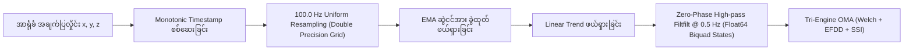

# Operational Modal Analysis (OMA) နှင့် DSP သတ်မှတ်ချက်များ (မြန်မာဘာသာ)

## ၁။ သင်္ချာနှင့် အင်ဂျင်နီယာဆိုင်ရာ အခြေခံသဘောတရား

စမတ်ဖုန်းများတွင် ပါရှိသော MEMS accelerometer များသည် analog-to-digital အကူးအပြောင်းတွင် ကွဲလွဲချက်များ၊ အပူချိန်ကြောင့် တန်ဖိုးရွေ့လျားမှုများ (thermal drift) နှင့် ကမ္ဘာ့ဆွဲငင်အား DC gravity offset ($1g \approx 9.80665\text{ m/s}^2$) တို့ အမြဲတစေ ပါရှိနေပါသည်။

**PhoneSHM** သည် အဆိုပါ ချို့ယွင်းချက်များကို အောက်ပါ အဆင့် ၃ ဆင့်ဖြင့် တိကျစွာ ပြင်ဆင်တွက်ချက်ပါသည်-
1. **Deterministic Preprocessing**: Hardware timestamp မှန်ကန်မှု စစ်ဆေးခြင်း၊ 64-bit Double grid ဖြင့် Uniform $100.0\text{ Hz}$ resampling ပြုလုပ်ခြင်း၊ EMA gravity ဖယ်ရှားခြင်းနှင့် 64-bit precision IIR states ပါဝင်သော Zero-phase Butterworth filtering။
2. **Tri-Engine Modal Identification**:
   - **Method 1 (Frequency Domain)**: Welch PSD၊ Sub-bin parabolic interpolation နှင့် Median + 3*MAD segment gating။
   - **Method 2 (Spatial/Frequency Domain)**: Enhanced Frequency Domain Decomposition (EFDD) - ဒေါင်လိုက် slab modes များနှင့် ရောထွေးမှုမရှိစေရန် Horizontal 2-axis ($X, Y$) sway CSD matrix အဖြစ် ခွဲထုတ်ကာ C++ SVD ဖြင့် တွက်ချက်ခြင်း။
   - **Method 3 (Time Domain)**: Multi-Channel Random Decrement Technique နှင့် Stochastic Subspace Identification (RDT-SSI)။
3. **Tri-Engine Modal Consensus**: အယ်လဂိုရီသမ် ၃ ခုမှ ရရှိသော အကြိမ်နှုန်းများကို 5% tolerance ဖြင့် စစ်ဆေးပြီး အဆောက်အအုံ၏ စစ်မှန်သော သဘာဝတုန်ခါမှုနှုန်း ($f_0$) ကို အတည်ပြုခြင်း။

---

## ၂။ အချက်ပြလှိုင်း ပြင်ဆင်သန့်စင်ခြင်း (Signal Preprocessing)

### က။ Resampling နှင့် Monotonicity စစ်ဆေးခြင်း
Android OS သည် sensor events များကို အချိန်အခိုက်အတန့် မညီမညာ ပေးပို့လေ့ရှိသည်။ ထို့ကြောင့် Hardware timestamp များ တသမတ်တည်း တိုးတက်မှုရှိမရှိ စစ်ဆေးပြီး လှိုင်းများကို $100\text{ Hz}$ ($\Delta t = 10\text{ ms}$) သို့ linear/cubic interpolation ဖြင့် တစ်ပြေးညီ ပြန်လည်ချိန်ညှိပါသည်။
အချိန်ကြာမြင့်စွာ တိုင်းတာချိန်တွင် integer truncation ကြောင့် စက္ကန့်ပိုင်းအတွင်း millisecond များ drift မဖြစ်စေရန် Target grid timestamps များကို 64-bit double precision ဖြင့် တိကျစွာ တွက်ချက်ပါသည်:
$$t_{\text{target}, k} = t_{\text{start}} + \text{round}\left(k \cdot \frac{10^9}{f_s}\right)$$

### ခ။ ကမ္ဘာ့ဆွဲငင်အား ဖယ်ရှားခြင်း (Gravity Removal)
ဖုန်း၏ အနေအထားကြောင့် ပါဝင်နေသော Static Gravity vector ကို Exponential Moving Average (EMA) ဖြင့် တွက်ချက်ဖယ်ရှားပါသည်:
$$\mathbf{g}_i = \alpha \mathbf{a}_i + (1 - \alpha) \mathbf{g}_{i-1}, \quad (\alpha = 0.05)$$
$$\mathbf{a}_{\text{free}, i} = \mathbf{a}_i - \mathbf{g}_i$$
ထို့နောက် အပူချိန်ကြောင့် လှိုင်းတန်ဖိုး တဖြည်းဖြည်း မြင့်တက်/ကျဆင်းသွားခြင်းကို Ordinary Least Squares Linear Detrending ဖြင့် ဖြောင့်တန်းစေပါသည်။

### ဂ။ Zero-Phase High-Pass Filter (`filtfilt`) နှင့် 64-bit Numerical Stability
အလွန်နိမ့်သော အပူချိန်လှိုင်းများနှင့် မိုက်ခရိုတုန်ခါမှုများကို အဆင့်မလွဲချော်စေဘဲ (Zero-phase distortion) ရှင်းလင်းရန် $f_c = 0.5\text{ Hz}$ cut-off ရှိသော forward-backward Butterworth filter ကို အသုံးပြုထားပါသည်။

Cut-off frequency သည် sampling rate နှင့်ယှဉ်လျှင် အလွန်နိမ့်ကျနေသဖြင့် ($\frac{f_c}{f_s} = 0.005$) filter pole များသည် unit circle ($z \approx 0.978 \pm j0.022$) အနီး ကပ်နေပါသည်။ ထို့ကြောင့် single-precision (`float32`) တွင် ဖြစ်ပေါ်တတ်သော coefficient quantization error နှင့် limit cycle တုန်ခါမှုများကို ကာကွယ်ရန် biquad coefficients ($b_0, b_1, b_2, a_1, a_2$) နှင့် state delay registers ($z_1, z_2$) များကို **64-bit `Double` (`double` in C++)** ဖြင့် တည်ဆောက်ထားပါသည်။

---

## ၃။ Method 1: Welch Power Spectral Density (PSD)

Welch ၏ Averaged Modified Periodogram နည်းပညာဖြင့် X, Y, Z နှင့် ပေါင်းစပ် Acceleration Magnitude အပေါ်တွင် Power Spectrum ကို တွက်ချက်ပါသည်-

### သတ်မှတ်ချက်များ
- **Sampling Frequency ($f_s$)**: $100\text{ Hz}$
- **FFT Size ($N_{\text{fft}}$)**: $1024$ samples
- **Window Function**: Hanning window
- **Window Overlap**: $50\%$ ($512$ samples overlap)
- **Spectral Resolution ($\Delta f$)**: $\frac{100}{1024} \approx 0.09766\text{ Hz}$

### အဖျက်သဘောဆောင်သော ရုတ်တရက်လှိုင်းများ ဖယ်ထုတ်ခြင်း (Segment Gating)
အဆောက်အအုံအတွင်း လူလျှောက်သံ၊ တံခါးပိတ်သံ သို့မဟုတ် ဖုန်းထိမိခြင်းကြောင့် ဖြစ်ပေါ်သော transient broadband impulse များ Welch PSD ကို မထိခိုက်စေရန် Median + $3 \times \text{MAD}$ RMS Gate စနစ် ထည့်သွင်းထားပါသည်-
1. Segment တစ်ခုချင်းစီ၏ RMS စွမ်းအင်ကို တွက်ချက်သည်။
2. Segments အားလုံး၏ အလယ်ကိန်း Median RMS ($\widetilde{\text{RMS}}$) နှင့် Median Absolute Deviation ($\text{MAD}$) ကို ရှာဖွေသည်။
3. $\text{RMS}_m \le \widetilde{\text{RMS}} + 3 \times \max(\text{MAD}, 10^{-6})$ သတ်မှတ်ချက်နှင့် ကိုက်ညီသော segments များကိုသာ periodogram ပျမ်းမျှတွက်ချက်မှုထဲသို့ ထည့်သွင်းသည်။

### Memory Optimization (C++20)
[`dsp_core.cpp`](file:///data/data/com.termux/files/home/play-ground/ronin_shm/core/dsp/src/main/cpp/dsp_core.cpp) တွင် segment အကြိမ်ရာပေါင်းများစွာအတွက် vector allocate/free ပြုလုပ်ခြင်းကို ရှောင်ရှားပြီး loop ပြင်ပတွင် `segment`, `real`, `imag` vector များကို တစ်ကြိမ်တည်း preallocate လုပ်ကာ အသုံးပြုထားပါသည်။

### Parabolic Sub-Bin Interpolation
Discrete frequency grid $\Delta f$ ထက် ပိုမိုတိကျသော peak frequency ရရှိစေရန် logarithmic parabolic interpolation ဖြင့် ဒသမကိန်း တိကျစွာ ရှာဖွေပေးပါသည်။

---

## ၄။ Method 2: Enhanced Frequency Domain Decomposition (EFDD)

Frequency Domain Decomposition (FDD) သည် multi-degree-of-freedom တုန်ခါမှုလှိုင်းများကို Singular Value Decomposition (SVD) အသုံးပြု၍ single-degree-of-freedom (SDOF) စနစ်များအဖြစ် ခွဲထုတ်ပေးပါသည်။

### Horizontal Sway ခွဲထုတ်ခြင်း ($2 \times 2$ CSD Matrix)
အရပ်ဘက် အဆောက်အအုံများ၏ အဓိကသဘာဝတုန်ခါမှုသည် အလျားလိုက်ယိမ်းခါမှု (Horizontal sway) ဖြစ်သည်။ စမတ်ဖုန်း၏ ဒေါင်လိုက် ($Z$-axis) သည် ဒေသန္တရကြမ်းခင်းတုန်ခါမှုများ လွှမ်းမိုးနေတတ်သဖြင့် horizontal sway ကို မဖုံးကွယ်စေရန်အတွက် horizontal axes $X, Y$ ကိုသာ သီးခြား $2 \times 2$ Cross-Spectral Density (CSD) matrix အဖြစ် ခွဲထုတ်တွက်ချက်ပါသည်-

1. **Horizontal CSD Matrix**: Frequency bin တစ်ခုစီတွင် $2 \times 2$ matrix $\mathbf{G}_{xy}(f_k)$ ကို တည်ဆောက်သည်:
   $$\mathbf{G}_{xy}(f_k) = \begin{bmatrix} 
   S_{xx}(f_k) & S_{xy}(f_k) \\
   S_{yx}(f_k) & S_{yy}(f_k)
   \end{bmatrix}$$
   (CSD မတွက်မီ segments များကို Median + $3 \times \text{MAD}$ gate ဖြင့် စစ်ဆေးသည်)။
2. **Singular Value Decomposition (SVD)**:
   $$\mathbf{G}_{xy}(f_k) = \mathbf{U}_k \mathbf{\Sigma}_k \mathbf{U}_k^H = \sigma_{1}(f_k) \mathbf{u}_{1, k} \mathbf{u}_{1, k}^H + \sigma_{2}(f_k) \mathbf{u}_{2, k} \mathbf{u}_{2, k}^H$$
   ပထမ singular value $\sigma_1(f_k)$ သည် ဖုန်း၏ ထားရှိရာ orientation ထောင့်အပေါ် မမူတည်ဘဲ (Azimuth invariant) အဆောက်အအုံ၏ အဓိက horizontal sway စွမ်းအင်ကို ဖော်ပြသည်။
3. **First Singular Value Line Spectrum**: အလျားလိုက် သဘာဝတုန်ခါမှု mode များသည် $\sigma_1(f)$ spectrum ပေါ်တွင် ထင်ရှားသော peak များအဖြစ် ပေါ်ပေါက်လာသည်။
4. **Damping Ratio ($\zeta$) တွက်ချက်ခြင်း**:
   - Peak ပတ်ဝန်းကျင် SDOF bell ကို Inverse Discrete Fourier Transform (IDFT) ပြုလုပ်ပြီး auto-correlation free decay envelope ကို ရယူသည်။
   - Autocorrelation peak များကို ရှာဖွေရာတွင် $r[i] \ge 0.15 \cdot r_{\text{first}}$ တန်ဖိုးဖြင့် စစ်ဆေးပြီး Logarithmic Decrement ($\delta$) မှတစ်ဆင့် damping ratio ($\zeta$) ကို တိကျစွာ ထုတ်ယူပေးသည်။

---

## ၅။ Method 3: Multi-Channel RDT-SSI (Time Domain)

Random Decrement Technique (RDT) ဖြင့် သဘာဝကျပန်းတုန်ခါမှုများမှ free vibration decay လက်မှတ်များကို ဖော်ထုတ်ပြီး Stochastic Subspace Identification (SSI) ဖြင့် state-space dynamic matrix မှ အဆောက်အအုံ၏ တုန်ခါမှု mode များကို ထုတ်ယူပါသည်-

1. **Triggering**: အမြင့်ဆုံး variance ရှိသော axis ကို reference အဖြစ် ရွေးချယ်ပြီး $1.0\sigma$ မှ $2.0\sigma$ အထိ trigger အဆင့် ၁၀ ဆင့်ဖြင့် synchronous averaging (RDS) ပြုလုပ်သည်။
2. **Block Hankel Matrix**: ချန်နယ် ၃ ခု၏ RDS မှ $(3i \times i)$ Block Hankel matrix ကို တည်ဆောက်သည်။
3. **Eigen SVD**: BDCSVD Thin decomposition ဖြင့် Observability matrix $\mathbf{O}_n = \mathbf{U}_n \mathbf{\Sigma}_n^{1/2}$ ကို တွက်ထုတ်သည်။
4. **Transition Matrix & Poles**:
   $$\mathbf{A} = \mathbf{O}_{\text{up}}^\dagger \mathbf{O}_{\text{down}}$$
   System matrix $\mathbf{A}$ ၏ Eigenvalues ($\lambda_i$) များမှ စစ်မှန်သော frequency ($f_i$) နှင့် damping ($\zeta_i$) များကို ရယူသည်။

---

## ၆။ Tri-Engine Modal Consensus စနစ်

[`ModalConsensusEngine`](file:///data/data/com.termux/files/home/play-ground/ronin_shm/core/modal/src/main/kotlin/com/ronin/phoneshm/core/modal/ModalConsensusEngine.kt) သည် Welch, EFDD, SSI သုံးခုစလုံးမှ ရရှိသော အကြိမ်နှုန်းများကို 5% structural tolerance ဘောင်အတွင်း ကိုက်ညီမှု ရှိမရှိ စစ်ဆေးပေးပါသည်:

$$\frac{|f_1 - f_2|}{\frac{f_1 + f_2}{2}} \le 0.05$$

- **`AGREED` (100% ယုံကြည်စိတ်ချရမှု)**: Method ၃ ခုစလုံး 5% အတွင်း ကိုက်ညီသောအခါ။
- **`PARTIAL` (66.7% ယုံကြည်စိတ်ချရမှု)**: Method ၂ ခုသာ ကိုက်ညီသောအခါ။
- **`DISAGREED` (33.3% ယုံကြည်စိတ်ချရမှု)**: Method များအားလုံး သီးခြားစီ ကွဲလွဲနေသောအခါ။
- **`INSUFFICIENT` (0% ယုံကြည်စိတ်ချရမှု)**: တုန်ခါမှုအားနည်းလွန်းသဖြင့် မည်သည့် method တွင်မျှ peak မထွက်ပေါ်သောအခါ။
