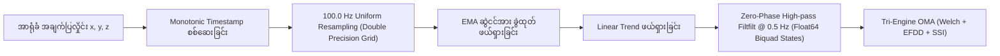

# Operational Modal Analysis (OMA) နှင့် DSP သတ်မှတ်ချက်များ (မြန်မာဘာသာ)

## ၁။ သင်္ချာနှင့် အင်ဂျင်နီယာဆိုင်ရာ အခြေခံသဘောတရား

စမတ်ဖုန်းများတွင် ပါရှိသော MEMS accelerometer များသည် analog-to-digital အကူးအပြောင်းတွင် ကွဲလွဲချက်များ၊ အပူချိန်ကြောင့် တန်ဖိုးရွေ့လျားမှုများ (thermal drift) နှင့် ကမ္ဘာ့ဆွဲငင်အား DC gravity offset ($1g \approx 9.80665\text{ m/s}^2$) တို့ အမြဲတစေ ပါရှိနေပါသည်။

**PhoneSHM** သည် အဆိုပါ ချို့ယွင်းချက်များကို အောက်ပါ အဆင့် ၃ ဆင့်ဖြင့် တိကျစွာ ပြင်ဆင်တွက်ချက်ပါသည်-
1. **Deterministic Preprocessing**: Hardware timestamp မှန်ကန်မှု စစ်ဆေးခြင်း၊ 64-bit Double grid ဖြင့် Uniform $100.0\text{ Hz}$ resampling ပြုလုပ်ခြင်း၊ EMA gravity ဖယ်ရှားခြင်းနှင့် 64-bit precision IIR states ပါဝင်သော Zero-phase Butterworth filtering။
2. **Tri-Engine Modal Identification**:
   - **Method 1 (Frequency Domain)**: Welch PSD၊ Sub-bin parabolic interpolation နှင့် Median + 3*MAD segment gating။
   - **Method 2 (Spatial/Frequency Domain)**: Enhanced Frequency Domain Decomposition (EFDD) - ဒေါင်လိုက် slab modes များနှင့် ရောထွေးမှုမရှိစေရန် Horizontal 2-axis ($X, Y$) sway CSD matrix အဖြစ် ခွဲထုတ်ကာ C++ SVD ဖြင့် တွက်ချက်ခြင်း။
   - **Method 3 (Time Domain)**: Multi-Channel Random Decrement Technique နှင့် Stochastic Subspace Identification (RDT-SSI)။
3. **Tri-Engine Modal Consensus**: အယ်လဂိုရီသမ် ၃ ခုမှ ရရှိသော အကြိမ်နှုန်းများကို 5% tolerance ဖြင့် စစ်ဆေးပြီး အဆောက်အအုံ၏ စစ်မှန်သော သဘာဝတုန်ခါမှုနှုန်း ($f_0$) ကို အတည်ပြုခြင်း။

---

## ၂။ အချက်ပြလှိုင်း ပြင်ဆင်သန့်စင်ခြင်း (Signal Preprocessing)

### က။ Fritsch-Carlson PCHIP Resampling နှင့် Gap-Mask Gating
Android OS သည် sensor events များကို အချိန်အခိုက်အတန့် မညီမညာ ပေးပို့လေ့ရှိပြီး Xiaomi/MIUI ကဲ့သို့သော ဖုန်းများတွင် OS scheduling ကြောင့် ခေတ္တပြတ်တောက်မှု (gaps) များ ဖြစ်ပေါ်တတ်သည်။ ထို့ကြောင့် `resampleToUniformGrid` တွင် အောက်ပါအတိုင်း တိကျစွာ ချိန်ညှိပါသည်-
1. **64-bit Target Grid**: အချိန်ကြာမြင့်စွာ တိုင်းတာချိန်တွင် integer truncation ကြောင့် drift မဖြစ်စေရန် Target grid timestamps များကို 64-bit double precision ဖြင့် တွက်ချက်သည်:
   $$t_{\text{target}, k} = t_{\text{start}} + \text{round}\left(k \cdot \frac{10^9}{f_s}\right)$$
2. **Fritsch-Carlson Monotone Cubic Hermite (`PCHIP_CUBIC`) နှင့် Linear Gap Fallback**:
   - ပုံမှန်အချိန်ခြားနားချက် ($\Delta t_i \le 50.0\text{ ms}$) များအတွက် overshoot မဖြစ်စေသော monotone cubic Hermite နည်းဖြင့် တွက်ချက်သည် (`gapMask[k] = 0`)။
   - $> 50.0\text{ ms}$ ကျော်လွန်သော gap များတွင် cubic polynomial ဖောင်းပွမှုမဖြစ်စေရန် linear bridge သို့ အလိုအလျောက် ပြောင်းလဲတွက်ချက်ပြီး `gapMask[k] = 1` အဖြစ် မှတ်သားသည်။
3. **Gap-Mask Window Rejection**:
   - Settling window (`settlingN`) ဖြတ်ထုတ်ချိန်တွင် `gapMask` ကိုပါ ကိုက်ညီစွာ ဖြတ်ထုတ်ပြီး `gapMask != 0` ပါဝင်သော မည်သည့် FFT window ကိုမဆို Median + $3 \times \text{MAD}$ gate နှင့်အတူ Welch PSD နှင့် EFDD CSD တွက်ချက်မှုမှ ချန်လှပ်ပစ်သည်။

### ခ။ ကမ္ဘာ့ဆွဲငင်အား ဖယ်ရှားခြင်း (Gravity Removal)
ဖုန်း၏ အနေအထားကြောင့် ပါဝင်နေသော Static Gravity vector ကို Exponential Moving Average (EMA) ဖြင့် တွက်ချက်ဖယ်ရှားပါသည်:
$$\mathbf{g}_i = \alpha \mathbf{a}_i + (1 - \alpha) \mathbf{g}_{i-1}, \quad (\alpha = 0.05)$$
$$\mathbf{a}_{\text{free}, i} = \mathbf{a}_i - \mathbf{g}_i$$
ထို့နောက် အပူချိန်ကြောင့် လှိုင်းတန်ဖိုး တဖြည်းဖြည်း မြင့်တက်/ကျဆင်းသွားခြင်းကို Ordinary Least Squares Linear Detrending ဖြင့် ဖြောင့်တန်းစေပါသည်။

### ဂ။ Zero-Phase High-Pass Filter (`filtfilt`) နှင့် 64-bit Numerical Stability
အလွန်နိမ့်သော အပူချိန်လှိုင်းများနှင့် မိုက်ခရိုတုန်ခါမှုများကို အဆင့်မလွဲချော်စေဘဲ (Zero-phase distortion) ရှင်းလင်းရန် $f_c = 0.5\text{ Hz}$ cut-off ရှိသော forward-backward Butterworth filter ကို အသုံးပြုထားပါသည်။

Cut-off frequency သည် sampling rate နှင့်ယှဉ်လျှင် အလွန်နိမ့်ကျနေသဖြင့် ($\frac{f_c}{f_s} = 0.005$) filter pole များသည် unit circle ($z \approx 0.978 \pm j0.022$) အနီး ကပ်နေပါသည်။ ထို့ကြောင့် single-precision (`float32`) တွင် ဖြစ်ပေါ်တတ်သော coefficient quantization error နှင့် limit cycle တုန်ခါမှုများကို ကာကွယ်ရန် biquad coefficients ($b_0, b_1, b_2, a_1, a_2$) နှင့် state delay registers ($z_1, z_2$) များကို **64-bit `Double` (`double` in C++)** ဖြင့် တည်ဆောက်ထားပါသည်။

---

## ၃။ Method 1: Welch Power Spectral Density (PSD)

Welch ၏ Averaged Modified Periodogram နည်းပညာဖြင့် X, Y, Z နှင့် ပေါင်းစပ် Acceleration Magnitude အပေါ်တွင် Power Spectrum ကို တွက်ချက်ပါသည်-

### သတ်မှတ်ချက်များ
- **Sampling Frequency ($f_s$)**: $100\text{ Hz}$
- **FFT Size ($N_{\text{fft}}$)**: $1024$ samples
- **Window Function**: Hanning window
- **Window Overlap**: $50\%$ ($512$ samples overlap)
- **Spectral Resolution ($\Delta f$)**: $\frac{100}{1024} \approx 0.09766\text{ Hz}$

### အဖျက်သဘောဆောင်သော ရုတ်တရက်လှိုင်းများ ဖယ်ထုတ်ခြင်း (Segment Gating)
အဆောက်အအုံအတွင်း လူလျှောက်သံ၊ တံခါးပိတ်သံ သို့မဟုတ် ဖုန်းထိမိခြင်းကြောင့် ဖြစ်ပေါ်သော transient broadband impulse များ Welch PSD ကို မထိခိုက်စေရန် Median + $3 \times \text{MAD}$ RMS Gate စနစ် ထည့်သွင်းထားပါသည်-
1. Segment တစ်ခုချင်းစီ၏ RMS စွမ်းအင်ကို တွက်ချက်သည်။
2. Segments အားလုံး၏ အလယ်ကိန်း Median RMS ($\widetilde{\text{RMS}}$) နှင့် Median Absolute Deviation ($\text{MAD}$) ကို ရှာဖွေသည်။
3. $\text{RMS}_m \le \widetilde{\text{RMS}} + 3 \times \max(\text{MAD}, 10^{-6})$ သတ်မှတ်ချက်နှင့် ကိုက်ညီသော segments များကိုသာ periodogram ပျမ်းမျှတွက်ချက်မှုထဲသို့ ထည့်သွင်းသည်။

### Memory Optimization (C++20)
[`dsp_core.cpp`](file:///data/data/com.termux/files/home/play-ground/ronin_shm/core/dsp/src/main/cpp/dsp_core.cpp) တွင် segment အကြိမ်ရာပေါင်းများစွာအတွက် vector allocate/free ပြုလုပ်ခြင်းကို ရှောင်ရှားပြီး loop ပြင်ပတွင် `segment`, `real`, `imag` vector များကို တစ်ကြိမ်တည်း preallocate လုပ်ကာ အသုံးပြုထားပါသည်။

### Parabolic Sub-Bin Interpolation
Discrete frequency grid $\Delta f$ ထက် ပိုမိုတိကျသော peak frequency ရရှိစေရန် logarithmic parabolic interpolation ဖြင့် ဒသမကိန်း တိကျစွာ ရှာဖွေပေးပါသည်။

### Gated Transient Time-Frequency Analysis (STFT နှင့် Daubechies `db4` WPT)
Median + $3 \times \text{MAD}$ gate မှ ပယ်ချခံရသော စွမ်းအင်မြင့် transient segments များ (အမြင့်ဆုံး $K = 5$ ခု) ကို စွန့်ပစ်မည့်အစား [`analyzeGatedTransients`](file:///data/data/com.termux/files/home/play-ground/ronin_shm/core/dsp/src/main/cpp/dsp_core.cpp) (`wavelet_packet_core.cpp`) ဖြင့် သီးသန့် ခွဲခြမ်းစိတ်ဖြာပါသည်-
1. **Short-Time Fourier Transform (STFT)**: 256-point Hanning window ($75\%$ overlap / 64-sample hop) ဖြင့် time-frequency spectrogram ကို တွက်ချက်သည်။
2. **Daubechies `db4` Wavelet Packet Transform (Depth $J = 4$)**: $100\text{ Hz}$ vibration လှိုင်းကို audio downsampling မလုပ်ဘဲ Depth $J = 4$ ($16$ subbands, $0\text{–}50\text{ Hz}$) ဖြင့် တိုက်ရိုက် ခွဲခြမ်းစိတ်ဖြာသည်။
3. **Shannon Wavelet Entropy နှင့် NaN Guard**: Subband energy သုညဖြစ်နေချိန်တွင် $\ln(0)$ ကြောင့် NaN မဖြစ်စေရန် $p_j > 10^{-12}$ ဖြစ်သော subband များကိုသာ $S_{\text{wpt}} = -\sum p_j \ln(p_j)$ တွင် ပေါင်းထည့်တွက်ချက်ပြီး $S_{\text{wpt}} < 1.8$ နှင့် အနိမ့်ပိုင်းကြိမ်နှုန်းစွမ်းအင် $\ge 55\%$ ရှိပါက `isStructuralShock = true` အဖြစ် သတ်မှတ်သည်။
4. **Safe JNI Timestamp Reconstruction**: 64-bit integer ကို `float` အဖြစ် bitcast လုပ်ပါက `sNaN` corruption ဖြစ်ပေါ်နိုင်သဖြင့် JNI မှ `onsetSampleIndex` (single float) ကိုသာ ပို့ဆောင်ပြီး Kotlin ဘက်တွင် `reconstructOnsetTimestampNs` ဖြင့် 64-bit nanosecond timestamp ကို ပြန်လည်တွက်ချက်သည်။

---

## ၄။ Method 2: Enhanced Frequency Domain Decomposition (EFDD)၊ Tri-Axial Coherence နှင့် Roving Mode Shapes

Frequency Domain Decomposition (FDD) သည် multi-degree-of-freedom တုန်ခါမှုလှိုင်းများကို Singular Value Decomposition (SVD) အသုံးပြု၍ single-degree-of-freedom (SDOF) စနစ်များအဖြစ် ခွဲထုတ်ပေးပါသည်။

### $3 \times 3$ CSD Matrix, Tri-Axial Coherence နှင့် Axis-Aligned Sway Gate
အရပ်ဘက် အဆောက်အအုံများ၏ အဓိကသဘာဝတုန်ခါမှုသည် အလျားလိုက်ယိမ်းခါမှု (Horizontal sway) ဖြစ်ပြီး ဒေါင်လိုက် ($Z$-axis) ကြမ်းခင်းတုန်ခါမှုနှင့် ခွဲခြားနိုင်ရန် [`fdd_core.cpp`](file:///data/data/com.termux/files/home/play-ground/ronin_shm/core/dsp/src/main/cpp/fdd_core.cpp) တွင် အောက်ပါအတိုင်း တွက်ချက်ပါသည်-

1. **$3 \times 3$ CSD နှင့် $2 \times 2$ Horizontal SVD**:
   - X, Y, Z ဝင်ရိုး ၃ ခုအတွက် $3 \times 3$ Cross-Spectral Density matrix $\mathbf{G}_{3\times 3}(f_k)$ ကို တည်ဆောက်ပြီး အလျားလိုက် $2 \times 2$ sub-block $\mathbf{G}_{xy}(f_k)$ ပေါ်တွင် SVD တွက်ချက်ကာ ပထမ singular value $\sigma_1(f_k)$ နှင့် singular vector $\mathbf{u}_1(f_k)$ ကို ရယူသည်။
2. **Coherence Division-by-Zero Guard**:
   - Auto-spectrum တန်ဖိုးများ သုညနီးပါးဖြစ်နေချိန်တွင် NaN/Inf မဖြစ်စေရန် ပိုင်းခြေ၌ `std::max(..., 1e-30)` ထားရှိပြီး $\gamma_{xy}^2, \gamma_{xz}^2, \gamma_{yz}^2 \in [0.0, 1.0]$ နှင့် Horizontal-to-Vertical ratio $\sigma_1(f_k) / S_{zz}(f_k)$ တို့ကို တွက်ချက်သည်။
3. **Axis-Aligned Sway Gate နှင့် Azimuth SVD**:
   - ဖုန်း၏ X သို့မဟုတ် Y ဝင်ရိုးတစ်ခုတည်းအတိုင်း 1D လွှဲနေသော mode များ ($\gamma_{xy}^2 \approx 0$) မပယ်ချခံရစေရန် $\gamma_{xy}^2$ ကန့်သတ်ချက်မထားဘဲ $\sigma_1(f_0)/S_{zz}(f_0) > 3.0$၊ $\gamma_{xz}^2(f_0) \le 0.35$ နှင့် $\gamma_{yz}^2(f_0) \le 0.35$ တို့ဖြင့် စစ်ဆေးသည်။
   - အဓိကလွှဲနေသော ထောင့် $\theta_{\text{sway}} = \text{atan2}(\text{Re}(u_y), \text{Re}(u_x)) \in [-180^\circ, 180^\circ]$ ကို $\mathbf{u}_1(f_0)$ မှ ထုတ်ယူသည်။
4. **Damping Ratio ($\zeta$) နှင့် Roving Mode Shape Synthesis**:
   - Peak ပတ်ဝန်းကျင် SDOF bell ($\text{MAC} \ge 0.85$) ကို IDFT ပြုလုပ်ပြီး Logarithmic Decrement ($\delta$) မှ damping ratio ($\zeta$) ကို တွက်ချက်သည်။
   - [`RovingModeShapeEngine.kt`](file:///data/data/com.termux/files/home/play-ground/ronin_shm/core/modal/src/main/kotlin/com/ronin/phoneshm/core/modal/RovingModeShapeEngine.kt) ဖြင့် အထပ်အလိုက် တိုင်းတာချက်များကို $|\phi(L)| = \sqrt{\sigma_1^{(L)}(f_0) / \max(\sigma_{\text{amb}, L}^2, 10^{-12})}$ ဖြင့် excitation normalize လုပ်ကာ $\cos(\theta_L - \theta_{\text{ref}}) < 0$ ဖြစ်ပါက phase sign $-1.0$ သတ်မှတ်ပြီး အမြင့်ဆုံးအထပ် (Roof) ဖြင့် $\phi(\text{Roof}) = 1.0$ ဖြစ်အောင် တွက်ချက်ပေးသည်။

---

## ၅။ Method 3: Multi-Channel RDT-SSI (Time Domain)

Random Decrement Technique (RDT) ဖြင့် သဘာဝကျပန်းတုန်ခါမှုများမှ free vibration decay လက်မှတ်များကို ဖော်ထုတ်ပြီး Stochastic Subspace Identification (SSI) ဖြင့် state-space dynamic matrix မှ အဆောက်အအုံ၏ တုန်ခါမှု mode များကို ထုတ်ယူပါသည်-

1. **Triggering**: အမြင့်ဆုံး variance ရှိသော axis ကို reference အဖြစ် ရွေးချယ်ပြီး $1.0\sigma$ မှ $2.0\sigma$ အထိ trigger အဆင့် ၁၀ ဆင့်ဖြင့် synchronous averaging (RDS) ပြုလုပ်သည်။
2. **Block Hankel Matrix**: ချန်နယ် ၃ ခု၏ RDS မှ $(3i \times i)$ Block Hankel matrix ကို တည်ဆောက်သည်။
3. **Eigen SVD**: BDCSVD Thin decomposition ဖြင့် Observability matrix $\mathbf{O}_n = \mathbf{U}_n \mathbf{\Sigma}_n^{1/2}$ ကို တွက်ထုတ်သည်။
4. **Transition Matrix & Poles**:
   $$\mathbf{A} = \mathbf{O}_{\text{up}}^\dagger \mathbf{O}_{\text{down}}$$
   System matrix $\mathbf{A}$ ၏ Eigenvalues ($\lambda_i$) များမှ စစ်မှန်သော frequency ($f_i$) နှင့် damping ($\zeta_i$) များကို ရယူသည်။

---

## ၆။ Tri-Engine Modal Consensus စနစ်

[`ModalConsensusEngine`](file:///data/data/com.termux/files/home/play-ground/ronin_shm/core/modal/src/main/kotlin/com/ronin/phoneshm/core/modal/ModalConsensusEngine.kt) သည် Welch, EFDD, SSI သုံးခုစလုံးမှ ရရှိသော အကြိမ်နှုန်းများကို 5% structural tolerance ဘောင်အတွင်း ကိုက်ညီမှု ရှိမရှိ စစ်ဆေးပေးပါသည်:

$$\frac{|f_1 - f_2|}{\frac{f_1 + f_2}{2}} \le 0.05$$

- **`AGREED` (100% ယုံကြည်စိတ်ချရမှု)**: Method ၃ ခုစလုံး 5% အတွင်း ကိုက်ညီသောအခါ။
- **`PARTIAL` (66.7% ယုံကြည်စိတ်ချရမှု)**: Method ၂ ခုသာ ကိုက်ညီသောအခါ။
- **`DISAGREED` (33.3% ယုံကြည်စိတ်ချရမှု)**: Method များအားလုံး သီးခြားစီ ကွဲလွဲနေသောအခါ။
- **`INSUFFICIENT` (0% ယုံကြည်စိတ်ချရမှု)**: တုန်ခါမှုအားနည်းလွန်းသဖြင့် မည်သည့် method တွင်မျှ peak မထွက်ပေါ်သောအခါ။

သဘောတူညီသော အင်ဂျင်များအကြား (`AGREED` သို့မဟုတ် `PARTIAL`) sample variance $\sigma_{\text{consensus}}^2 = \frac{1}{k-1}\sum (f_i - f_{\text{consensus}})^2$ နှင့် `uncertaintyRatioPct` ($\%$) တို့ကိုပါ တွက်ချက်ပြီး `BaselineHistoryEntity` တွင် မှတ်တမ်းတင်ထားပါသည်။
