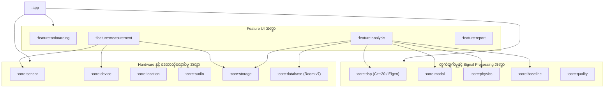

# PhoneSHM (မြန်မာဘာသာ)
### သာမန် စမတ်ဖုန်းများဖြင့် အဆောက်အအုံ ကြံ့ခိုင်မှု တိုင်းတာစစ်ဆေးရေး စနစ် (Structural Health Monitoring Platform)

[-009688.svg?style=flat)](https://developer.android.com/training/data-storage/room)

[အသုံးပြုသူ လမ်းညွှန်](APP_USER_GUIDE_MY.md) • [စနစ်ဖွဲ့စည်းပုံ Architecture](ARCHITECTURE_MY.md) • [DSP နှင့် Modal Analysis](DSP_AND_MODAL_ANALYSIS_MY.md) • [Baseline နှင့် ရူပဗေဒစံနှုန်း](BASELINE_AND_PHYSICS_MY.md) • [ဒေတာ သိုလှောင်မှု](DATA_FORMATS_MY.md)

---

## 📌 ပရောဂျက် မိတ်ဆက်

**PhoneSHM** သည် သာမန်ပြည်သူများ လက်ဝယ်ရှိ စမတ်ဖုန်းများကို အသုံးပြု၍ အဆောက်အအုံများနှင့် တံတားများ၏ သဘာဝတုန်ခါမှု (Fundamental Natural Frequency, $f_0$) နှင့် ကြံ့ခိုင်မှုအခြေအနေ (Structural Health) ကို သိပ္ပံနည်းကျ စောင့်ကြည့်တိုင်းတာနိုင်သော Sovereign, Citizen-Scale Android Native Platform တစ်ခုဖြစ်ပါသည်။

လေတိုက်ခတ်မှု၊ ယာဉ်သွားလာမှုနှင့် ပတ်ဝန်းကျင်လှုပ်ရှားမှုများကြောင့် အဆောက်အအုံများတွင် သိမ်မွေ့သော တုန်ခါမှုများ အမြဲတစေ ဖြစ်ပေါ်နေပါသည်။ PhoneSHM သည် အဆိုပါ တုန်ခါမှုများကို $100\text{ Hz}$ အမြန်နှုန်းဖြင့် ဖမ်းယူပြီး စမတ်ဖုန်းပေါ်တွင် တိုက်ရိုက် C++20 အဆင့်မြင့် Digital Signal Processing (Welch, EFDD, RDT-SSI) ဖြင့် တွက်ချက်ကာ အဆောက်အအုံများ၏ ရေရှည်ကြံ့ခိုင်မှုကို စောင့်ကြည့်ပေးပါသည်။

---

## ⚡ အဓိက စွမ်းဆောင်ရည်များ

### ၁။ Tri-Engine Operational Modal Analysis (OMA)
အဆောက်အအုံများ၏ သဘာဝတုန်ခါမှုနှုန်း ($f_0$) ကို တိကျစွာ ဖော်ထုတ်နိုင်ရန် အယ်လဂိုရီသမ် ၃ မျိုးကို ပူးတွဲအသုံးပြုထားပါသည်-
- **Welch PSD**: $1024$-point FFT, $50\%$ Hanning overlap, logarithmic parabolic interpolation၊ Median + 3*MAD segment gating နှင့် zero-allocation preallocated scratch buffers များ ပါဝင်သည်။
- **Enhanced Frequency Domain Decomposition (EFDD)**: Horizontal sway ကို $2 \times 2$ cross-spectral density matrix $\mathbf{G}_{xy}(f)$ အဖြစ် သီးခြားခွဲထုတ်ကာ (ဒေါင်လိုက်ကြမ်းခင်းတုန်ခါမှု mode များ မနှောင့်ယှက်နိုင်ဘဲ) C++ Eigen SVD ဖြင့် First singular value ($\sigma_1$) နှင့် logarithmic decrement damping ratio ($\zeta$) များကို တိကျစွာ ထုတ်ယူသည်။
- **Multi-Channel RDT-SSI (Time Domain)**: Random Decrement Technique ဖြင့် free decay လှိုင်းများကို ထုတ်ယူပြီး Block Hankel SVD ဖြင့် state-space poles များကို ရှာဖွေသည်။
- **Tri-Engine Consensus စနစ်**: Method ၃ ခုစလုံးမှ ရရှိသော အကြိမ်နှုန်းများကို 5% tolerance ဖြင့် တိုက်ဆိုင်စစ်ဆေးကာ `AGREED`, `PARTIAL`, `DISAGREED`, `INSUFFICIENT` status များဖြင့် ခွဲခြားပေးသည်။

### ၂။ အဆောက်အအုံ ရူပဗေဒစံနှုန်းများဖြင့် အတည်ပြုခြင်း
ရရှိလာသော အကြိမ်နှုန်းများကို နိုင်ငံတကာ မြေငလျင်ခံ အဆောက်အအုံ စံနှုန်းများ (Eurocode 8 / ASCE 7) ဖြင့် စစ်ဆေးပြီး `GLOBAL_MODE` (အဆောက်အအုံတစ်ခုလုံး တုန်ခါမှု), `LOCAL_MODE` (ကြမ်းခင်းတုန်ခါမှု), `SENSOR_ARTIFACT` (လျှပ်စစ်ဆူညံသံ) အဖြစ် အလိုအလျောက် ခွဲခြားပေးသည်။

### ၃။ ရေရှည် Baseline စောင့်ကြည့်ခြင်းနှင့် သတိပေးချက်များ
- **Online Welford Algorithm**: Memory မပြည့်လျှံစေဘဲ ပျမ်းမျှ ($\mu$) နှင့် စံသွေဖည်ကိန်း ($\sigma$) ကို အချိန်နှင့်တစ်ပြေးညီ တွက်ချက်သည်။
- **၁၀ ကြိမ်မြောက် Baseline တည်ဆောက်မှု**: ပထမ ၁၀ ကြိမ်ကို ပတ်ဝန်းကျင်လေ့လာမှုအဖြစ် သတ်မှတ်ပြီး နောက်ပိုင်းတိုင်းတာမှုများတွင် မူလစံနှုန်းထက် $|\Delta f_0\%| > 5.0\%$ ကျဆင်းသွားပါက Anomaly သတိပေးချက် ထုတ်ပြန်သည်။
- **ပတ်ဝန်းကျင် အပူချိန်နှင့် နေ့/ည စနစ်**: အပူချိန်ကြောင့် အဆောက်အအုံ ကျုံ့/ပွမှုကို ထည့်သွင်းစဉ်းစားရန် Battery temperature နှင့် Time-of-day (`MORNING`, `AFTERNOON`, `EVENING`, `NIGHT`) တို့ကို အတူတွဲဖက် မှတ်တမ်းတင်သည်။

### ၄။ Zero ANR နှင့် Hardware တိကျမှု
- **Threading ခွဲဝေမှုနှင့် သီးခြား Sensor Thread**: တွက်ချက်မှုများကို `Dispatchers.Default`၊ ဖိုင်သိမ်းဆည်းမှုကို `Dispatchers.IO`၊ UI ကို `Dispatchers.Main` တွင် သီးခြား run စေပြီး Hardware sensor ကို သီးသန့် background `HandlerThread("PhoneSHM-SensorThread")` ပေါ်တွင် 4096-sample buffer နှင့် 100ms UI throttling ဖြင့် run သဖြင့် UI မထစ်ငေါ့စေရန် အာမခံသည်။
- **Hardware Precision**: Monotonic timestamp စစ်ဆေးခြင်း၊ Clock Jitter (ms) နှင့် Clock Drift (PPM) များကို တိကျစွာ တိုင်းတာသည်။
- **Termux နှင့် အပြန်အလှန်ချိတ်ဆက်နိုင်မှု**: Binary ဒေတာ (`.bin`) နှင့် Metadata (`.meta.json`) များကို `/sdcard/Download/PhoneSHM/` သို့ အလိုအလျောက် ကူးယူပေးထားသဖြင့် Termux သို့မဟုတ် Python ဖြင့် တိုက်ရိုက် စစ်ဆေးနိုင်သည်။

---

## 🏛 စနစ်ဖွဲ့စည်းပုံ (Architecture)

အသေးစိတ်ကို [docs/my/ARCHITECTURE_MY.md](ARCHITECTURE_MY.md) တွင် ဖတ်ရှုနိုင်ပါသည်။

---

## 🚀 စတင်အသုံးပြုခြင်း (Getting Started)

### လိုအပ်ချက်များ
- Android 8.0 (API 26) သို့မဟုတ် အထက်ရှိသော မည်သည့် Android စမတ်ဖုန်းမဆို။

### အက်ပ်ကို ဒေါင်းလုဒ်ရယူခြင်း
[GitHub Releases](https://github.com/intellibits28/PhoneSHM/releases) စာမျက်နှာမှ `PhoneSHM-v1.2.0-research-grade.apk` ကို ဒေါင်းလုဒ်ရယူပြီး တပ်ဆင်နိုင်ပါသည်။

အသေးစိတ် အသုံးပြုနည်းများကို [docs/my/APP_USER_GUIDE_MY.md](APP_USER_GUIDE_MY.md) တွင် အဆင့်ဆင့် ဖော်ပြထားပါသည်။

---

## 📜 လိုင်စင် (License)

PhoneSHM သည် [Apache License 2.0](file:///data/data/com.termux/files/home/play-ground/ronin_shm/LICENSE) အောက်တွင် ဖြန့်ချိထားသော Open-source ဆော့ဖ်ဝဲလ် ဖြစ်ပါသည်။
