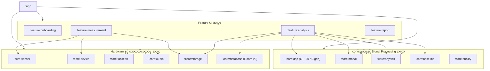

# PhoneSHM (မြန်မာဘာသာ)
### သာမန် စမတ်ဖုန်းများဖြင့် အဆောက်အအုံ ကြံ့ခိုင်မှု တိုင်းတာစစ်ဆေးရေး စနစ် (Structural Health Monitoring Platform)

[-009688.svg?style=flat)](https://developer.android.com/training/data-storage/room)

[အသုံးပြုသူ လမ်းညွှန်](APP_USER_GUIDE_MY.md) • [စနစ်ဖွဲ့စည်းပုံ Architecture](ARCHITECTURE_MY.md) • [DSP နှင့် Modal Analysis](DSP_AND_MODAL_ANALYSIS_MY.md) • [Forensic Audit အစီရင်ခံစာ](../DSP_PIPELINE_FORENSIC_AUDIT.md) • [Synthetic စမ်းသပ်မှု အစီရင်ခံစာ](../DSP_SYNTHETIC_VERIFICATION_Z_REPORT.md) • [Baseline နှင့် ရူပဗေဒစံနှုန်း](BASELINE_AND_PHYSICS_MY.md) • [ဒေတာ သိုလှောင်မှု](DATA_FORMATS_MY.md)

---

## 📌 ပရောဂျက် မိတ်ဆက်

**PhoneSHM** သည် သာမန်ပြည်သူများ လက်ဝယ်ရှိ စမတ်ဖုန်းများကို အသုံးပြု၍ အဆောက်အအုံများနှင့် တံတားများ၏ သဘာဝတုန်ခါမှု (Fundamental Natural Frequency, $f_0$) နှင့် ကြံ့ခိုင်မှုအခြေအနေ (Structural Health) ကို သိပ္ပံနည်းကျ စောင့်ကြည့်တိုင်းတာနိုင်သော Sovereign, Citizen-Scale Android Native Platform တစ်ခုဖြစ်ပါသည်။

လေတိုက်ခတ်မှု၊ ယာဉ်သွားလာမှုနှင့် ပတ်ဝန်းကျင်လှုပ်ရှားမှုများကြောင့် အဆောက်အအုံများတွင် သိမ်မွေ့သော တုန်ခါမှုများ အမြဲတစေ ဖြစ်ပေါ်နေပါသည်။ PhoneSHM သည် အဆိုပါ တုန်ခါမှုများကို $100\text{ Hz}$ အမြန်နှုန်းဖြင့် ဖမ်းယူပြီး စမတ်ဖုန်းပေါ်တွင် တိုက်ရိုက် C++20 အဆင့်မြင့် Digital Signal Processing (Welch, EFDD, RDT-SSI) ဖြင့် တွက်ချက်ကာ အဆောက်အအုံများ၏ ရေရှည်ကြံ့ခိုင်မှုကို စောင့်ကြည့်ပေးပါသည်။

---

## ⚡ အဓိက စွမ်းဆောင်ရည်များ

### ၁။ Tri-Engine Operational Modal Analysis (OMA) နှင့် Single-Node Roving Mode Shapes
အဆောက်အအုံများ၏ သဘာဝတုန်ခါမှုနှုန်း ($f_0, f_1$)၊ Damping ratio ($\zeta_0$) နှင့် အထပ်လိုက် Mode Shape များကို တိကျစွာ ဖော်ထုတ်နိုင်ရန် အယ်လဂိုရီသမ် ၃ မျိုးနှင့် Single-Node spatial နည်းပညာများကို ပူးတွဲအသုံးပြုထားပါသည်-
- **Zero-Velocity Accelerometer Bias Subtraction**: တိုင်းတာမှုမစတင်မီ Static calibration မှ ရရှိသော Sensor bias $[b_x, b_y, b_z]$ ကို Sensor stream မှရော `resampleToUniformGrid` အစပိုင်းတွင်ပါ တိုက်ရိုက် နုတ်ထုတ်ရှင်းလင်းသည်။
- **Jitter-Compensated Resampling နှင့် Gap-Mask Gating**: မညီညာသော Hardware timestamps များကို $100.0\text{ Hz}$ uniform grid သို့ Fritsch-Carlson Monotone Cubic Hermite (`PCHIP_CUBIC`) ဖြင့် ပြောင်းလဲပေးပြီး $> 50\text{ ms}$ gap များကို linear bridge နှင့် `gapMask` သတ်မှတ်ကာ gap ပါဝင်သော FFT window များကို PSD နှင့် CSD တွက်ချက်မှုမှ အလိုအလျောက် ချန်လှပ်ပေးသည်။
- **Continuous Ambient Baseline (300s / 30,000 samples) နှင့် Linear Detrending**: ၅ မိနစ်ကြာ တိုင်းတာမှု profile (`ambient_baseline_continuous`) ဖြင့် spectral averages လုံလောက်စွာ ရရှိစေသည်။ High-cutoff EMA အစား Mean subtraction နှင့် OLS Linear Detrending ကို အသုံးပြုထားသဖြင့် $0.1\text{ Hz} - 0.2\text{ Hz}$ အထိ structural mode များ မှေးမှိန်မသွားစေဘဲ ထိန်းသိမ်းပေးသည်။ (၁၀ စက္ကန့် Demo mode ကို Live Preview အဖြစ်သာ သတ်မှတ်ပြီး modal consensus မှ ချန်လှပ်ထားကာ ၃၀ စက္ကန့်ကို heel-drop စစ်ဆေးမှုအတွက်သာ ကန့်သတ်ထားသည်)။
- **Magnitude PSD ပေါင်းစပ်မှု တိကျစေခြင်း**: X, Y, Z ဝင်ရိုး ၃ ခု၏ Welch PSD များကို တိုက်ရိုက်ပေါင်းစပ်တွက်ချက်သည့် $S_{\text{mag}}(f) = S_{xx}(f) + S_{yy}(f) + S_{zz}(f)$ ((m/s²)²/Hz) ကို Kotlin ရော C++20 ပါ တစ်သမတ်တည်း သုံးစွဲထားသဖြင့် time-domain Euclidean norm ကြောင့်ဖြစ်သော harmonic distortion အမှားများကို လုံးဝ ပပျောက်စေသည်။
- **Sliding-Window Persistence စနစ်**: Filter settling ပြီးနောက် ၆၀ စက္ကန့် window ၈ ခု (၃၀ စက္ကန့် hop) ဖြင့် စစ်ဆေးကာ $\max(5\% f_0, 4\Delta f)$ tolerance ဖြင့် ရေရှည်တည်ငြိမ်သော structural frequency များကို ရွေးထုတ်ပေးသည်။
- **Enhanced Frequency Domain Decomposition (EFDD) နှင့် Tri-Axial Coherence**: X, Y, Z ဝင်ရိုး ၃ ခုအတွက် $3 \times 3$ CSD matrix $\mathbf{G}_{3\times 3}(f_k)$ နှင့် $2 \times 2$ horizontal sway SVD ($\sigma_1(f_k), \mathbf{u}_1(f_k)$) တို့ကို $[0.2, 25.0]\text{ Hz}$ structural band တွင် တွက်ချက်သည်။ Division-by-zero ကာကွယ်ထားသော coherences ($\gamma_{xy}^2, \gamma_{xz}^2, \gamma_{yz}^2$)၊ Horizontal-to-Vertical ratio ($\sigma_1 / S_{zz}$)၊ SVD sway azimuth ($\theta_{\text{sway}}$) နှင့် **Axis-Aligned Sway Gate** ($\sigma_1 / S_{zz} > 3.0$, $\gamma_{xz}^2 \le 0.35$, $\gamma_{yz}^2 \le 0.35$) တို့ဖြင့် ဒေါင်လိုက်ကြမ်းခင်းတုန်ခါမှုကို ပယ်ချပြီး စစ်မှန်သော horizontal sway mode များကို ထုတ်ယူသည်။
- **Single-Node Roving Mode Shape Synthesis နှင့် MAC**: ဖုန်းတစ်လုံးတည်းဖြင့် အထပ်အလိုက် တိုင်းတာထားသော session များမှ stationary broadband RMS variance ဖြင့် excitation-normalized လုပ်ထားသော Mode Shape $\phi(L)$၊ $\text{sgn}(\text{Re}(G_{xz}))$ phase orientation၊ Inter-story drift $\Delta\phi$ နှင့် အဆောက်အအုံ Shear profile စစ်ဆေးနိုင်သည့် **Modal Assurance Criterion (MAC)** တို့ကို `RovingModeShapeEngine` ဖြင့် တွက်ချက်ပေးသည်။
- **Multi-Channel RDT-SSI (True Model Order)**: State-space model order အစစ်အမှန် $n \in \{2..40\}$ နှင့် cluster stability count တို့ကို ပူးတွဲဖော်ပြပြီး (`n=22 (20x)`) Native C++ နှင့် JVM အပြည့်အဝ ကိုက်ညီစွာ တွက်ချက်သည်။
- **Tri-Engine Consensus နှင့် Uncertainty စနစ်**: Method ၃ ခုစလုံးမှ ရရှိသော အကြိမ်နှုန်းများကို 5% tolerance ဖြင့် တိုက်ဆိုင်စစ်ဆေးကာ `AGREED`, `PARTIAL`, `DISAGREED`, `INSUFFICIENT` status များအပြင် အင်ဂျင်များအကြား frequency variance ($\sigma_{\text{consensus}}^2$) နှင့် uncertainty အချိုး ($\%$) ကိုပါ တွက်ချက်ပေးသည်။

### ၂။ အဆောက်အအုံ ရူပဗေဒစံနှုန်းများဖြင့် အတည်ပြုခြင်း
ရရှိလာသော အကြိမ်နှုန်းများကို နိုင်ငံတကာ မြေငလျင်ခံ အဆောက်အအုံ စံနှုန်းများ (Eurocode 8 / ASCE 7) ဖြင့် စစ်ဆေးပြီး `GLOBAL_MODE` (အဆောက်အအုံတစ်ခုလုံး တုန်ခါမှု), `LOCAL_MODE` (ကြမ်းခင်းတုန်ခါမှု), `SENSOR_ARTIFACT` (လျှပ်စစ်ဆူညံသံ) အဖြစ် အလိုအလျောက် ခွဲခြားပေးသည်။

### ၃။ ရေရှည် Multi-Mode Baseline နှင့် Welford Thermal Drift ထိန်းညှိမှု
- **Online Multi-Mode Welford Algorithm**: Memory မပြည့်လျှံစေဘဲ $f_0$, $f_1$, $\zeta_0$ နှင့် X/Y ဝင်ရိုးအလိုက် ($f_{0,x}, f_{0,y}$) ပျမ်းမျှနှင့် variance တန်ဖိုးများကို အချိန်နှင့်တစ်ပြေးညီ တွက်ချက်သည်။
- **Anomaly-First Baseline စစ်ဆေးမှု**: ပထမ ၁၀ ကြိမ်ကို ပတ်ဝန်းကျင်လေ့လာမှုအဖြစ် သတ်မှတ်ပြီး နောက်ပိုင်းတိုင်းတာမှုများတွင် ယခင် thermal sensitivity ဖြင့် အပူချိန်ထိန်းညှိထားသော $|\Delta \hat{f}_0\%| > 5.0\%$ ကို အရင်စစ်ဆေးပြီး ပုံမှန်ဖြစ်မှသာ Welford နှင့် thermal state များကို update လုပ်သည်။
- **တည်ငြိမ်သော Welford Co-Moment Thermal Regression**: Floating-point cancellation မဖြစ်စေဘဲ အပူချိန်ပြောင်းလဲမှုနှင့် ကြိမ်နှုန်းဆက်စပ်မှုကို `meanTempC`, `m2Temp`, `coMomentTempF0` တို့ဖြင့် မှတ်တမ်းတင်ကာ $n_T \ge 10$ နှင့် $M_{2,T} > 10^{-4}$ ပြည့်မီချိန်တွင် thermal sensitivity $k_T = C_{T, f_0} / M_{2,T}$ ($\text{Hz}/^\circ\text{C}$) ကို အလိုအလျောက် တွက်ချက်ပေးသည်။

### ၄။ Zero ANR နှင့် Hardware တိကျမှု
- **Threading ခွဲဝေမှုနှင့် သီးခြား Sensor Thread**: တွက်ချက်မှုများကို `Dispatchers.Default`၊ ဖိုင်သိမ်းဆည်းမှုကို `Dispatchers.IO`၊ UI ကို `Dispatchers.Main` တွင် သီးခြား run စေပြီး Hardware sensor ကို သီးသန့် background `HandlerThread("PhoneSHM-SensorThread")` ပေါ်တွင် 4096-sample buffer နှင့် 100ms UI throttling ဖြင့် run သဖြင့် UI မထစ်ငေါ့စေရန် အာမခံသည်။
- **Hardware Precision**: Monotonic timestamp စစ်ဆေးခြင်း၊ Clock Jitter (ms) နှင့် Clock Drift (PPM) များကို တိကျစွာ တိုင်းတာသည်။
- **Termux နှင့် အပြန်အလှန်ချိတ်ဆက်နိုင်မှု**: Binary ဒေတာ (`.bin`) နှင့် Metadata (`.meta.json`) များကို `/sdcard/Download/PhoneSHM/` သို့ အလိုအလျောက် ကူးယူပေးထားသဖြင့် Termux သို့မဟုတ် Python ဖြင့် တိုက်ရိုက် စစ်ဆေးနိုင်သည်။

---

## 🏛 စနစ်ဖွဲ့စည်းပုံ (Architecture)

အသေးစိတ်ကို [docs/my/ARCHITECTURE_MY.md](ARCHITECTURE_MY.md) တွင် ဖတ်ရှုနိုင်ပါသည်။

---

## 🚀 စတင်အသုံးပြုခြင်း (Getting Started)

### လိုအပ်ချက်များ
- Android 8.0 (API 26) သို့မဟုတ် အထက်ရှိသော မည်သည့် Android စမတ်ဖုန်းမဆို။

### အက်ပ်ကို ဒေါင်းလုဒ်ရယူခြင်း
[GitHub Releases](https://github.com/intellibits28/PhoneSHM/releases) စာမျက်နှာမှ `PhoneSHM-v1.2.0-research-grade.apk` ကို ဒေါင်းလုဒ်ရယူပြီး တပ်ဆင်နိုင်ပါသည်။

အသေးစိတ် အသုံးပြုနည်းများကို [docs/my/APP_USER_GUIDE_MY.md](APP_USER_GUIDE_MY.md) တွင် အဆင့်ဆင့် ဖော်ပြထားပါသည်။

---

## 📜 လိုင်စင် (License)

PhoneSHM သည် [Apache License 2.0](file:///data/data/com.termux/files/home/play-ground/ronin_shm/LICENSE) အောက်တွင် ဖြန့်ချိထားသော Open-source ဆော့ဖ်ဝဲလ် ဖြစ်ပါသည်။
